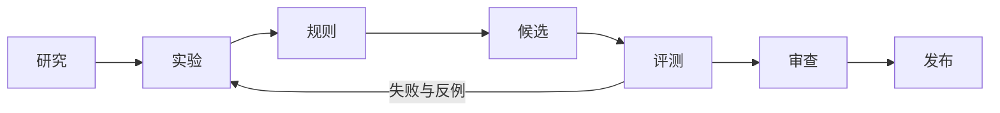

# War Thunder 涂装 Skill 研发工作区

把原作观察、UV 与材质实验整理成可追溯的制作规则，再通过固定评测和人工审查，装配为可独立使用的 Skill。仓库同时维护飞机与地面载具的风格源码、工程工具、评测契约，以及已有版本的下载入口。

**[研发流程](docs/workflow/README.md) · [终末地0.1.0完整展示](docs/skills/wt-style-endfield-0.1.0.md) · [源码与职责](#源码与职责) · [检查与构建](#检查与构建) · [当前推荐下载](#当前推荐下载) · [文档导航](docs/README.md)**



每条规则要能说明来源、适用条件和验证方法。技术检查、视觉评价、游戏验证与跨任务复现分别记录；候选通过代码检查后，仍需对具体结果和变更范围作出审查决定。

## 当前状态

| 模块 | 仓库中的实际内容 | 使用状态 |
| --- | --- | --- |
| 研究 `wt-skin-study` | 证据、实验、规则提炼与独立评测的候选工作流 | 开发候选；尚无正式版本 |
| 工程 `wt-skin-build` | 输入契约、原生 UV、通道、导出与交付检查的候选工作流 | 开发候选；领域工具按包配置装配 |
| 飞机风格 | Akamywek 1.14 内容及其参考资料 | 已发布基线；源码通过构建器装配 |
| 地面风格 | ENDFIELD 布局说明、车型方向与既有兼容源码 | 新执行包处于候选阶段；兼容包归入历史版本 |
| 飞机兼容包 | `war-thunder-user-skins` 3.14 内容 | 保留旧调用入口与既有版本线 |
| 载具配置 | profile schema 与合成示例 | 尚无已验证的真实载具 profile |
| 评测 | 工作流契约、记录检查器与回归测试 | 验证结构和证据关联；视觉与游戏结果另行记录 |

这次仓库重构建立了可执行的源码与构建入口。新研究、工程模块仍处于候选阶段；已有正式版本号和下载附件保持原样。“已发布基线”说明内容的来源版本，不代表其中所有设计已获美术认可。

## 风格说明与演示

**[wt-style-endfield 0.1.0 完整展示](docs/skills/wt-style-endfield-0.1.0.md)**：当前候选包的 A7V 八条解析、五车型四向建议、部件与子区、三套兜底、全部制作素材预览、工具及验证范围汇总。

[终末地布局：A7V 范本、部件分区与五车型方向](docs/skills/endfield-layout-guide.md) 提供原作关系、侧前后顶示意和可选兜底。演示图供读者理解，执行 Skill 通过规则、结构化资料及必要素材表达同一套方法；车型方向可以改写，预设可以不用。

## 当前推荐下载

以下是当前推荐的正式安装包。从对应 Release 的 **Assets** 下载 `.skill.zip`，各包自带所需脚本和参考资料，可以单独安装。终末地新执行包仍处于候选阶段，既有兼容包放在[历史版本](docs/history/README.md)。

| 用途 | 已发布版本 | 说明与历史 |
| --- | --- | --- |
| 二次元固定翼喷气机涂装 | **[下载 3.14](https://github.com/IcyRyna/war-thunder-skin-skills/releases/tag/war-thunder-user-skins/v3.14)** | [功能说明](docs/skills/jet-liveries.md) · [完整更新记录](docs/changelog/war-thunder-user-skins.md) |
| Akamywek 风格飞机涂装 | **[下载 1.14](https://github.com/IcyRyna/war-thunder-skin-skills/releases/tag/war-thunder-style-akamywek/v1.14)** | [风格说明](docs/skills/akamywek.md) · [完整更新记录](docs/changelog/war-thunder-style-akamywek.md) |

**[安装与运行环境](docs/installation.md) · [历史版本](docs/history/README.md) · [下载说明与发布档案](releases/README.md) · [全部历史 Releases](https://github.com/IcyRyna/war-thunder-skin-skills/releases)**

## 源码与职责

```text
src/
  study/wt-skin-study/                        研究与规则候选
  build/wt-skin-build/                        中性工程候选
  styles/aircraft/war-thunder-style-akamywek/  飞机风格源码
  styles/ground/war-thunder-tank-style-endfield/  地面风格源码
  legacy/war-thunder-user-skins/              3.14 兼容源码
toolkits/aircraft/scripts/                    飞机公共工具单一源码
profiles/                                    载具配置契约与合成示例
evals/                                       评测契约、检查器与测试
tools/repository.py                          列表、检查与独立包构建
catalog.json                                 构建输入与装配关系
releases/                                    既有发布索引
docs/                                        流程、安装、维护与版本记录
.github/workflows/                           仓库自动检查
```

研究模块处理“规则从哪里来、如何证伪”；工程模块处理“如何正确落到目标 UV 与交付格式”；风格模块表达配色、图形、字标和构图关系；载具 profile 描述具体资源与表面的约束。飞机公共脚本集中维护，地面专用工具保留自己的适用范围。

`src/` 是创作源码。构建器按根目录 [`catalog.json`](catalog.json) 将公共工具和必要参考装入单个 Skill，保留包内的 `scripts/` 等运行路径。安装应使用 Release 附件，或经过审查的构建产物。完整目录约定见[仓库结构](docs/workflow/repository-layout.md)。

## 检查与构建

在仓库根目录使用 Python 3.10 或更新版本：

```bash
python -B tools/repository.py list
python -B tools/repository.py check
python -B tools/repository.py build wt-skin-study
```

最后一条命令生成 `dist/wt-skin-study-candidate.zip`，供候选审查使用。其他包用 `list` 输出的 ID 构建。候选构建不会创建正式版本、上传 Release 或安装 Skill。

ENDFIELD 兼容源码的历史资源补齐与构建方法保存在[历史版本](docs/history/README.md)。默认源码检查与完整素材检查的范围不同；构建历史基线时仍须提供清单固定的资源。

## 一轮研发如何推进

| 阶段 | 要形成的结果 | 下一步依据 |
| --- | --- | --- |
| 研究 | 来源身份、文件摘要、原尺寸观察、适用范围 | 事实与假设可区分，观察可复查 |
| 实验 | 固定输入、基线、变量与全部运行结果 | 能复现差异，能定位失败 |
| 规则 | 触发条件、动作、理由、例外与验证方式 | 可执行、可证伪，并关联证据 |
| 候选 | 选定规则、源码、profile 与装配清单 | 变更边界清楚，文件身份固定 |
| 评测 | 并排图、技术检查、视觉评价与迁移记录 | 明确通过项、退步和未执行项 |
| 审查 | 对具体结果、规则差异和发布范围的决定 | 采用范围与产物哈希对应 |
| 发布 | 独立包、版本记录、清单与下载核验 | 包可独立使用，上传内容与核验一致 |

现有规则与目标载具条件匹配时，可直接制作。新风格、新表面、规则失效或需要改进复现能力时，再开启研发轮次。原作品、完整制作工程和未公开评价留在各自制作任务；仓库保存可复用的源码、契约与适合分发的资料。

[证据与评测细则](docs/workflow/evidence-and-evaluation.md) · [检查器契约](evals/CONTRACT.md) · [维护与发布](docs/maintaining.md) · [素材来源](docs/credits.md)
