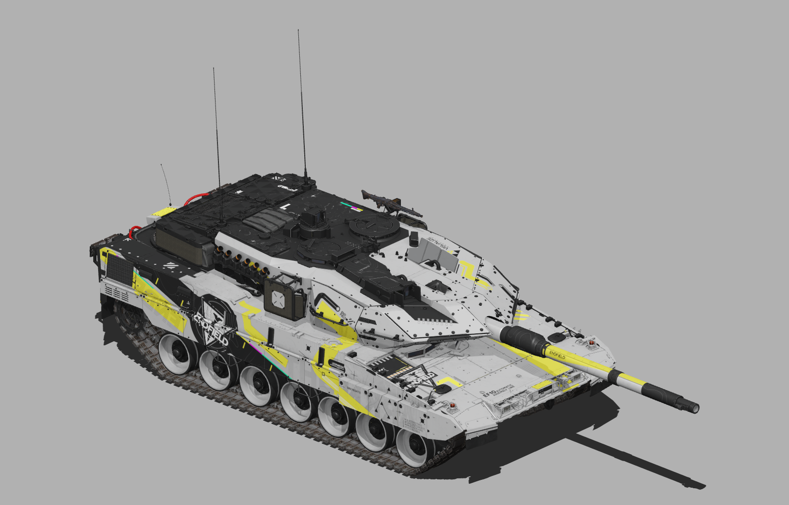

# 战争雷霆 · 涂装制作 Skills

让 AI 助手按明确流程制作飞机与地面载具涂装：研究参考、安排图形、处理 UV 与材质，保存分层工程，并检查游戏交付。

**[选择 Skill](#选择适合的-skill) · [三步开始](#三步开始) · [中文术语](docs/terminology.md) · [完整文档](docs/README.md) · [开发入口](#参与开发)**

## 每套涂装的在线 3D 预览

**[进入作品集，打开各套介绍与 3D 预览](https://icyryna.github.io/war-thunder-liveries/)** · [通用涂装工作台](https://icyryna.github.io/war-thunder-skin-skills/) · [打开自己的模型](docs/web-preview.md)

点击作品标题，介绍页会自动载入该车型和该套涂装，可直接旋转、缩放和切换视角。F-2A、EMBT 等提供车型版本选择；原有下载、来源和评价保留。通用工作台用于载入自己的模型、校准独立装饰、文字和区域改色。

## 选择适合的 Skill

| 中文名称 | 适合做什么 | 正式下载 | 中文解读 |
| --- | --- | --- | --- |
| 炭灰工业涂装 · 地面载具 | AZUR三主灰区、几何与蜂窝、车型贴纸、车尾警示及分区材质 | [0.1.5](https://github.com/IcyRyna/war-thunder-skin-skills/releases/tag/wt-style-charcoal-industrial/v0.1.5) | [制作精髓与示例](docs/skills/charcoal-industrial.md) |
| 终末地风格 · 地面载具 | 黑白黄工业构图、部件分区、原生 UV 与材质制作 | [0.1.1](https://github.com/IcyRyna/war-thunder-skin-skills/releases/tag/wt-style-endfield/v0.1.1) | [图文介绍](docs/skills/endfield-tanks.md) |
| 通用飞机痛涂 | 固定翼喷气机的人物布局、几何图形、漆面与交付 | [3.14](https://github.com/IcyRyna/war-thunder-skin-skills/releases/tag/war-thunder-user-skins/v3.14) | [用途与工具](docs/skills/jet-liveries.md) |
| Akamywek 风格 · 飞机 | 深炭底、签名色、白色几何焦点与三角马赛克 | [1.14](https://github.com/IcyRyna/war-thunder-skin-skills/releases/tag/war-thunder-style-akamywek/v1.14) | [风格与顺序](docs/skills/akamywek.md) |

每个正式安装包都能独立使用，自带对应版本的说明、工具和必要素材。完整下载记录见[下载中心](releases/README.md)，旧终末地 1.4 等版本见[历史档案](docs/history/README.md)。

## 三步开始

1. 按上表选择工作流，进入发布页，在 **Assets（附件）** 中下载 `.skill.zip`。
2. 保留解压后的完整 Skill 文件夹，按[安装指南](docs/installation.md)放入所用助手的技能目录。
3. 提供目标载具、原始贴图、人物或主题素材和参考图，明确需要游戏包、分层工程或预览图。

第一次使用可先读[中文快速上手](docs/quick-start.md)。安装包、开发源码和历史素材的区别也在那里说明。

## 终末地风格：从参考关系到目标载具



先理解明暗分区、黄色路径、工业标识和图形密度，再根据目标车辆的实际表面重新构图。布局资料包含五个车型家族的方向建议与可选预设，使用时仍需核对目标车的 UV 和材质。

[风格概览](docs/skills/endfield-tanks.md) · [A7V 与五车型图解](docs/skills/endfield-layout-guide.md) · [0.1.1 完整素材与工具](docs/skills/wt-style-endfield-0.1.1.md)

## 它会怎样完成一套涂装

| 阶段 | 主要工作 | 可检查的结果 |
| --- | --- | --- |
| 理解参考 | 分辨原作特征、素材来源与适用范围 | 参考记录、方向选择 |
| 建立工程 | 核对模型、原生 UV、贴图与材质通道 | 输入配置、表面与图层关系 |
| 制作设计 | 安排色块、人物、标识和局部细节 | 分层工程、整车与局部预览 |
| 检查交付 | 检查纹理、配置引用和目标载具显示 | 游戏包、源码包、验证结果 |

结构检查、视觉评价和实机测试分别记录。某次检查通过，只说明对应检查项通过；具体适用车型和未执行项见各工作流说明。

## 参与开发

源码按职责分开，公共工具集中维护，独立包由构建器装配。

| 位置 | 中文说明 |
| --- | --- |
| [`src/`](src/) | 研究、工程、风格与兼容工作流源码 |
| [`toolkits/`](toolkits/) | 飞机和地面载具的公共工具 |
| [`profiles/`](profiles/) | 载具资源与表面约束配置 |
| [`evals/`](evals/) | 评测契约、检查器和测试 |
| [`catalog.json`](catalog.json) | 包与源码、工具、素材的装配关系 |
| [`docs/`](docs/README.md) | 中文说明、研发流程、安装和版本记录 |

`wt-skin-study` 与 `wt-skin-build` 是开发候选，尚无正式版本。试用和修改候选前，先读[研发流程](docs/workflow/README.md)与[检查和构建指南](docs/maintaining.md)。

```bash
python -B tools/repository.py list
python -B tools/repository.py check
```

创作源码经装配后形成独立包，正式使用请选择 Release 的安装附件。

## 作品、版本与许可

[涂装作品集](https://github.com/IcyRyna/war-thunder-liveries) · [版本记录](docs/changelog/README.md) · [素材来源](docs/credits.md) · [许可说明](docs/licensing.md)

自行编写的代码、Skill 指令和文档采用 [MIT](LICENSE)。参考图片、游戏资源和单独许可素材按来源记录及各自适用条款使用。

[发布资料整理说明](docs/distribution.md)
