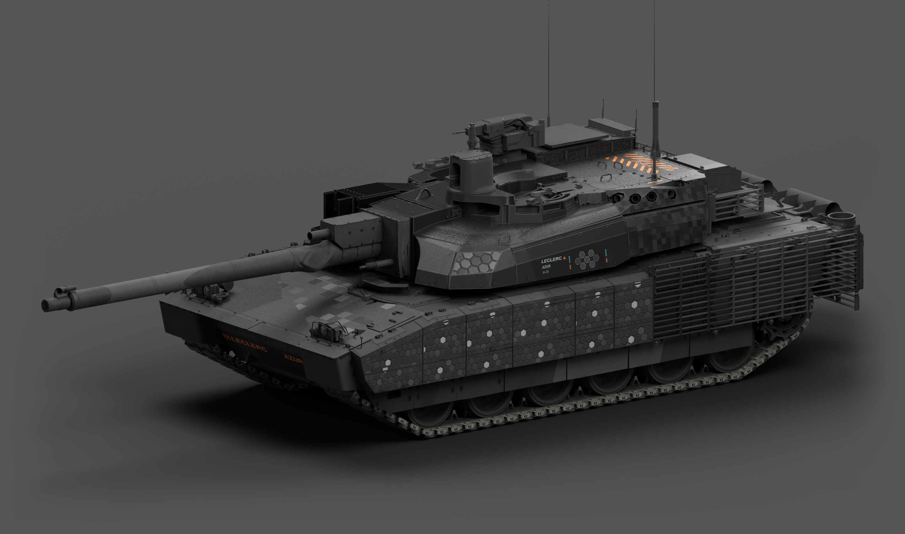

# 炭灰工业涂装 · 0.2.0

面向 War Thunder 地面载具的炭灰工业风格涂装 Skill。唯一范本是勒克莱尔 AZUR v29：中性炭灰底上压大块直边斜切碎片，侧裙铺满带亮格的实心蜂窝，炮塔尾舱侧铺满暗色数码块，首上一簇渐散数码块；炮塔侧一组身份铭牌，首下琥珀斜体车名，顶部泄压盖黑底橙色人字斜条，车尾两侧橙黑斜条短板。



## 下载

| 下载 | 大小 | 内容 |
|---|---:|---|
| [Skill安装包](https://github.com/IcyRyna/war-thunder-skin-skills/releases/download/wt-style-charcoal-industrial/v0.2.0/wt-style-charcoal-industrial-v0.2.0.skill.zip) | 350.03 KB | 规则、工具、模板；不含生产图片 |
| [独立素材包](https://github.com/IcyRyna/war-thunder-skin-skills/releases/download/wt-style-charcoal-industrial/v0.2.0/wt-charcoal-industrial-assets-v0.2.0.zip) | 72.65 MB | 32项可直接用/改制的素材（含14项AZUR v29新子版）、高清防滑材质、AZUR范本图 |
| [合集](https://github.com/IcyRyna/war-thunder-skin-skills/releases/download/wt-style-charcoal-industrial/v0.2.0/wt-charcoal-industrial-bundle-v0.2.0.zip) | 73.00 MB | 两个并列目录，内容与单独下载一致 |

## Skill 结构

```text
SKILL.md                 入口：范本、优先级、按任务读什么、制作顺序、工具速查
references/README.md     全部文档一句话索引
references/style/        审美总纲 · 装饰手法 · 逐部位做法 · 贴纸与文字 · 材质观感
references/workflow/     制作契约 · 极细检查 · 原皮细节 · 素材使用 · 症状诊断
references/contracts/    schema 3 · 布局/覆盖/范围审计 · 材质参数 · 运行与交付 · 工具回执
references/delivery/     包体预算 · 命名 · 发布模板 · 验证范围
references/data/         style-policy 等机器规则与 AZUR 实测数据
scripts/                 检查、合成、材质、DDS 与交付工具
```

## 安装与素材定位

将 `wt-style-charcoal-industrial` 放入技能目录，调用 `$wt-style-charcoal-industrial`。素材包 `wt-charcoal-industrial-assets` 与 Skill 并排解压可自动识别；放在别处用 `WT_CHARCOAL_ASSETS` 指定。

```text
python -B scripts/verify_release.py
python -B scripts/verify_release.py --assets "独立素材包目录"
```

## 本版改进

- **审美按 AZUR 实测重写。** 解码 AZUR v29 运行贴图逐块测量：灰阶、深浅碎片、数码五档、蜂窝格与亮格、警示与铭牌颜色、点缀色。M1 不再作为来源。
- **29份历史案例文档提炼为规则。** 叙事与返工经过删除，用户纠正过的做法全部转为直接规则和"默认不做"清单。
- **新增装饰手法。** 三层装饰（纹样场/焦点/小件）、按视角的密度预算、构图原则、装饰词汇、救素顺序、按车型落位与素/花自查，防止成品太素。
- **AZUR 默认写入机器规则。** 首上数码簇、炮塔尾舱数码带、炮管长曲线大区为必需元素；数码块为必需图形角色；电路线须附用户原话。
- **目录体系化。** 参考文档分 style/workflow/contracts/delivery/data 五类并配索引；入口按任务给出阅读路径。
- **14项新素材。** 人字警示（竖/横）、BLOW-OUT字层、车尾斜条板、身份铭牌组件、首下»箭头、微色标、缺口标、刻度尺、三角符、数码满铺与渐散、侧裙亮格蜂窝平铺块；颜色取自 AZUR 实测，PNG＋SVG。
- 修复安装包中 `verify_package.py` 引用未随包模块的问题。

## 兼容性

0.2.0 的机器规则新增必需元素与图形角色。按 0.1.6 写的车辆工程需把 `policy_version` 改为 0.2.0，并补上 `pixel_cluster`、`rear_pixel_band`、`long_barrel_zone` 与 `pixel_field`，或改为 `adapted` 并写明本车理由。

## 验证范围

292项单元/集成回归通过；独立解压验证覆盖Skill单独使用、缺素材包、并排目录和任意素材路径；32项素材的细线与字高区域检查通过。新规则只在合成用例上验证，尚未用于新车整车制作；不表示未见车型制作、旧工程迁移或新游戏实装已完成，美术认可由用户判断。

原作研究来源：[Fying_ / WT Live 1192186](https://live.warthunder.com/post/1192186/en/)。自行编写的代码与指令沿用仓库MIT许可；第三方参考与游戏资源保留各自范围，见[许可说明](../licensing.md)。
