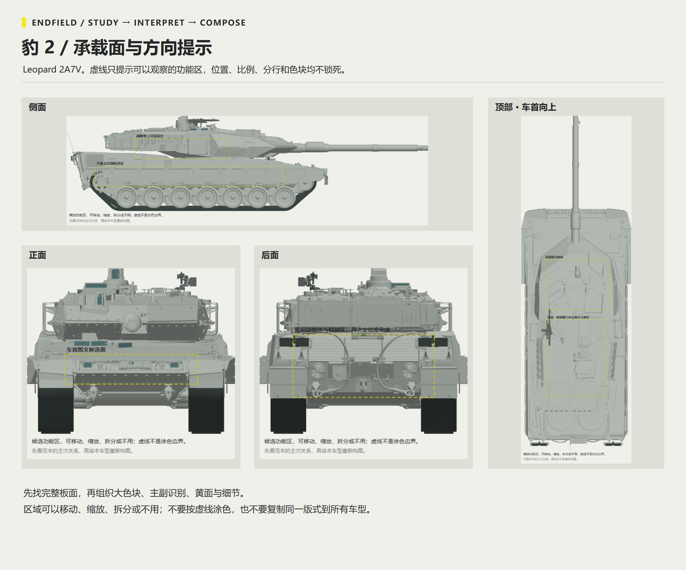
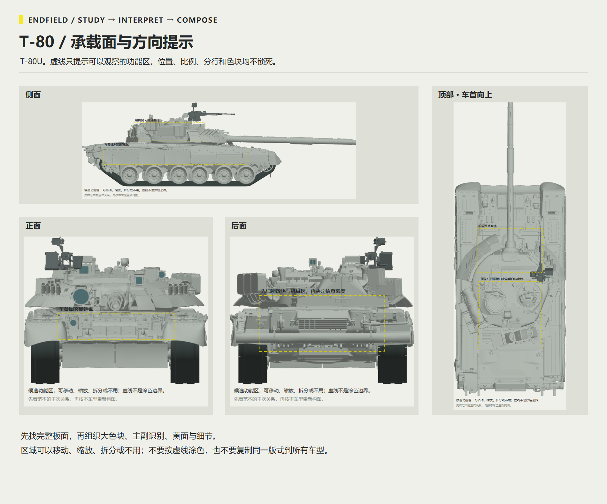
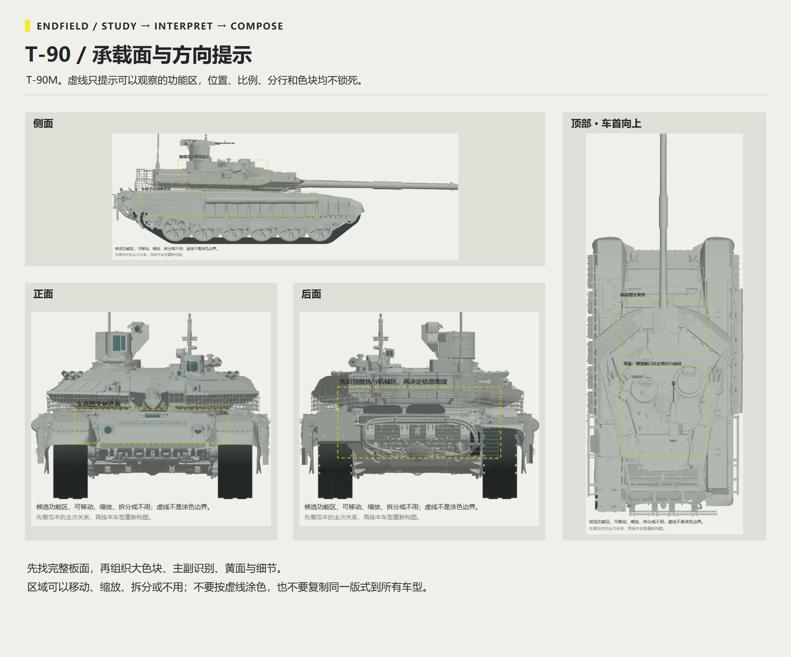
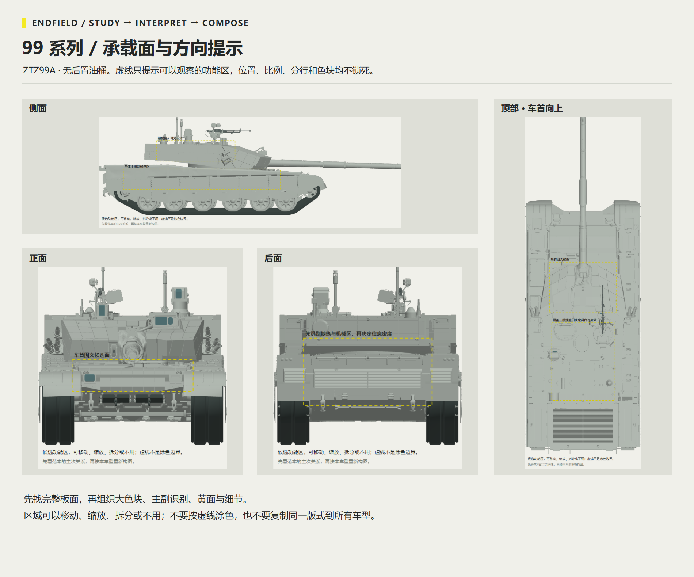
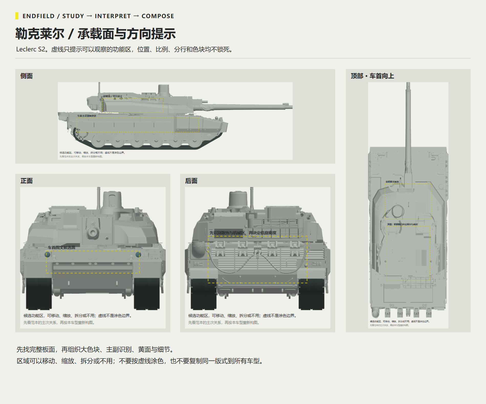
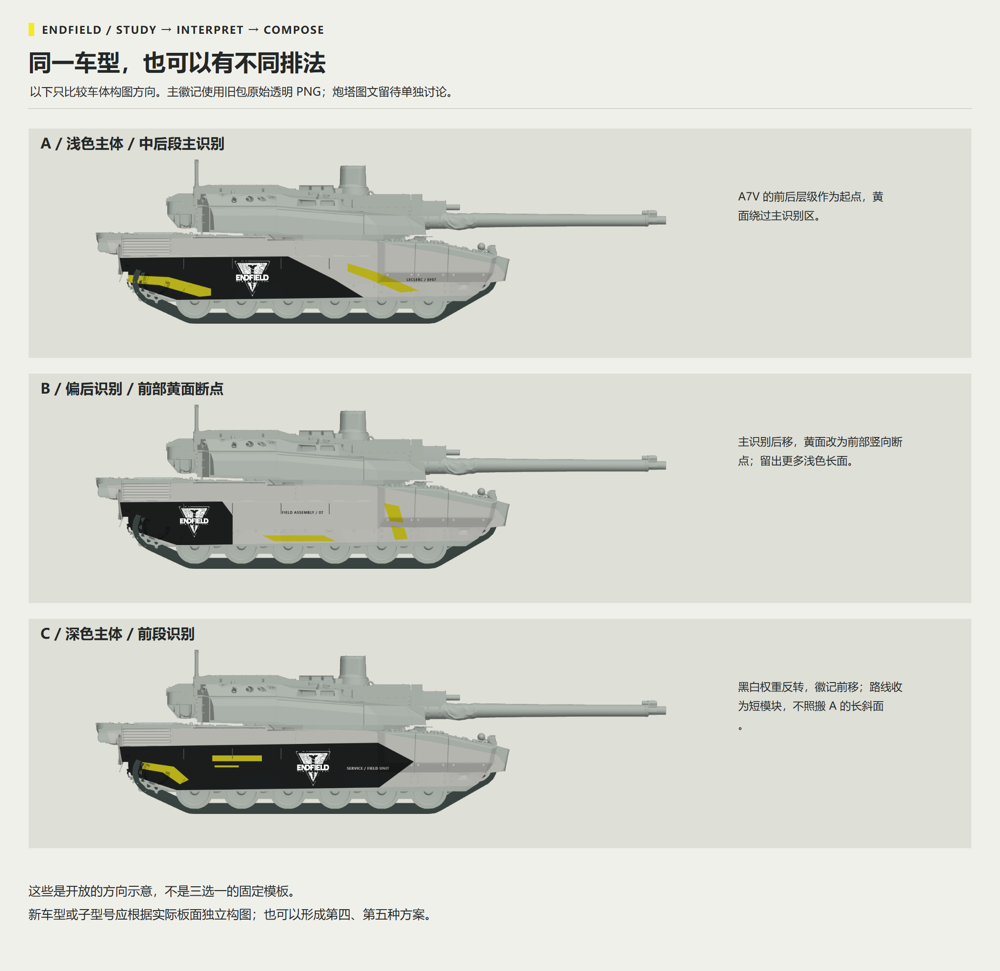
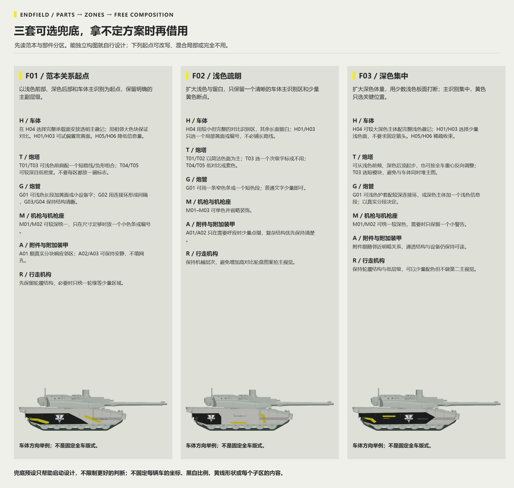

# 终末地布局：从 A7V 范本到不同坦克

以 HK416の午夜福音的 [A7V 原作](https://live.warthunder.com/post/1162771/en/) 理解黑白分区、黄色方向、完整工业标识、信息层级和留白，再根据目标坦克的真实结构重新布局。原作提供关系与语汇，车型示例提供承载方向，具体图形由本车的部件、UV 和设计意图决定。

本页图板供读者理解风格与方法。独立 Skill 的执行知识应写在 `SKILL.md`、Markdown／JSON 规则和部件／车型资料中；透明素材与少量实际有用的分区／预设图按需读取。无需把带长篇说明的展示图板装进运行包。

**版本状态：** 新的 `wt-style-endfield` 0.1.0 属于候选方向，尚无正式推荐安装版。本页配图不代表新 Skill 已正式发布或车型涂装已通过游戏验收。既有兼容包仅在[历史版本](../history/README.md)提供追溯入口。

## 先理解 A7V 的布局关系

- **视觉职责：** 车体长面可承载主工业徽记，炮塔肩部承载次级图文，顶部与机械区保留低密度层次。
- **大色块：** 黑白灰建立体量和焦点，黄色承担宽方向面、路线、转折或端点等不同职责，少量辅彩只点睛。
- **阅读层级：** 完整主徽记、次级组合字标、设备编号与微字有强弱；不能让所有板件都变成同等醒目的海报。
- **疏密与留白：** 图文集中成模块，安静区仍保留真实机械细节；低对比底纹不填满全部空处。
- **图形家族：** 路线、圆端、三角、节点、十字、刻度和等高线可以重新组合，不要求每车都用全套。
- **跨面关系：** 左右呼应而不镜像出反字，跨板看实际邻接，炮塔旋转／炮管俯仰的接口独立处理。
- **标志与文本：** 工业徽记保持整个组合，可换的是普通编号、车名和辅助信息。

原作观察、视觉解释与迁移建议应区分记录。临摹总结可以补充检查点，其色值、比例或工序自述不自动成为通用规则。默认不做旧，漆面颗粒、结构与可选做旧分开。

## 先分部件，再让各部位发挥

| 部件 | 典型区域 | 设计职责 |
|---|---|---|
| H 车体 | 前甲、甲板、左右侧裙、动力甲板、尾面 | 全车主识别与大色块 |
| T 炮塔 | 前颊、侧壁、前肩、乘员顶、尾顶、炮盾过渡 | 次级体量、图文与留白 |
| G 炮管 | 护套、连接环、炮口、根部 | 长轴节奏与材料分段 |
| M 机枪／座 | 外壳、底座、枪管及机构 | 尺寸允许时的小标或素色 |
| A 附件 | 附加装甲、ERA、箱体、网架、可选外桶 | 与邻区协调，保留孔隙与结构 |
| R 轮履 | 负重轮、履带与悬挂 | 支撑层次，避免抢主视觉 |

29 个示例子区可以增、减、合并；它们是工作语义，不是精确 UV 遮罩。先设定全车的焦点、颜色角色、黄色职责和疏密，再给部件自己的构图意图。H04 长侧面与 H07 单板细分选择一个实际工作粒度，避免重叠修改。

## 五个车型家族的大方向

代表车型用于理解体量，子型号根据真实装甲、侧裙、附件和资源调整，不要求为每个子型号预制一套。图中分区色帮助识别部件，不是规定涂装配色。

| 家族代表 | 重新布局时先解决什么 |
|---|---|
| Leopard 2A7V | 连续长裙板、前肩与后顶的层级，宽黄色方向面与主识别的关系 |
| T-80U | 圆形炮塔、密集 ERA、实际连续侧裙，路径可随块分段 |
| T-90M | 实心板与网架分开，避免把标志印到孔隙；不沿用 T-90A 轮廓 |
| 99A，无后置双油桶 | 较高侧裙与楔形前部；尾部按散热、牵引和灯具设计 |
| Leclerc S2 | 当前示例主徽记在车体／侧裙，炮塔另行设计；同车也可改变主标、明暗和黄面 |

Leopard 2A7V：侧、前、后、顶视与承载面方向

这些是工作部位与可选承载面提示，不规定徽记坐标、比例、线形或填充顺序；生产前仍需映射本车原生 UV。

T-80U：侧、前、后、顶视与承载面方向

这些是工作部位与可选承载面提示，不规定徽记坐标、比例、线形或填充顺序；生产前仍需映射本车原生 UV。

T-90M：侧、前、后、顶视与承载面方向

这些是工作部位与可选承载面提示，不规定徽记坐标、比例、线形或填充顺序；生产前仍需映射本车原生 UV。

99A，无后置双油桶：侧、前、后、顶视与承载面方向

这些是工作部位与可选承载面提示，不规定徽记坐标、比例、线形或填充顺序；生产前仍需映射本车原生 UV。

Leclerc S2：侧、前、后、顶视与承载面方向

这些是工作部位与可选承载面提示，不规定徽记坐标、比例、线形或填充顺序；生产前仍需映射本车原生 UV。

## 预设作为可选兜底

| 起点 | 建议 |
|---|---|
| F01 范本关系 | 浅前、暗后、车体主识别与次级炮塔图文，按本车重排 |
| F02 浅色疏朗 | 更多留白和较少方向断点，复杂结构可省装饰 |
| F03 深色集中 | 较重暗色体量、少量浅色打断，主识别集中 |

默认独立构图。读过范本与部件后仍拿不定方案时，可借一个起点，也可以混合、只取局部、改写或不用。三张车体示例不代表炮塔已设计，也不代表原生 UV／DDS 已验证。

查看逐部件兜底建议图

## 素材和执行知识怎样组织

工业徽记是一个整体：外三角、轮廓纹、ENDFIELD 与 INDUSTRIES 保持完整，统一缩放，不裁标、不拆字、不额外添加独立不透明底板。优先选已有透明母版，通过车身色块保证对比；小尺寸提取图不能放大后冒充高清原件。

执行包内按用途分目录：`assets/` 放实际透明素材与可编辑图形，`references/visuals/` 放有读取任务的分区／预设参考和图例。每组图都应说明何时读、看什么、哪些只是示意；文字与 JSON 同时提供规则、部件角色、车型条件、例外和检查动作。大型原 UV、历史提取源与完整旧素材库可按需配套，正常执行保持独立。

PS／Composa 检查使用实时 MCP，关键局部以原尺寸检查并对应到模型；最终 DDS 再读回，CMPS 从验证副本重开。技术、视觉、游戏和复现分别记录；分区研究图不能替代实际新车的材质和游戏检查。

## 参考与图像说明

主要视觉参考：[HK416の午夜福音 / A7V / WT Live 1162771](https://live.warthunder.com/post/1162771/en/)。原作显示图、局部研究和真实游戏模型的静态解码视图用于解释布局；新的示意编排不是原作者工程，不证明原作者采用某种工序。社区分发标志与其他素材继续分别标明来源，见[素材来源](../credits.md)。

本页展示图位于 `docs/images/endfield-layout/`，用于 GitHub 说明。候选的新规则与资料按审查和发布流程推进；既有包的下载与兼容信息集中在[历史版本](../history/README.md)。

[历史兼容资料](../history/README.md) · [文档导航](../README.md) · [仓库首页](../../README.md)
