# wt-style-endfield 0.1.0 · 完整展示

这是 **0.1.0 本地审查候选包的完整图文展示**：规则、车型方向、部件分区、三套可选兜底、制作素材、工具和验证范围都在本页。运行包为 **201 文件、约 15.7 MiB**，目前尚未正式安装或创建 Release。

这里展示的是一套让 AI 为不同坦克重新设计的工作方法与资源，不是已经完成并通过游戏验收的整车涂装。

**[A7V 解析](#a7v-原作八条解析) · [部件与29子区](#部件与29个子区) · [五车型方向](#五个车型家族) · [三套兜底](#三套可选兜底) · [全部制作素材预览](#制作素材完整预览) · [输入与输出](#输入与输出) · [工具与ps流程](#工具与ps流程) · [验证范围](#验证范围) · [完整文件目录](#完整包内目录)**

## AI 怎样使用这套 Skill

1. 理解 A7V 原作的布局关系。
2. 确认目标车型、子型号与附件状态。
3. 识别大部件和子区。
4. 确定全车主次，再让各部位自由构图。
5. 拿不定方案时，按需参考可选兜底。
6. 在 PS／模型中检查，最终读回 DDS 并复查可编辑源。

先理解范本，再理解新车型。车型方向不固定黑白比例、徽记坐标、黄线形状或贴花数量；子型号按实际装甲、侧裙、附件和 UV 调整。预设可以改、混合、只取局部或不用。

## A7V 原作八条解析

第一视觉依据是 HK416の午夜福音的 [WT Live 1162771 原作](https://live.warthunder.com/post/1162771/en/)。临摹总结只用于补充检查点，其自述工序、色值和指标不自动成为通用规则。

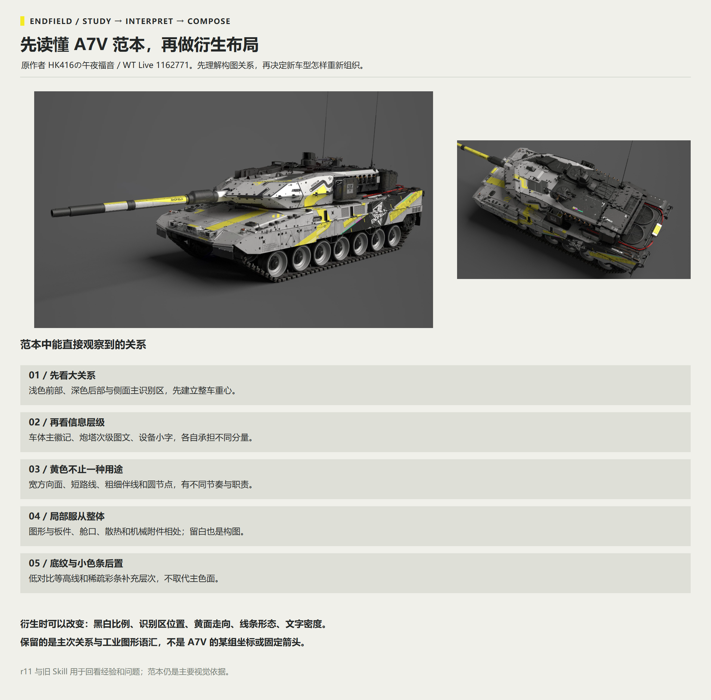

下列八条保留原作观察、视觉解释、迁移操作和例外，不把对视觉作用的解释当作作者本人确认的工序。

### LAYOUT-01 · 先分配物理表面的视觉职责

**原作观察：** 两侧裙板中后段承担大工业徽记；炮塔浅色前肩承担中等识别模块，暗色设备顶面承担低对比纹样和小标；炮管沿长轴延伸；机枪座/后部机械区不抢主视觉。

**关系解释：** 整车由主识别面、次识别面、方向延伸面和安静机械面共同成立，不能把同一张徽记铺到每个部件。

**迁移到新车：** 新车先标出连续侧板、炮塔肩部、窄长覆板、设备密集区，再分配角色；缺少某类表面时缩减该层信息，不挤成同一张拼贴。

**边界与例外：** 这是该A7V原作的职责分配，不是所有终末地作品必须照搬的布局。

原尺寸局部：[B01](../images/endfield-skill-0.1.0/assets/legacy/reference-a7v/crops/B01.png) · [T01](../images/endfield-skill-0.1.0/assets/legacy/reference-a7v/crops/T01.png) · [T05](../images/endfield-skill-0.1.0/assets/legacy/reference-a7v/crops/T05.png) · [T09](../images/endfield-skill-0.1.0/assets/legacy/reference-a7v/crops/T09.png) · [G01](../images/endfield-skill-0.1.0/assets/legacy/reference-a7v/crops/G01.png) · [M01](../images/endfield-skill-0.1.0/assets/legacy/reference-a7v/crops/M01.png)。

### LAYOUT-02 · 黑白灰负责大块结构，黄色负责方向，小彩色只作点睛

**原作观察：** 炮塔后顶和设备集中区较暗，前部楔形装甲与车首以灰白为主；侧裙黑区给白色主徽记托底。黄带在灰白/黑面间形成高识别路线；青绿/品红主要是侧裙细线和暗顶微型色条。

**关系解释：** 识别主要来自大块明暗关系与黄色动线；彩色层级是主黄、微量辅彩，而非同权重多色拼贴。

**迁移到新车：** 先画黑/灰白的大区，再给少量黄色方向面；青绿、品红作为可选的微标/细线系统。调色应在新车主要视角上判断，不使用UV空白面积或r11色板推整车比例。

**边界与例外：** 未测得真实表面积比例；不设固定黑白百分比、不声称r11十六进制色值是原作者配方。

原尺寸局部：[B01](../images/endfield-skill-0.1.0/assets/legacy/reference-a7v/crops/B01.png) · [B08](../images/endfield-skill-0.1.0/assets/legacy/reference-a7v/crops/B08.png) · [B09](../images/endfield-skill-0.1.0/assets/legacy/reference-a7v/crops/B09.png) · [T02](../images/endfield-skill-0.1.0/assets/legacy/reference-a7v/crops/T02.png) · [T05](../images/endfield-skill-0.1.0/assets/legacy/reference-a7v/crops/T05.png) · [T09](../images/endfield-skill-0.1.0/assets/legacy/reference-a7v/crops/T09.png)。

### LAYOUT-03 · 黄色是有主次的路径系统

**原作观察：** 原作同时使用宽色带、较细平行带、折转、圆端/圆节点；侧裙的斜向黄面与炮塔肩部路线相互呼应，炮管黄带沿长轴展开。

**关系解释：** 方向、端点、粗细和重复关系比小图案数量更能建立工业风格。

**迁移到新车：** 配套素材提供直段、转角、圆端、节点与细伴随线的成组模块。每个主要视角先定一条主路径，再布置次路径；跨板按可见连续面安排，炮塔与车体的独立运动部件以方向呼应，不强求一条静止跨轴连线。

**边界与例外：** 复用形态语汇和相对关系，不复用A7V像素坐标、固定转角位置或绝对线宽。

原尺寸局部：[B08](../images/endfield-skill-0.1.0/assets/legacy/reference-a7v/crops/B08.png) · [B10](../images/endfield-skill-0.1.0/assets/legacy/reference-a7v/crops/B10.png) · [T02](../images/endfield-skill-0.1.0/assets/legacy/reference-a7v/crops/T02.png) · [T03](../images/endfield-skill-0.1.0/assets/legacy/reference-a7v/crops/T03.png) · [T04](../images/endfield-skill-0.1.0/assets/legacy/reference-a7v/crops/T04.png) · [G01](../images/endfield-skill-0.1.0/assets/legacy/reference-a7v/crops/G01.png)。

### LAYOUT-04 · 建立远看标识、近看模块、贴近看信息的层级

**原作观察：** 侧裙的大工业三角/ENDFIELD为最醒目的身份；顶部VISUALIZE组合、侧面END/FIELD字标承担中层识别；CAUTION、EF10、车型铭牌、坐标和小编号分布在局部。

**关系解释：** 层级同时由尺寸、对比、成组关系和承载面决定，不能只靠缩字号。

**迁移到新车：** 素材包按主徽记、次级组合字标、设备/警告模块三级组织；先给主徽记留完整阅读空间，再放功能小模块。一次主视角保留清楚的焦点，不让多个大标等面积竞争。

**边界与例外：** 不把每个元素复制成相同大小的贴花；主次数量随新车有效阅读面改变。

原尺寸局部：[B01](../images/endfield-skill-0.1.0/assets/legacy/reference-a7v/crops/B01.png) · [B03](../images/endfield-skill-0.1.0/assets/legacy/reference-a7v/crops/B03.png) · [B04](../images/endfield-skill-0.1.0/assets/legacy/reference-a7v/crops/B04.png) · [B05](../images/endfield-skill-0.1.0/assets/legacy/reference-a7v/crops/B05.png) · [B07](../images/endfield-skill-0.1.0/assets/legacy/reference-a7v/crops/B07.png) · [T01](../images/endfield-skill-0.1.0/assets/legacy/reference-a7v/crops/T01.png) · [T04](../images/endfield-skill-0.1.0/assets/legacy/reference-a7v/crops/T04.png) · [T06](../images/endfield-skill-0.1.0/assets/legacy/reference-a7v/crops/T06.png) · [T07](../images/endfield-skill-0.1.0/assets/legacy/reference-a7v/crops/T07.png) · [G02](../images/endfield-skill-0.1.0/assets/legacy/reference-a7v/crops/G02.png)。

### LAYOUT-05 · 把密度聚在少数模块，让大色面有喘息空间

**原作观察：** 大徽记、前翼板三角网络和工程小字是密集区；炮塔前斜面的许多区域仍是大片灰白。暗顶虽有等高线/十字/微标，但对比低，远看仍收为暗面。

**关系解释：** 留白是低图文密度的色面，不等于没有机械细节；局部密度反差使标签看起来有信息组织。

**迁移到新车：** 为每个主阅读面同时规划图形聚集区和安静区；技术文本成块排，重复符号成组排。低对比背景线只在需要的色场内延续，避免随机碎线填满所有空处。

**边界与例外：** 没有测量全车密度阈值；不提出固定贴花数量或全图纹理覆盖率。

原尺寸局部：[B02](../images/endfield-skill-0.1.0/assets/legacy/reference-a7v/crops/B02.png) · [B03](../images/endfield-skill-0.1.0/assets/legacy/reference-a7v/crops/B03.png) · [B06](../images/endfield-skill-0.1.0/assets/legacy/reference-a7v/crops/B06.png) · [T01](../images/endfield-skill-0.1.0/assets/legacy/reference-a7v/crops/T01.png) · [T05](../images/endfield-skill-0.1.0/assets/legacy/reference-a7v/crops/T05.png) · [T09](../images/endfield-skill-0.1.0/assets/legacy/reference-a7v/crops/T09.png) · [G02](../images/endfield-skill-0.1.0/assets/legacy/reference-a7v/crops/G02.png)。

### LAYOUT-06 · 素材按几何家族和用途组织，而不是混成一袋装饰

**原作观察：** 原作反复使用三角徽记/实空三角网络、圆端带/圆节点、斜纹块、十字与刻度、低对比等高线，以及极小CMY色条。各家族在不同尺寸重复，但承担不同职责。

**关系解释：** 一致性来自少数家族跨部位复现；等高线与工程微标是设计语汇，不能与污渍或机械阴影混为一类。

**迁移到新车：** 准备六组可编辑素材：品牌徽记与字标；路径/节点；三角网络/方向标；斜纹/十字/刻度；低对比轮廓线；CMY微标。每组给大、中、小用途示例，明确它适合当主形、节奏或背景。

**边界与例外：** 这不是要求每辆车同时使用全部家族，更不是把原作带底图的裁片当透明独立素材。

原尺寸局部：[B01](../images/endfield-skill-0.1.0/assets/legacy/reference-a7v/crops/B01.png) · [B02](../images/endfield-skill-0.1.0/assets/legacy/reference-a7v/crops/B02.png) · [B03](../images/endfield-skill-0.1.0/assets/legacy/reference-a7v/crops/B03.png) · [B06](../images/endfield-skill-0.1.0/assets/legacy/reference-a7v/crops/B06.png) · [B09](../images/endfield-skill-0.1.0/assets/legacy/reference-a7v/crops/B09.png) · [T02](../images/endfield-skill-0.1.0/assets/legacy/reference-a7v/crops/T02.png) · [T03](../images/endfield-skill-0.1.0/assets/legacy/reference-a7v/crops/T03.png) · [T05](../images/endfield-skill-0.1.0/assets/legacy/reference-a7v/crops/T05.png) · [T09](../images/endfield-skill-0.1.0/assets/legacy/reference-a7v/crops/T09.png) · [G02](../images/endfield-skill-0.1.0/assets/legacy/reference-a7v/crops/G02.png)。

### LAYOUT-07 · 保持跨面呼应，允许局部不对称

**原作观察：** 左右侧都能认出同一黑白黄/工业徽记系统，但文字按各自阅读方向排。俯视的前徽记、黄色长带、顶部文字/路线并不按中轴完全镜像；车首图案跨多个实际板片成立。

**关系解释：** 整体平衡依靠视觉重量和方向呼应，局部不对称提供节奏。

**迁移到新车：** 新车型左右侧共用同一视觉语言和相近主次强度，局部文字、编号、路径可按板面改变；跨板图案先在整体视图构图，再拆成属于各承载面的部分。

**边界与例外：** 允许不对称不是随机左右不同；阅读旋转仅属于源裁图，不能作为新车型的默认旋转。

原尺寸局部：[B01](../images/endfield-skill-0.1.0/assets/legacy/reference-a7v/crops/B01.png) · [B02](../images/endfield-skill-0.1.0/assets/legacy/reference-a7v/crops/B02.png) · [B03](../images/endfield-skill-0.1.0/assets/legacy/reference-a7v/crops/B03.png) · [B07](../images/endfield-skill-0.1.0/assets/legacy/reference-a7v/crops/B07.png) · [B11](../images/endfield-skill-0.1.0/assets/legacy/reference-a7v/crops/B11.png) · [B12](../images/endfield-skill-0.1.0/assets/legacy/reference-a7v/crops/B12.png) · [B13](../images/endfield-skill-0.1.0/assets/legacy/reference-a7v/crops/B13.png) · [T01](../images/endfield-skill-0.1.0/assets/legacy/reference-a7v/crops/T01.png) · [T02](../images/endfield-skill-0.1.0/assets/legacy/reference-a7v/crops/T02.png)。

### LAYOUT-08 · 把品牌字形与可换设备信息分开

**原作观察：** ENDFIELD等品牌字形有特定几何切口和组合关系；VISUALIZE等模块采用紧凑大字与疏排小字；CAUTION、EF10、05、LEOPARD2A7等形成工程/设备信息层。

**关系解释：** 品牌身份依赖可辨字形，工业感还依赖大小字、短横线、数字和载具信息的排版关系。

**迁移到新车：** 保留已核实的品牌母版与组合示例；另做可编辑的警告块、设备编号、车型铭牌、短工程说明和坐标模块。换车型改车辆身份字段，保持对齐/间距/层级，不把A7名字固化为风格。

**边界与例外：** 未识别到的字体/官方锁定版式不能凭相似无衬线字体冒充；EF10/05作为可换模块是设计提案，不是已证明作者意图。

原尺寸局部：[B03](../images/endfield-skill-0.1.0/assets/legacy/reference-a7v/crops/B03.png) · [B04](../images/endfield-skill-0.1.0/assets/legacy/reference-a7v/crops/B04.png) · [B05](../images/endfield-skill-0.1.0/assets/legacy/reference-a7v/crops/B05.png) · [T01](../images/endfield-skill-0.1.0/assets/legacy/reference-a7v/crops/T01.png) · [T04](../images/endfield-skill-0.1.0/assets/legacy/reference-a7v/crops/T04.png) · [T05](../images/endfield-skill-0.1.0/assets/legacy/reference-a7v/crops/T05.png) · [T06](../images/endfield-skill-0.1.0/assets/legacy/reference-a7v/crops/T06.png) · [G01](../images/endfield-skill-0.1.0/assets/legacy/reference-a7v/crops/G01.png) · [G02](../images/endfield-skill-0.1.0/assets/legacy/reference-a7v/crops/G02.png)。

## 部件与29个子区

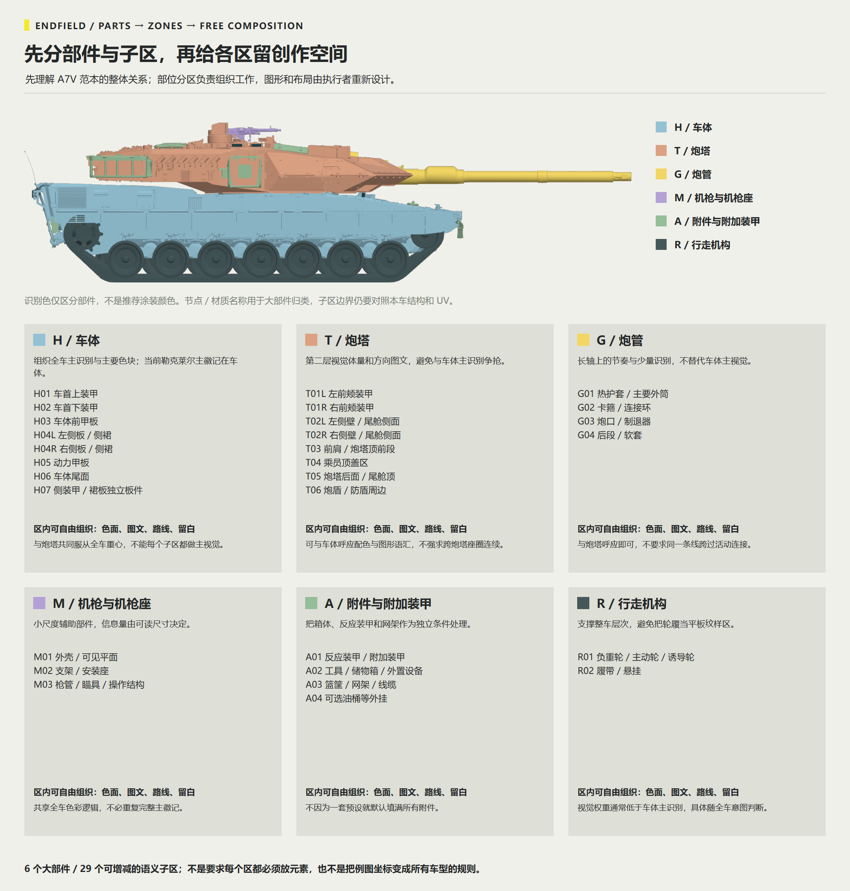

先确定全车焦点、颜色角色、黄色职责和疏密，再给部件自己的设计意图。颜色只区分部件，不是涂装配色。子区可以合并、增加、删除，边界需结合本车原生 UV 确定。

| 部件 | 在整车中的作用 | 可以发挥的范围 |
|---|---|---|
| H · 车体 | 组织全车主识别与主要色块；当前勒克莱尔主徽记在车体。 | 可独立设计大色面、主图文、方向面、设备字与留白；不锁定标志坐标或黄线形状。 |
| T · 炮塔 | 第二层视觉体量和方向图文，避免与车体主识别争抢。 | 前颊、侧壁与顶面可采用不同局部组合；当前勒克莱尔炮塔图文另行讨论。 |
| G · 炮管 | 长轴上的节奏与少量识别，不替代车体主视觉。 | 可宽带、窄条、分段色面、普通设备字或保持素色。 |
| M · 机枪与机枪座 | 小尺度辅助部件，信息量由可读尺寸决定。 | 可单色、一个小色条、小编号或省略装饰。 |
| A · 附件与附加装甲 | 把箱体、反应装甲和网架作为独立条件处理。 | 可继承邻近部件的视觉意图，也可作为局部断点。 |
| R · 行走机构 | 支撑整车层次，避免把轮履当平板纹样区。 | 可调整轮缘、轮心或局部配色，也可保留结构。 |

H04 是长侧面的整体任务，H07 是进一步按单板细分的方式，不作为重叠的第二遍绘制。车体／炮塔、炮塔／炮管有独立运动关系，图形可以方向呼应，不强求静止跨轴连通。

<details>
<summary>查看全部 29 个语义子区与检查点</summary>

| 子区 | 名称 | 可发挥内容 | 结构检查 |
|---|---|---|---|
| H01 | 车首上装甲 | 可偏置或分段组织图文和方向面 | 识别驾驶员视口、灯具、铰链与切角 |
| H02 | 车首下装甲 | 可少量色块或保持安静 | 牵引点、孔壁和机械结构不混作空白画布 |
| H03 | 车体前甲板 | 可选较宽方向面、小编号或留白 | 舱口、工具与炮塔活动范围 |
| H04L | 左侧板／侧裙 | 可改变完整徽记位置、比例、色块与方向 | 分板、挂点、共享 UV 与文字阅读方向 |
| H04R | 右侧板／侧裙 | 可重新排字、换局部图形与密度 | 不得镜像出反字；按本车实际部件判断 |
| H05 | 动力甲板 | 可低密度底纹、微型标记或不用 | 散热格栅、风扇与结构细节 |
| H06 | 车体尾面 | 可小警告、编号、方向点或留白 | 牵引、电缆、排气与尾灯 |
| H07 | 侧装甲／裙板独立板件 | 可拆分为更细任务，与 H04 共享总体意图 | 连续图形不等于跨缝硬拉；按 UV 回查 |
| T01L | 左前颊装甲 | 可色面、短路线、负形或留白 | 观瞄、烟幕与倒角 |
| T01R | 右前颊装甲 | 允许不对称，不要求照搬另一侧 | 板件差异与文字方向 |
| T02L | 左侧壁／尾舱侧面 | 可换图文组合、密度与位置 | 挂载与工具箱、可用整面 |
| T02R | 右侧壁／尾舱侧面 | 可以呼应而不复制 | 不能直接翻转文字贴花 |
| T03 | 前肩／炮塔顶前段 | 可一个局部组合，也可留白 | 设备遮挡、装甲分板 |
| T04 | 乘员顶盖区 | 可深浅分区、弱底纹、小校准条或不用 | 舱口、机枪、观瞄与活动件 |
| T05 | 炮塔后面／尾舱顶 | 可少量设备字与小符号 | 篮筐、通风与外置设备 |
| T06 | 炮盾／防盾周边 | 可独立过渡色，不必延续侧面大图 | 炮管运动、软套和孔壁 |
| G01 | 热护套／主要外筒 | 可纵向黄面、小字或局部分色 | 真实分段、UV 周向接缝与阅读方向 |
| G02 | 卡箍／连接环 | 可作为间隔或保持结构色 | 不要用扁平图形抹掉结构 |
| G03 | 炮口／制退器 | 可少量色面或不用 | 内孔、孔壁与金属结构 |
| G04 | 后段／软套 | 通常低密度；按主题可调整 | 不同载具未必有同样结构 |
| M01 | 外壳／可见平面 | 可少量图形或不用 | 可用面积与像素可读性 |
| M02 | 支架／安装座 | 可统一色或局部强调 | 运动关节、连接件 |
| M03 | 枪管／瞄具／操作结构 | 以结构清晰为先，可保持原样 | 玻璃、孔洞与细小机构 |
| A01 | 反应装甲／附加装甲 | 可分块处理或与主区呼应 | 板件缝隙、归属与共享 UV |
| A02 | 工具／储物箱／外置设备 | 可少量小字、警告或保持安静 | 避免把机械阴影当成绘画图形 |
| A03 | 篮筐／网架／线缆 | 可统一材料感，不强求贴花 | 不能把网孔填成实心板 |
| A04 | 可选油桶等外挂 | 有才设计，未装则不生成 | 当前 99A 不带后部两只油桶 |
| R01 | 负重轮／主动轮／诱导轮 | 可轮缘或轮心配色 | 轮胎、镂空和真实构件分开 |
| R02 | 履带／悬挂 | 可低密度处理或保留 | 不得用统一面色抹掉结构与材质语义 |

</details>

## 五个车型家族

代表车型用于把握结构与大方向，不为每个子型号预制一套死模板。每个家族在包内有侧、前、后、顶四张真实模型参考与文字／JSON 建议；诊断色图不是精确 UV mask，也不是已完成的新涂装。

### 豹 2 · Leopard 2A7V

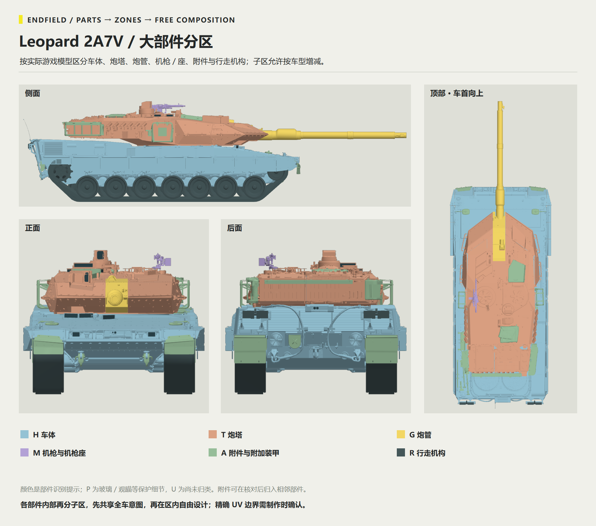

- 侧面：连续长裙板可承载完整工业主徽记；主标、较宽黄方向面与安静色场有主次，不把原作缩成两条细线。可随本车板缝改变位置与尺寸。
- 前面：以车首偏置黄面／小图形和设备信息的分工为起点；光学、灯组、炮盾及附加装甲让出真实结构。不是强制对称 V。
- 后面：动力与机械密度高，深浅收束和小编号／警告可用；不把后部变成第二张大标海报或大 U 路线。
- 顶部：理解前肩浅、后顶较暗的关系；前肩次级图文、短路线，乘员／动力区安静。避开舱盖、观瞄和旋转界面。

**子型号调整：** A7V 是研究范本，不把同家族另一车的装甲包、尾舱、裙板和炮管差异锁死；先检查当前资源。

### T-80 · T-80U

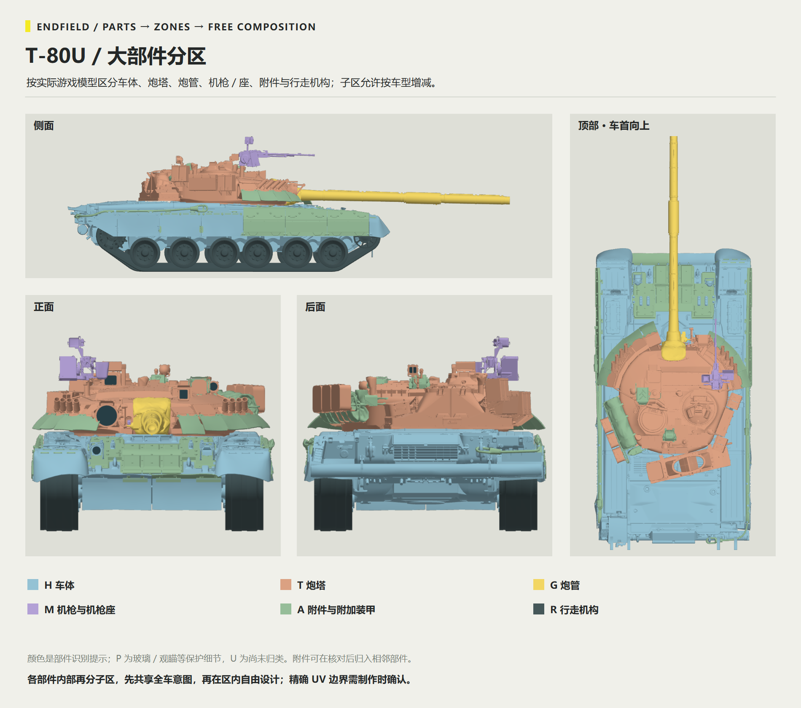

- 侧面：从实际连续侧裙寻找完整主识别面；裙板和 ERA 的节奏与豹 2 不同，黄方向可分段或转为较宽块，不横跨挂点硬画同一长线。
- 前面：圆形炮塔与密集 ERA 先分块看明暗，短方向面随块走；不要把豹 2 楔形前肩直接盖上去。
- 后面：发动机／排气、缆索与附件保持可读，少量局部标识收尾；附件状态改变后重判承载面。
- 顶部：围绕圆形炮塔、舱口和观瞄安排低密度次级模块；不能为了拼成某路线而填掉设备。

**子型号调整：** 代表仅 T-80U；B/BVM 等子型号的 ERA、侧裙、顶部设备与附件由执行者查实际模型后调整，不要求每个子型号预制一套。

### T-90 · T-90M

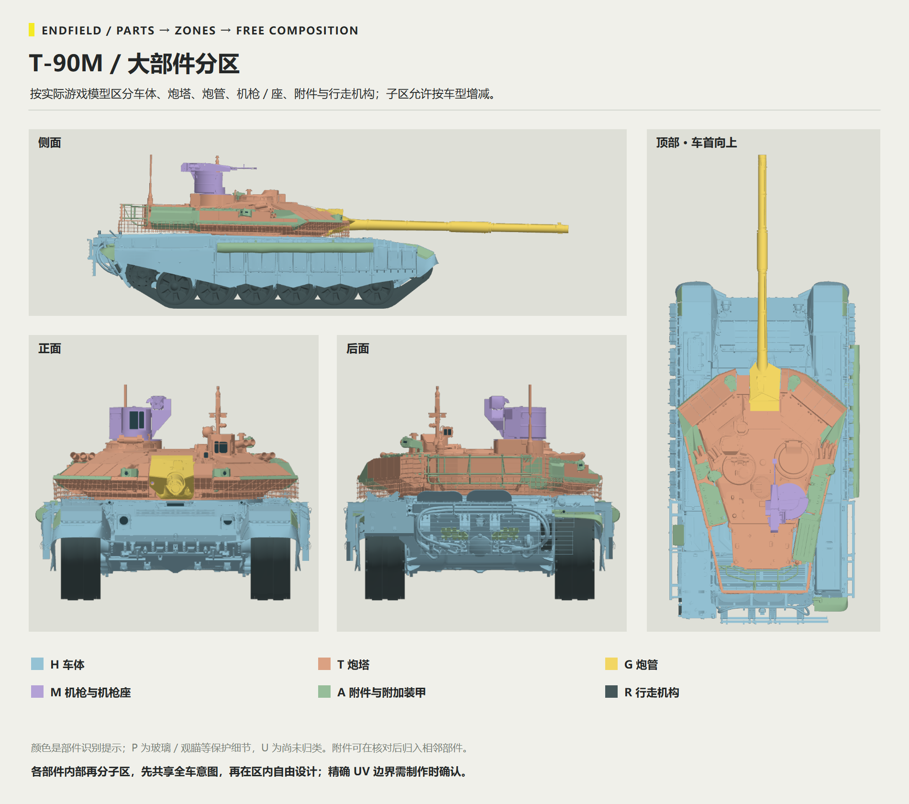

- 侧面：在真实实心车体／裙板选完整主标区；顶部细管、网架和侧装甲分清，标志不能印到透明网孔上再称完整。
- 前面：按 T-90M 实际楔形与 ERA 块面分明暗、方向与留白，不沿用 T-90A 轮廓或排法。
- 后面：尾舱／网架是结构，不能视为大块实心画布；小编号与设备信息可落在真实实体上。
- 顶部：先标舱口、观瞄、武器站与长管，前肩／后顶各选层级，黄路线在实际实体内终止或转向。

**子型号调整：** 本包的 T-90 代表明确为 T-90M。网／笼与实装附件以实际模型和材质裁切为准；研究渲染的节点隐藏状态不自动变成游戏包配置。

### 99A · 无后置油桶

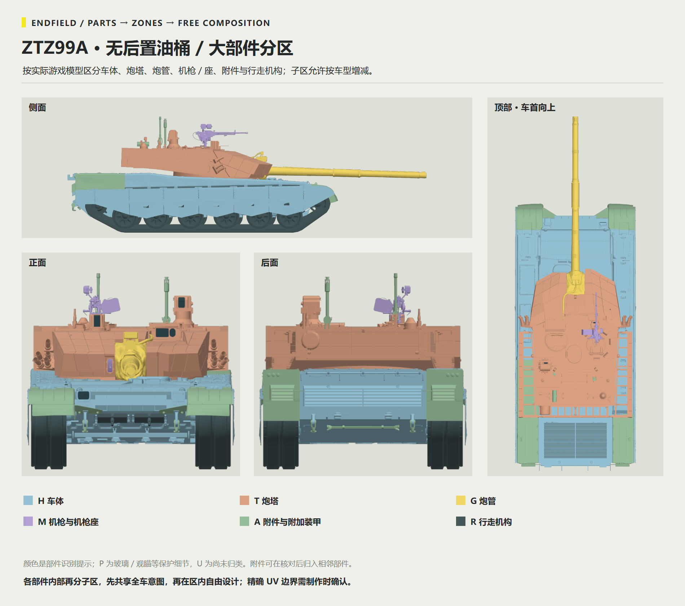

- 侧面：较高侧裙可容完整工业徽记和较宽明暗组织；按裙板长度与挂点重排，不复用 A7V 像素边界。
- 前面：前部楔形装甲、驾驶员视区与炮塔下沿共同决定可画区；方向面可偏置，避让孔壁／观瞄。
- 后面：当前指定无两只外置后油桶，尾部按真实排气、散热、牵引和尾灯设计；不能凭印象添两桶或用大标封满。
- 顶部：楔形前颊与后顶／发动机甲板分层，舱盖和设备上方留出结构阅读；纹样可少用或不用。

**子型号调整：** 代表为游戏 cn_ztz_99a，当前隐藏 ex_decor_l_05 / ex_decor_r_05 两只可选后桶；不宣称所有 99 系子型号同形或总是无桶。

### 勒克莱尔 · Leclerc S2

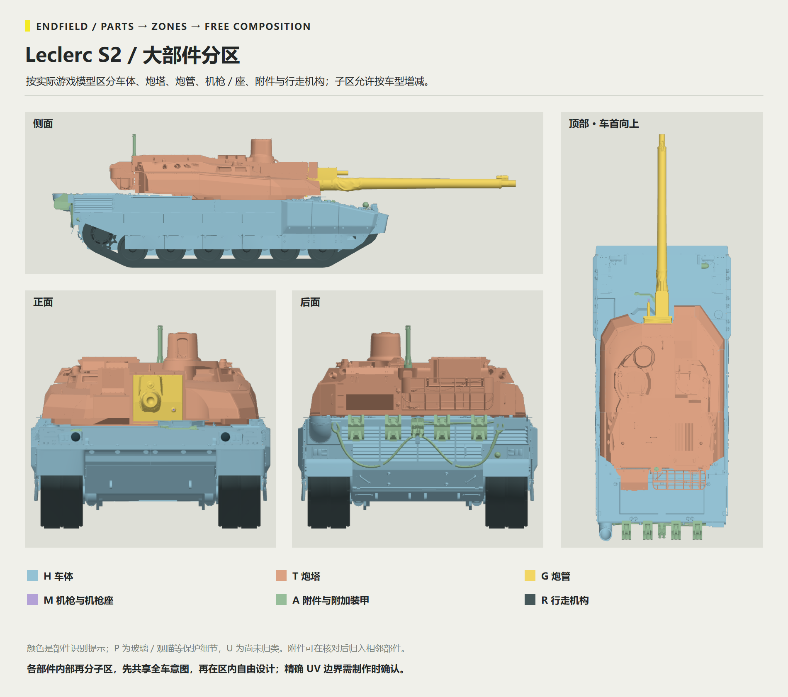

- 侧面：按当前用户要求主工业徽记在车体／侧裙。先决定车体色块与完整标志空间，再决定黄面在前、中或后，不能挪到炮塔凑空间。
- 前面：短车体前甲、楔形炮塔、炮盾与驾驶员区域分别判断，车首可用偏置方向或较安静组织，不把侧图强投影成对称图。
- 后面：车尾与炮塔尾舱分开，机械／散热区保持低信息量，局部铭牌随实体板面选。
- 顶部：炮塔布局另行设计，当前三个例子只设计车体；顶部仍需舱盖、观瞄和尾舱结构检查，不把中性色参考图当已完成涂装。

**子型号调整：** 三套车体 A/B/C 是同车型也能重新构图的例证，不是必须选一套。其他勒克莱尔子型号按实际侧裙、附加装甲和附件调整。

## 三套可选兜底

默认独立构图。用户选用，或执行 AI 读过范本与部件之后仍拿不定方案时，再借下面的起点。所有建议都可改写；不按例图复制坐标或填色。

三张原图使用同一勒克莱尔车体，主工业徽记在车体／侧裙；炮塔未设计。它们说明构图关系，不是原生 UV 遮罩、直接贴图或已通过游戏验收的作品。对应 PNG 和可编辑 SVG 随 Skill 提供。

### F01 · 范本关系起点

**适合何时：** 读过范本和分区，但暂时拿不定总体方案时。

**全车意图：** 以浅色前部、深色后部和车体主识别为起点，保留明确的主副层级。

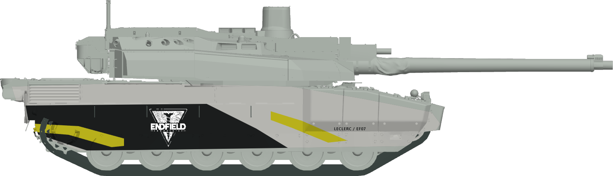

| 部件 | 可修改的起点 |
|---|---|
| 车体 | 在 H04 选择完整承载面安放透明主徽记；用相邻大色块保证对比。H01/H03 可试偏置宽黄面。H05/H06 降低信息量。 |
| 炮塔 | T01/T03 可浅色前肩配一个短路线/负形组合；T04/T05 可较深且低密度。不要每区都放一遍标志。 |
| 炮管 | G01 可浅色长段加黄面或小设备字；G02 用连接环形成间隔，G03/G04 保持结构清晰。 |
| 机枪与机枪座 | M01/M02 可较深统一，只在尺寸足够时放一个小色条或编号。 |
| 附件与附加装甲 | A01 顺真实分块响应邻区；A02/A03 可保持安静，不填网孔。 |
| 行走机构 | 先保留轮履结构，必要时只统一轮缘等少量区域。 |

### F02 · 浅色疏朗

**适合何时：** 偏好干净、低信息密度，或复杂车型不宜堆叠图形时。

**全车意图：** 扩大浅色与留白，只保留一个清晰的车体主识别区和少量黄色断点。

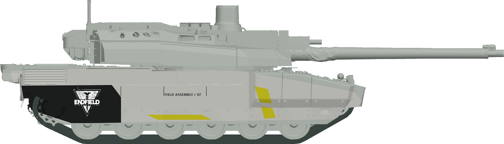

| 部件 | 可修改的起点 |
|---|---|
| 车体 | H04 用较小但完整的对比识别区，其余长面留白；H01/H03 只选一个局部黄面或编号，不必铺长路线。 |
| 炮塔 | T01/T02 以简洁色面为主；T03 选一个次级字标或不用；T04/T05 低对比或素色。 |
| 炮管 | G01 可用一条窄色条或一个短色段；普通文字少量即可。 |
| 机枪与机枪座 | M01–M03 可单色并省略装饰。 |
| 附件与附加装甲 | A01/A02 只在需要呼应时少量点缀，复杂结构优先保持清楚。 |
| 行走机构 | 保持机械层次，避免增加高对比轮盘图案抢主视觉。 |

### F03 · 深色集中

**适合何时：** 想要更重的工业体量、集中识别或较强明暗对比时。

**全车意图：** 扩大深色体量，用少数浅色板面打断；主识别集中，黄色只选关键位置。

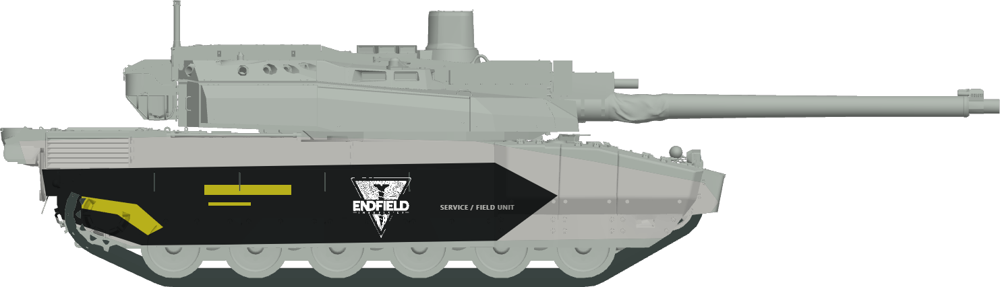

| 部件 | 可修改的起点 |
|---|---|
| 车体 | H04 可较大深色主体配完整浅色徽记；H01/H03 选择少量浅色面，不要求固定箭头。H05/H06 稀疏收束。 |
| 炮塔 | 可从浅色前颊、深色后顶起步，也可按全车重心反向调整；T03 选短模块，避免与车体同时堆主图。 |
| 炮管 | G01 可浅色护套配较深连接环，或深色主体加一个浅色信息段；以真实分段决定。 |
| 机枪与机枪座 | M01/M02 可统一较深色，需要时只保留一个小警告。 |
| 附件与附加装甲 | 附件跟随邻近明暗关系，通透结构与设备仍保持可读。 |
| 行走机构 | 保持轮履结构与低层级，可以少量配色但不做第二主视觉。 |

## 制作素材完整预览

下面展示的是包里实际携带的 PNG 对应预览，原文件未重画、裁切或改变像素。需要编辑几何或普通文本时用对应 SVG；品牌组合保持完整。素材分为已有母版、可选衍生模块和早期草案，状态不同。

### 透明身份素材

下列棋盘仅用于网页显示透明图，PNG 原文件与生产素材仍保持透明、原像素和完整边界；这些预览底色不会进入涂装。

主工业徽记是整个组合：三角、轮廓纹、ENDFIELD 与 INDUSTRIES 不拆、不裁，统一缩放。用车身实际色块建立对比，不给标志额外加一张不透明底板。

原作英文提取 PNG 的画布为 400×400，但有效墨迹仅约 122×122；适合小尺寸或结构核对。大尺寸用途先核对清晰度，或选择有来源说明的矢量。游戏标题、工业组织徽记、社区版本分别选择，不能混称同一母版。

| 预览 | 素材与用途 |
|---|---|
| 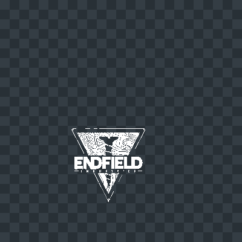 | **原作英文工业透明提取图**<br>原始完整透明 PNG；白色图形可点击文件查看。400×400 是画布，不是有效图案分辨率。 |
| 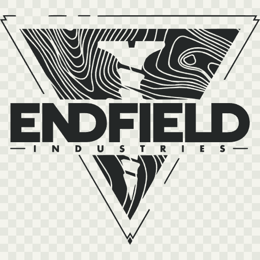 | **社区矢量的深色预览**<br>与原作提取图区分来源；有对应可缩放 SVG，核对组合后选择。 |
| 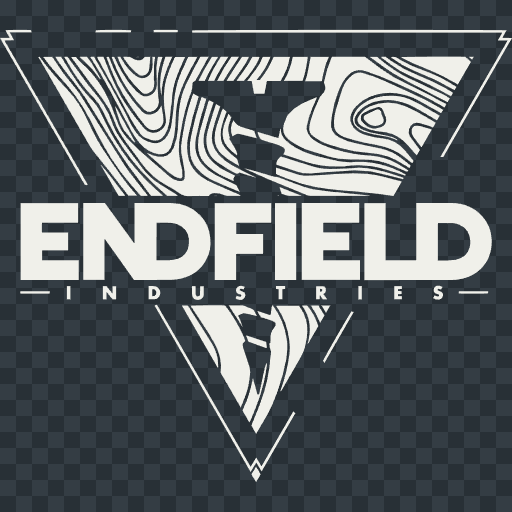 | **社区矢量的浅色预览**<br>完整单色组合，透明背景；不代表 A7V 作者提供的矢量原件。 |
| 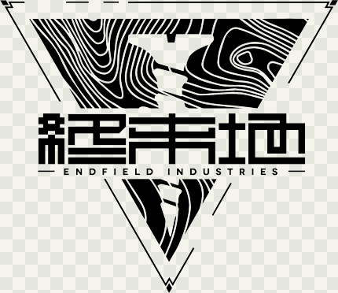 | **中文工业徽记**<br>保留已有来源与原件身份；不任意拼改成新的官方组合。 |
| 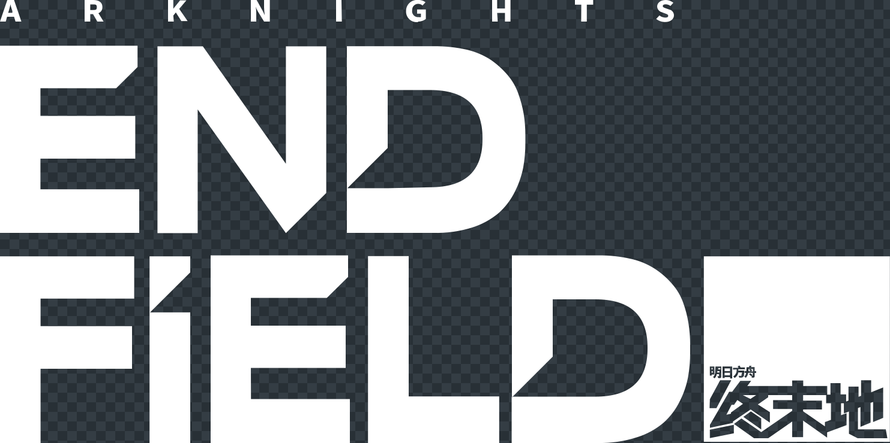 | **英文游戏标题**<br>有 PNG／SVG；这是游戏标题，不是工业组织徽记或可输入任意字的字体。 |

社区矢量来源为 [Yue-plus/endfield_icons](https://github.com/Yue-plus/endfield_icons)，预览保留其 [MIT 许可原文](../images/endfield-skill-0.1.0/community-vector-LICENSE.txt)。它与原作小图提取分别标明身份。

### D02–D08：七个原作关系衍生模块

每项均有 PNG 与可编辑 SVG。以下是可选语汇，需按本车的表面重新组织，不是每辆车必须放齐的清单。

| 预览 | 素材与用途 |
|---|---|
| 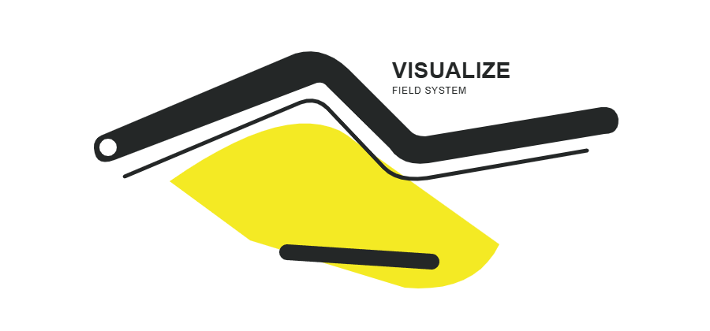 | **D02**<br>炮塔白肩的宽黄底、黑色圆头折线、透明/浅色负形与次级文字；不是全车通用双黄线。 |
| 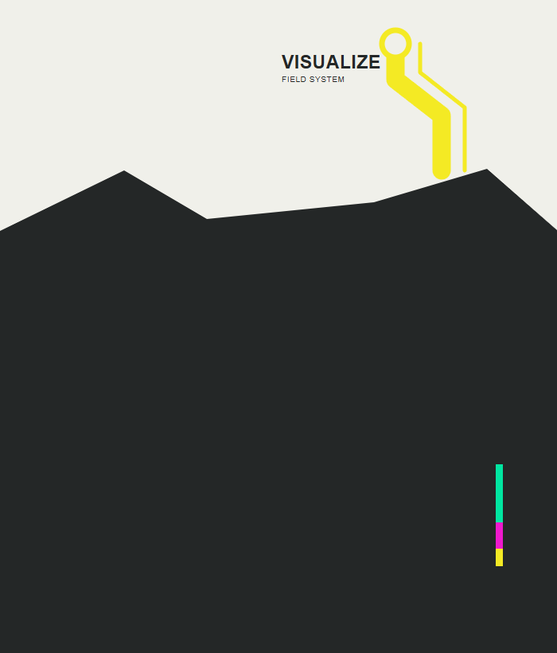 | **D03**<br>炮塔前肩浅色、后部安静深色；黄线止于前肩，不纵贯后盖和舱口。 |
| 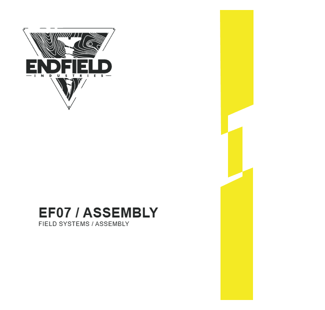 | **D04**<br>车首偏置黄带与另一侧小徽记、设备文字分工；中心为观瞄和炮口留空。 |
| 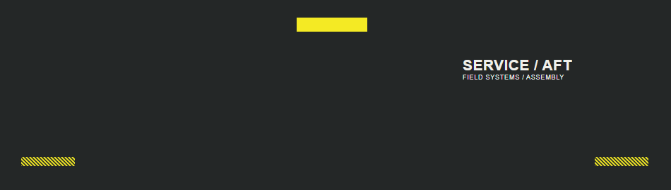 | **D05**<br>尾面留给机械结构；只给小铭牌和两端斜纹，不加大 U 形黄线或大徽记。 |
| 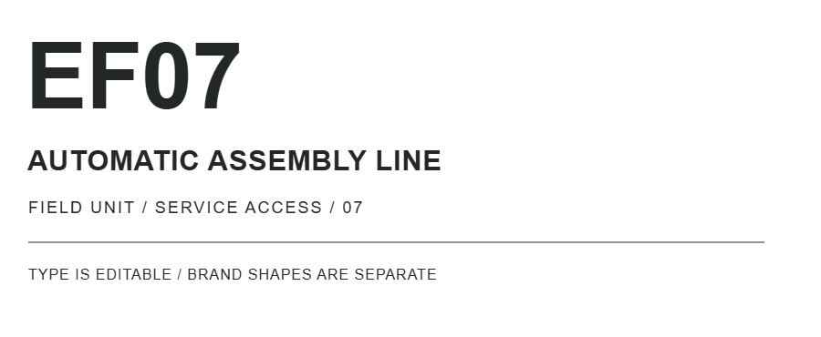 | **D06**<br>主编号、中级设备说明、小级辅助信息。普通文字可改，不能冒充原作品牌母版。 |
|  | **D07**<br>低对比等高线与稀疏符号；这是新画的底纹，原作裁图另存为参考，不能高反差铺满。 |
| 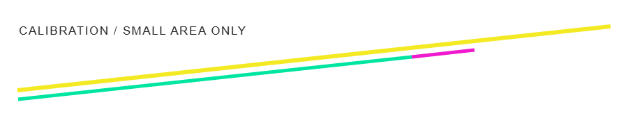 | **D08**<br>辅助彩条只作极小面积点睛，不能与主黄面抢层级。 |

### 第一批25个可编辑草案

这些草案继续保留，方便组合与对照；不把早期草案自动升为品牌母版或强制整车模板。特别是整块组合面板只演示元素关系，生产仍需在本车部件和 UV 上重新构图。

<details>
<summary>路径与端点 · 6项</summary>

| 预览 | 素材与用途 |
|---|---|
|  | **R01 long-route**<br>可编辑草案；按本车角色调整尺寸、间距、密度和组合。 |
|  | **R02 folded-double-route**<br>可编辑草案；按本车角色调整尺寸、间距、密度和组合。 |
|  | **R03 slot-terminal**<br>可编辑草案；按本车角色调整尺寸、间距、密度和组合。 |
| 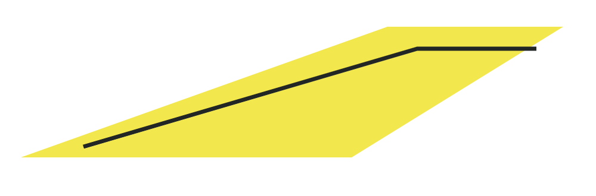 | **R04 direction-plane**<br>可编辑草案；按本车角色调整尺寸、间距、密度和组合。 |
|  | **R05 ring-node**<br>可编辑草案；按本车角色调整尺寸、间距、密度和组合。 |
|  | **R06 capsule-rhythm**<br>可编辑草案；按本车角色调整尺寸、间距、密度和组合。 |

</details>

<details>
<summary>符号、斜纹与刻度 · 6项</summary>

| 预览 | 素材与用途 |
|---|---|
|  | **S01 triangle-network**<br>可编辑草案；按本车角色调整尺寸、间距、密度和组合。 |
| 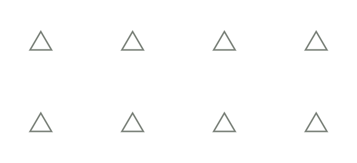 | **S02 hollow-triangles**<br>可编辑草案；按本车角色调整尺寸、间距、密度和组合。 |
| 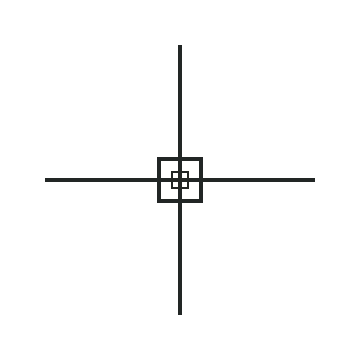 | **S03 crosshair**<br>可编辑草案；按本车角色调整尺寸、间距、密度和组合。 |
|  | **S04 hatch-block**<br>可编辑草案；按本车角色调整尺寸、间距、密度和组合。 |
|  | **S05 calibration-strip**<br>可编辑草案；按本车角色调整尺寸、间距、密度和组合。 |
| 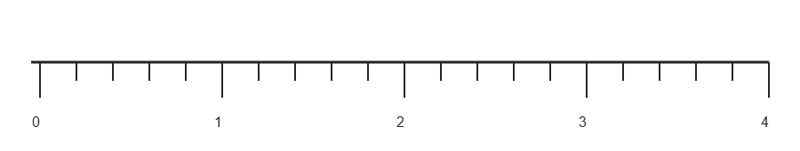 | **S06 tick-ruler**<br>可编辑草案；按本车角色调整尺寸、间距、密度和组合。 |

</details>

<details>
<summary>编号、铭牌与设备信息 · 5项</summary>

| 预览 | 素材与用途 |
|---|---|
| 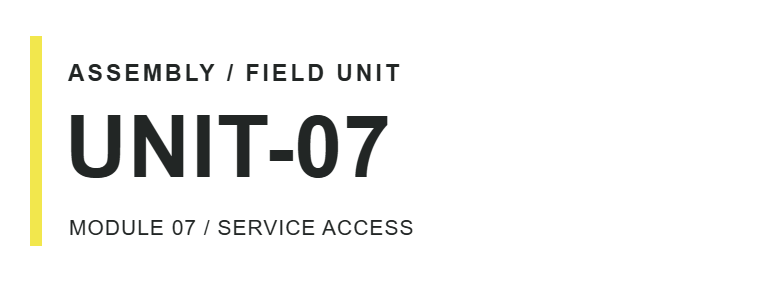 | **L01 equipment-id**<br>可编辑草案；按本车角色调整尺寸、间距、密度和组合。 |
|  | **L02 warning-stencil**<br>可编辑草案；按本车角色调整尺寸、间距、密度和组合。 |
| 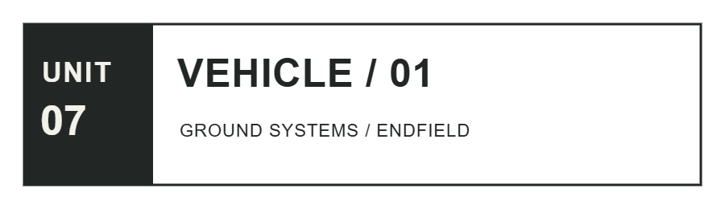 | **L03 vehicle-nameplate**<br>可编辑草案；按本车角色调整尺寸、间距、密度和组合。 |
| 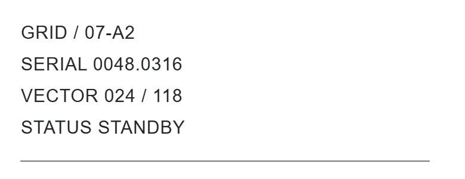 | **L04 technical-coordinates**<br>可编辑草案；按本车角色调整尺寸、间距、密度和组合。 |
|  | **L05 vertical-id**<br>可编辑草案；按本车角色调整尺寸、间距、密度和组合。 |

</details>

<details>
<summary>低对比纹样 · 3项</summary>

| 预览 | 素材与用途 |
|---|---|
|  | **P01 topographic-flow**<br>可编辑草案；按本车角色调整尺寸、间距、密度和组合。 |
| 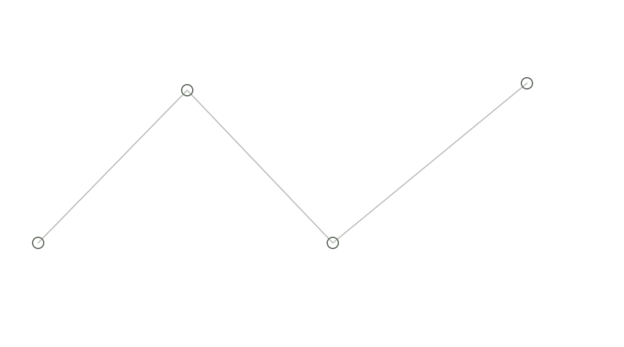 | **P02 quiet-node-field**<br>可编辑草案；按本车角色调整尺寸、间距、密度和组合。 |
| 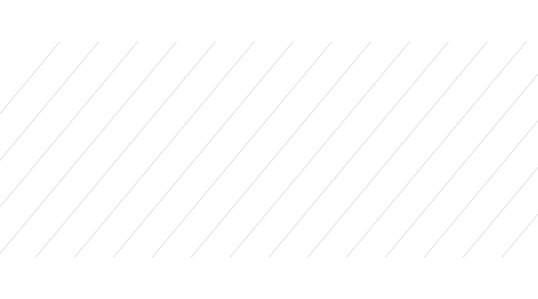 | **P03 diagonal-microgrid**<br>可编辑草案；按本车角色调整尺寸、间距、密度和组合。 |

</details>

<details>
<summary>早期身份草案 · 2项</summary>

| 预览 | 素材与用途 |
|---|---|
| 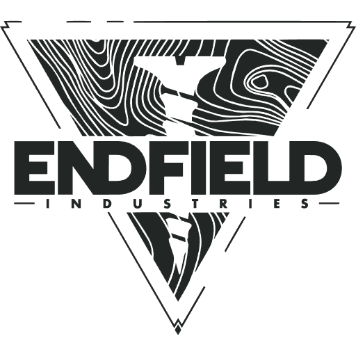 | **I01 industrial-ink**<br>可编辑草案；按本车角色调整尺寸、间距、密度和组合。 |
|  | **I02 industrial-light**<br>可编辑草案；按本车角色调整尺寸、间距、密度和组合。 |

</details>

<details>
<summary>组合关系草案 · 3项</summary>

| 预览 | 素材与用途 |
|---|---|
| 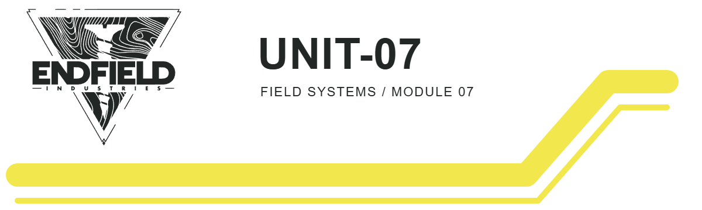 | **A01 long-panel**<br>可编辑草案；按本车角色调整尺寸、间距、密度和组合。 |
| 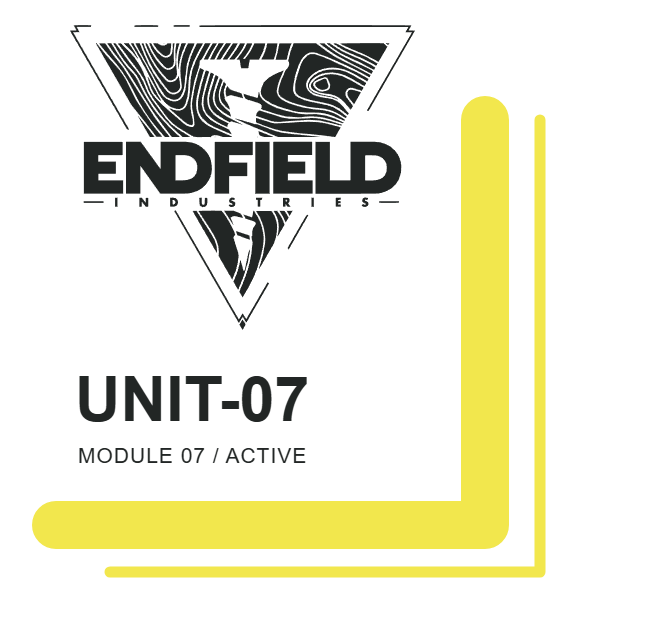 | **A02 compact-panel**<br>可编辑草案；按本车角色调整尺寸、间距、密度和组合。 |
| 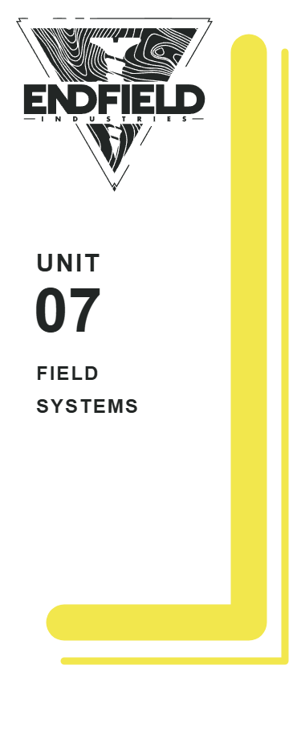 | **A03 vertical-panel**<br>可编辑草案；按本车角色调整尺寸、间距、密度和组合。 |

</details>

### 旧素材保留与原作参考

完整旧素材组 **40 文件、61,905,979 字节** 以原字节保存在完整源码和可选素材库；其中 32 个精选文件随运行包。其余大型原 UV、研究板和提取源按需查阅，正常执行不依赖旧 Skill 安装。

25 个原作局部用于观察字形、路径、板边和信息层级，带有原车材料、阴影与结构；它们是参考，不直接当另一辆车的透明贴花。

<details>
<summary>查看40项旧资源在当前包中的位置</summary>

| 资源 | 运行包／资料库 | 大小 |
|---|---|---|
| `decals/emblem-extraction.cmps` | 完整源码／可选资料库 | 37,673 B |
| `decals/endfield-industries-en-native.png` | 运行包＋完整资料库 | 2,847 B |
| `manifest.json` | 完整源码／可选资料库 | 24,592 B |
| `official/endfield-industries-cn.png` | 运行包＋完整资料库 | 64,868 B |
| `official/endfield-title-en.png` | 运行包＋完整资料库 | 33,074 B |
| `official/endfield-title-en.svg` | 运行包＋完整资料库 | 3,910 B |
| `official/site-color-bar.png` | 运行包＋完整资料库 | 381 B |
| [reference-a7v/crops/B01.png](../images/endfield-skill-0.1.0/assets/legacy/reference-a7v/crops/B01.png) | 运行包＋完整资料库 | 378,049 B |
| [reference-a7v/crops/B02.png](../images/endfield-skill-0.1.0/assets/legacy/reference-a7v/crops/B02.png) | 运行包＋完整资料库 | 693,245 B |
| [reference-a7v/crops/B03.png](../images/endfield-skill-0.1.0/assets/legacy/reference-a7v/crops/B03.png) | 运行包＋完整资料库 | 748,455 B |
| [reference-a7v/crops/B04.png](../images/endfield-skill-0.1.0/assets/legacy/reference-a7v/crops/B04.png) | 运行包＋完整资料库 | 167,357 B |
| [reference-a7v/crops/B05.png](../images/endfield-skill-0.1.0/assets/legacy/reference-a7v/crops/B05.png) | 运行包＋完整资料库 | 153,273 B |
| [reference-a7v/crops/B06.png](../images/endfield-skill-0.1.0/assets/legacy/reference-a7v/crops/B06.png) | 运行包＋完整资料库 | 210,593 B |
| [reference-a7v/crops/B07.png](../images/endfield-skill-0.1.0/assets/legacy/reference-a7v/crops/B07.png) | 运行包＋完整资料库 | 352,576 B |
| [reference-a7v/crops/B08.png](../images/endfield-skill-0.1.0/assets/legacy/reference-a7v/crops/B08.png) | 运行包＋完整资料库 | 416,591 B |
| [reference-a7v/crops/B09.png](../images/endfield-skill-0.1.0/assets/legacy/reference-a7v/crops/B09.png) | 运行包＋完整资料库 | 300,363 B |
| [reference-a7v/crops/B10.png](../images/endfield-skill-0.1.0/assets/legacy/reference-a7v/crops/B10.png) | 运行包＋完整资料库 | 675,620 B |
| [reference-a7v/crops/B11.png](../images/endfield-skill-0.1.0/assets/legacy/reference-a7v/crops/B11.png) | 运行包＋完整资料库 | 479,438 B |
| [reference-a7v/crops/B12.png](../images/endfield-skill-0.1.0/assets/legacy/reference-a7v/crops/B12.png) | 运行包＋完整资料库 | 169,088 B |
| [reference-a7v/crops/B13.png](../images/endfield-skill-0.1.0/assets/legacy/reference-a7v/crops/B13.png) | 运行包＋完整资料库 | 53,542 B |
| [reference-a7v/crops/G01.png](../images/endfield-skill-0.1.0/assets/legacy/reference-a7v/crops/G01.png) | 运行包＋完整资料库 | 612,045 B |
| [reference-a7v/crops/G02.png](../images/endfield-skill-0.1.0/assets/legacy/reference-a7v/crops/G02.png) | 运行包＋完整资料库 | 171,870 B |
| [reference-a7v/crops/M01.png](../images/endfield-skill-0.1.0/assets/legacy/reference-a7v/crops/M01.png) | 运行包＋完整资料库 | 237,725 B |
| [reference-a7v/crops/T01.png](../images/endfield-skill-0.1.0/assets/legacy/reference-a7v/crops/T01.png) | 运行包＋完整资料库 | 129,328 B |
| [reference-a7v/crops/T02.png](../images/endfield-skill-0.1.0/assets/legacy/reference-a7v/crops/T02.png) | 运行包＋完整资料库 | 280,703 B |
| [reference-a7v/crops/T03.png](../images/endfield-skill-0.1.0/assets/legacy/reference-a7v/crops/T03.png) | 运行包＋完整资料库 | 208,489 B |
| [reference-a7v/crops/T04.png](../images/endfield-skill-0.1.0/assets/legacy/reference-a7v/crops/T04.png) | 运行包＋完整资料库 | 240,109 B |
| [reference-a7v/crops/T05.png](../images/endfield-skill-0.1.0/assets/legacy/reference-a7v/crops/T05.png) | 运行包＋完整资料库 | 33,617 B |
| [reference-a7v/crops/T06.png](../images/endfield-skill-0.1.0/assets/legacy/reference-a7v/crops/T06.png) | 运行包＋完整资料库 | 61,412 B |
| [reference-a7v/crops/T07.png](../images/endfield-skill-0.1.0/assets/legacy/reference-a7v/crops/T07.png) | 运行包＋完整资料库 | 29,560 B |
| [reference-a7v/crops/T08.png](../images/endfield-skill-0.1.0/assets/legacy/reference-a7v/crops/T08.png) | 运行包＋完整资料库 | 177,952 B |
| [reference-a7v/crops/T09.png](../images/endfield-skill-0.1.0/assets/legacy/reference-a7v/crops/T09.png) | 运行包＋完整资料库 | 126,692 B |
| `reference-a7v/element-catalog.json` | 运行包＋完整资料库 | 25,003 B |
| `reference-a7v/front-panel-map.json` | 运行包＋完整资料库 | 1,237 B |
| `reference-a7v/uv/leopard_2a7v_body.png` | 完整源码／可选资料库 | 25,232,574 B |
| `reference-a7v/uv/leopard_2a7v_gun.png` | 完整源码／可选资料库 | 3,284,320 B |
| `reference-a7v/uv/leopard_2a7v_turret.png` | 完整源码／可选资料库 | 21,138,418 B |
| `reference-a7v/uv/mg_mount_leopard_2a7v.png` | 完整源码／可选资料库 | 255,654 B |
| `study/element-vocabulary.png` | 完整源码／可选资料库 | 1,967,893 B |
| `study/UV-study-overview.png` | 完整源码／可选资料库 | 2,725,843 B |

</details>

## 输入与输出

| 输入 | 当前行为 |
|---|---|
| 目标车型／子型号与附件状态 | 先查实际模型、资源、承载面；五个代表家族提供参考，生产 UV 另行定位 |
| 主题、编号、辅助字 | 可以改变普通信息；品牌标志保持核实过的完整组合 |
| 构图选择 | 默认独立构图；F01／F02／F03 只作可选起点 |
| `weathering` | `none` 或 `light`，默认 `none` |
| `surface_grain` | `none` 或 `subtle`，与做旧独立；没有确认的微颗粒保持 `none` |

实际制作应输出可编辑工程和图形／文字源、颜色与材质图、BLK、预览、来源与分项检查。关闭做旧必须同时去掉颜色和材质中的相应效果；微颗粒、焊缝、机械结构、AO 与磨损分别判断。

包内 `layout_brief.py` 可以生成可编辑任务书，组织全车意图、部件与检查接口；它不会自动生成完成的涂装。更换 EF10→EF11、指定区域的做旧开关等，需要对实际作品另做受控验证。

## 工具与PS流程

1. 通过 Composa MCP 读取实时 schema 和文档列表，保护已有文档；实际编辑与渲染留下证据。
2. 先看整体明暗与主次，再做原尺寸局部；车首倒角、侧裙、炮塔顶字、尾部、轮缘、炮管和机枪座都要回到模型核对。
3. 结构基底、色块、图形、文字、颗粒、可选做旧和诊断层分开；共享 UV、孔壁和活动接口单独检查。
4. 按实际材质声明 Alpha 与颜色空间。固定色全零 Alpha 下仍有有效 RGB，透明覆盖、N 和 AO 分别处理。
5. DDS 完整 mip 到 1×1，最终 DDS 重新读回 PS 检查；CMPS 先保存，再用验证副本重开。
6. 临时目录、裁区、检查点和清理随任务管理；不清空全局 TEMP、其他任务文档或活跃 recovery。

A7V 作者包的 C4／N4／AO3 是该参考资源范围，不是任意坦克固定数量，也不等同于原厂材料。其他车型保留自己的真实机械基底与通道语义。

<details>
<summary>查看包内10个工具文件及职责</summary>

| 文件 | 作用 |
|---|---|
| `layout_brief.py` | 创建／检查可编辑全车与部件任务书 |
| `composa_mcp.py` | 实时 MCP schema、调用与结果记录；不自动重放不确定编辑 |
| `export_uv_reference.py` | 原尺寸 RGB 查看副本，保留原输入 |
| `inspect_skin.py` | BLK、文件、尺寸、通道与语义检查 |
| `ground_dds.py` | 按固定 texconv 身份生成、读回和核验 mip |
| `dds_variant.py` | DDS 格式、编码器身份与逐 mip 读回支持 |
| `tank_preview.py` | 实际模型的离线预览与材质绑定检查 |
| `tank_core.py` | 图像／模型基础读写 |
| `texture_semantics.py` | 固定色、透明覆盖和数据图的独立滤波 |
| `artifact_io.py` | 新输出的安全写入与失败处理 |

</details>

## 验证范围

| 项目 | 当前范围 |
|---|---|
| 完整封装 | 201 个文件与装配源逐字节一致；包内链接与 SVG 依赖检查通过 |
| 工具回归 | 35 项通过，含真实 texconv、逐 mip 读回和实际 OpenGL 预览 |
| 原作研究 | A7V 原作者视觉分析与真实 MCP 原尺寸观察已保留 |
| 五家族 | 真实模型四视、来源身份与方向研究；不等于五车生产 UV 均已适配 |
| 新整车默认样例 | 未运行；不拿旧临摹修复充当新设计成功样例 |
| 游戏／独立冷启动 | 未运行；技术检查不提升为美术或游戏认可 |
| 正式安装／发布 | 未执行；当前为待审候选 |

本页的展示图帮助人理解，执行 Skill 同时通过文字、JSON、图例与少量有明确读取任务的图片表达这些知识。预设是建议，图片不代替实际载具的 UV 和材质检查。

## 完整包内目录

```text
wt-style-endfield/
  SKILL.md                 主入口与阶段选择
  references/              A7V解析、车型方向、部件、材料、检查规则
    layout/                部件／子区与可选兜底的JSON
    vehicles/              五个家族的方向说明
    visuals/               分区图例、三组预设PNG／SVG及读取说明
  assets/                  透明母版、可编辑组件、原作局部等
  profiles/ground/         实际车型四视与源资源身份
  scripts/                 独立工具
  agents/openai.yaml       Skill界面配置
  toolkit-lock.json        工具身份与依赖
```

<details>
<summary>查看实际201个文件清单</summary>

| 包内路径 | 大小 |
|---|---|
| `SKILL.md` | 6,259 B |
| `agents/openai.yaml` | 339 B |
| `assets/current-identity.json` | 607 B |
| `assets/identity/ENDFIELD-industries-complete-dark.png` | 33,511 B |
| `assets/identity/ENDFIELD-industries-complete-dark.svg` | 23,243 B |
| `assets/identity/ENDFIELD-industries-complete-light.png` | 32,256 B |
| `assets/identity/ENDFIELD-industries-complete-light.svg` | 23,244 B |
| `assets/identity/community/LICENSE` | 1,065 B |
| `assets/identity/community/endfield-icon-en.svg` | 4,980 B |
| `assets/identity/community/endfield-industries.svg` | 23,091 B |
| `assets/identity/community/endfield-logo-en.svg` | 5,405 B |
| `assets/identity/community/sources.json` | 1,215 B |
| `assets/identity/endfield-industries-en-original-transparent.png` | 2,847 B |
| `assets/inherited-draft-v1/assemblies/A01-long-panel.png` | 40,062 B |
| `assets/inherited-draft-v1/assemblies/A01-long-panel.svg` | 23,846 B |
| `assets/inherited-draft-v1/assemblies/A02-compact-panel.png` | 35,064 B |
| `assets/inherited-draft-v1/assemblies/A02-compact-panel.svg` | 23,805 B |
| `assets/inherited-draft-v1/assemblies/A03-vertical-panel.png` | 26,660 B |
| `assets/inherited-draft-v1/assemblies/A03-vertical-panel.svg` | 24,052 B |
| `assets/inherited-draft-v1/identity/I01-industrial-ink.png` | 33,612 B |
| `assets/inherited-draft-v1/identity/I01-industrial-ink.svg` | 23,204 B |
| `assets/inherited-draft-v1/identity/I02-industrial-light.png` | 31,446 B |
| `assets/inherited-draft-v1/identity/I02-industrial-light.svg` | 23,206 B |
| `assets/inherited-draft-v1/labels/L01-equipment-id.png` | 15,391 B |
| `assets/inherited-draft-v1/labels/L01-equipment-id.svg` | 931 B |
| `assets/inherited-draft-v1/labels/L02-warning-stencil.png` | 15,112 B |
| `assets/inherited-draft-v1/labels/L02-warning-stencil.svg` | 975 B |
| `assets/inherited-draft-v1/labels/L03-vehicle-nameplate.png` | 13,537 B |
| `assets/inherited-draft-v1/labels/L03-vehicle-nameplate.svg` | 1,156 B |
| `assets/inherited-draft-v1/labels/L04-technical-coordinates.png` | 22,326 B |
| `assets/inherited-draft-v1/labels/L04-technical-coordinates.svg` | 1,104 B |
| `assets/inherited-draft-v1/labels/L05-vertical-id.png` | 13,753 B |
| `assets/inherited-draft-v1/labels/L05-vertical-id.svg` | 823 B |
| `assets/inherited-draft-v1/patterns/P01-topographic-flow.png` | 69,526 B |
| `assets/inherited-draft-v1/patterns/P01-topographic-flow.svg` | 1,569 B |
| `assets/inherited-draft-v1/patterns/P02-quiet-node-field.png` | 19,790 B |
| `assets/inherited-draft-v1/patterns/P02-quiet-node-field.svg` | 867 B |
| `assets/inherited-draft-v1/patterns/P03-diagonal-microgrid.png` | 11,314 B |
| `assets/inherited-draft-v1/patterns/P03-diagonal-microgrid.svg` | 2,751 B |
| `assets/inherited-draft-v1/routes/R01-long-route.png` | 7,638 B |
| `assets/inherited-draft-v1/routes/R01-long-route.svg` | 793 B |
| `assets/inherited-draft-v1/routes/R02-folded-double-route.png` | 10,357 B |
| `assets/inherited-draft-v1/routes/R02-folded-double-route.svg` | 669 B |
| `assets/inherited-draft-v1/routes/R03-slot-terminal.png` | 6,005 B |
| `assets/inherited-draft-v1/routes/R03-slot-terminal.svg` | 908 B |
| `assets/inherited-draft-v1/routes/R04-direction-plane.png` | 13,879 B |
| `assets/inherited-draft-v1/routes/R04-direction-plane.svg` | 593 B |
| `assets/inherited-draft-v1/routes/R05-ring-node.png` | 7,522 B |
| `assets/inherited-draft-v1/routes/R05-ring-node.svg` | 682 B |
| `assets/inherited-draft-v1/routes/R06-capsule-rhythm.png` | 4,132 B |
| `assets/inherited-draft-v1/routes/R06-capsule-rhythm.svg` | 782 B |
| `assets/inherited-draft-v1/symbols/S01-triangle-network.png` | 14,048 B |
| `assets/inherited-draft-v1/symbols/S01-triangle-network.svg` | 735 B |
| `assets/inherited-draft-v1/symbols/S02-hollow-triangles.png` | 4,083 B |
| `assets/inherited-draft-v1/symbols/S02-hollow-triangles.svg` | 1,013 B |
| `assets/inherited-draft-v1/symbols/S03-crosshair.png` | 1,494 B |
| `assets/inherited-draft-v1/symbols/S03-crosshair.svg` | 691 B |
| `assets/inherited-draft-v1/symbols/S04-hatch-block.png` | 5,716 B |
| `assets/inherited-draft-v1/symbols/S04-hatch-block.svg` | 983 B |
| `assets/inherited-draft-v1/symbols/S05-calibration-strip.png` | 3,973 B |
| `assets/inherited-draft-v1/symbols/S05-calibration-strip.svg` | 841 B |
| `assets/inherited-draft-v1/symbols/S06-tick-ruler.png` | 2,067 B |
| `assets/inherited-draft-v1/symbols/S06-tick-ruler.svg` | 3,846 B |
| `assets/legacy/decals/endfield-industries-en-native.png` | 2,847 B |
| `assets/legacy/official/endfield-industries-cn.png` | 64,868 B |
| `assets/legacy/official/endfield-title-en.png` | 33,074 B |
| `assets/legacy/official/endfield-title-en.svg` | 3,910 B |
| `assets/legacy/official/site-color-bar.png` | 381 B |
| `assets/legacy/reference-a7v/crops/B01.png` | 378,049 B |
| `assets/legacy/reference-a7v/crops/B02.png` | 693,245 B |
| `assets/legacy/reference-a7v/crops/B03.png` | 748,455 B |
| `assets/legacy/reference-a7v/crops/B04.png` | 167,357 B |
| `assets/legacy/reference-a7v/crops/B05.png` | 153,273 B |
| `assets/legacy/reference-a7v/crops/B06.png` | 210,593 B |
| `assets/legacy/reference-a7v/crops/B07.png` | 352,576 B |
| `assets/legacy/reference-a7v/crops/B08.png` | 416,591 B |
| `assets/legacy/reference-a7v/crops/B09.png` | 300,363 B |
| `assets/legacy/reference-a7v/crops/B10.png` | 675,620 B |
| `assets/legacy/reference-a7v/crops/B11.png` | 479,438 B |
| `assets/legacy/reference-a7v/crops/B12.png` | 169,088 B |
| `assets/legacy/reference-a7v/crops/B13.png` | 53,542 B |
| `assets/legacy/reference-a7v/crops/G01.png` | 612,045 B |
| `assets/legacy/reference-a7v/crops/G02.png` | 171,870 B |
| `assets/legacy/reference-a7v/crops/M01.png` | 237,725 B |
| `assets/legacy/reference-a7v/crops/T01.png` | 129,328 B |
| `assets/legacy/reference-a7v/crops/T02.png` | 280,703 B |
| `assets/legacy/reference-a7v/crops/T03.png` | 208,489 B |
| `assets/legacy/reference-a7v/crops/T04.png` | 240,109 B |
| `assets/legacy/reference-a7v/crops/T05.png` | 33,617 B |
| `assets/legacy/reference-a7v/crops/T06.png` | 61,412 B |
| `assets/legacy/reference-a7v/crops/T07.png` | 29,560 B |
| `assets/legacy/reference-a7v/crops/T08.png` | 177,952 B |
| `assets/legacy/reference-a7v/crops/T09.png` | 126,692 B |
| `assets/legacy/reference-a7v/element-catalog.json` | 25,003 B |
| `assets/legacy/reference-a7v/front-panel-map.json` | 1,237 B |
| `assets/reference-derived/D02-shoulder-brace.png` | 24,376 B |
| `assets/reference-derived/D02-shoulder-brace.svg` | 1,532 B |
| `assets/reference-derived/D03-crew-roof-fields.png` | 11,673 B |
| `assets/reference-derived/D03-crew-roof-fields.svg` | 1,680 B |
| `assets/reference-derived/D04-offset-deck-route.png` | 22,078 B |
| `assets/reference-derived/D04-offset-deck-route.svg` | 23,746 B |
| `assets/reference-derived/D05-quiet-aft-markers.png` | 4,954 B |
| `assets/reference-derived/D05-quiet-aft-markers.svg` | 6,168 B |
| `assets/reference-derived/D06-equipment-type-hierarchy.png` | 19,368 B |
| `assets/reference-derived/D06-equipment-type-hierarchy.svg` | 1,252 B |
| `assets/reference-derived/D07-quiet-contour-network.png` | 69,784 B |
| `assets/reference-derived/D07-quiet-contour-network.svg` | 4,321 B |
| `assets/reference-derived/D08-sparse-colour-accent.png` | 12,791 B |
| `assets/reference-derived/D08-sparse-colour-accent.svg` | 1,031 B |
| `assets/reference/a7v/author-01.jpeg` | 209,313 B |
| `assets/reference/a7v/author-02.jpeg` | 309,501 B |
| `assets/reference/a7v/front.png` | 334,996 B |
| `assets/reference/a7v/iso.png` | 672,391 B |
| `assets/reference/a7v/iso_right.png` | 682,591 B |
| `assets/reference/a7v/left.png` | 464,397 B |
| `assets/reference/a7v/rear.png` | 350,939 B |
| `assets/reference/a7v/right.png` | 453,627 B |
| `assets/reference/a7v/top.png` | 294,821 B |
| `profiles/ground/a7v-author-resource/profile.json` | 4,658 B |
| `profiles/ground/a7v-author-resource/texture-manifest.json` | 1,559 B |
| `profiles/ground/leclerc/materials.json` | 7,776 B |
| `profiles/ground/leclerc/profile.json` | 23,559 B |
| `profiles/ground/leclerc/views/front.png` | 56,898 B |
| `profiles/ground/leclerc/views/rear.png` | 72,299 B |
| `profiles/ground/leclerc/views/side.png` | 97,530 B |
| `profiles/ground/leclerc/views/top.png` | 129,168 B |
| `profiles/ground/leopard-2/materials.json` | 9,763 B |
| `profiles/ground/leopard-2/profile.json` | 30,145 B |
| `profiles/ground/leopard-2/views/front.png` | 92,318 B |
| `profiles/ground/leopard-2/views/rear.png` | 84,790 B |
| `profiles/ground/leopard-2/views/side.png` | 167,865 B |
| `profiles/ground/leopard-2/views/top.png` | 217,925 B |
| `profiles/ground/t-80/materials.json` | 11,655 B |
| `profiles/ground/t-80/profile.json` | 36,529 B |
| `profiles/ground/t-80/views/front.png` | 120,248 B |
| `profiles/ground/t-80/views/rear.png` | 108,168 B |
| `profiles/ground/t-80/views/side.png` | 181,187 B |
| `profiles/ground/t-80/views/top.png` | 318,278 B |
| `profiles/ground/t-90/materials.json` | 11,194 B |
| `profiles/ground/t-90/profile.json` | 49,321 B |
| `profiles/ground/t-90/views/front.png` | 125,945 B |
| `profiles/ground/t-90/views/rear.png` | 133,663 B |
| `profiles/ground/t-90/views/side.png` | 193,090 B |
| `profiles/ground/t-90/views/top.png` | 280,193 B |
| `profiles/ground/type-99/materials.json` | 9,768 B |
| `profiles/ground/type-99/profile.json` | 37,612 B |
| `profiles/ground/type-99/views/front.png` | 93,332 B |
| `profiles/ground/type-99/views/rear.png` | 51,646 B |
| `profiles/ground/type-99/views/side.png` | 132,183 B |
| `profiles/ground/type-99/views/top.png` | 151,364 B |
| `references/a7v-analysis.md` | 13,286 B |
| `references/a7v-observations.json` | 23,349 B |
| `references/a7v-ps-study.json` | 5,692 B |
| `references/a7v-resource-contract.md` | 892 B |
| `references/assets-and-editing.md` | 3,219 B |
| `references/assets-index.json` | 62,524 B |
| `references/coverage.json` | 3,178 B |
| `references/editable-drafts-index.json` | 9,186 B |
| `references/editor-evidence.json` | 3,068 B |
| `references/inheritance-and-lessons.md` | 2,116 B |
| `references/layout/direction-index.json` | 5,474 B |
| `references/layout/fallbacks.json` | 4,094 B |
| `references/layout/part-brief-contract.json` | 1,576 B |
| `references/layout/reference-first-contract.json` | 1,995 B |
| `references/layout/zone-tree.json` | 14,796 B |
| `references/legacy-assets.json` | 9,445 B |
| `references/optional-components.json` | 3,261 B |
| `references/optional-fallbacks.md` | 1,505 B |
| `references/parts-and-briefs.md` | 2,559 B |
| `references/provenance.json` | 2,980 B |
| `references/ps-production.md` | 3,541 B |
| `references/r11-summary-source.txt` | 6,768 B |
| `references/texture-contract.md` | 2,230 B |
| `references/tool-usage.md` | 4,135 B |
| `references/validation-and-delivery.md` | 2,135 B |
| `references/vehicle-directions.md` | 1,459 B |
| `references/vehicles/index.json` | 6,857 B |
| `references/vehicles/leclerc.md` | 1,911 B |
| `references/vehicles/leopard-2.md` | 1,900 B |
| `references/vehicles/t-80.md` | 1,795 B |
| `references/vehicles/t-90.md` | 1,773 B |
| `references/vehicles/type-99.md` | 1,825 B |
| `references/visuals/F01-hull-example.png` | 105,494 B |
| `references/visuals/F01-hull-example.svg` | 256,570 B |
| `references/visuals/F02-hull-example.png` | 103,908 B |
| `references/visuals/F02-hull-example.svg` | 256,600 B |
| `references/visuals/F03-hull-example.png` | 103,241 B |
| `references/visuals/F03-hull-example.svg` | 256,619 B |
| `references/visuals/index.json` | 2,625 B |
| `references/visuals/index.md` | 1,184 B |
| `scripts/artifact_io.py` | 16,341 B |
| `scripts/composa_mcp.py` | 31,634 B |
| `scripts/dds_variant.py` | 7,100 B |
| `scripts/export_uv_reference.py` | 3,133 B |
| `scripts/ground_dds.py` | 23,069 B |
| `scripts/inspect_skin.py` | 8,635 B |
| `scripts/layout_brief.py` | 13,898 B |
| `scripts/tank_core.py` | 7,105 B |
| `scripts/tank_preview.py` | 15,280 B |
| `scripts/texture_semantics.py` | 8,275 B |
| `toolkit-lock.json` | 2,472 B |

</details>

当前候选尚无正式 Release 下载。实际执行包和完整维护源码在本地审查；本页展示与其同一份冻结内容，不把展示资料、旧兼容版本或历史审查包冒充当前运行包。

[布局图解与演示](endfield-layout-guide.md) · [历史兼容版本](../history/README.md) · [文档导航](../README.md) · [仓库首页](../../README.md)
