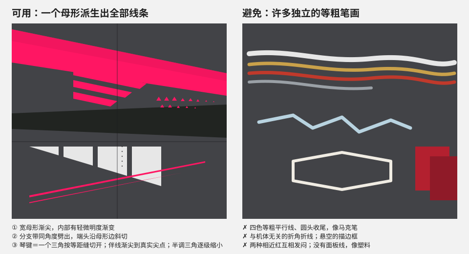
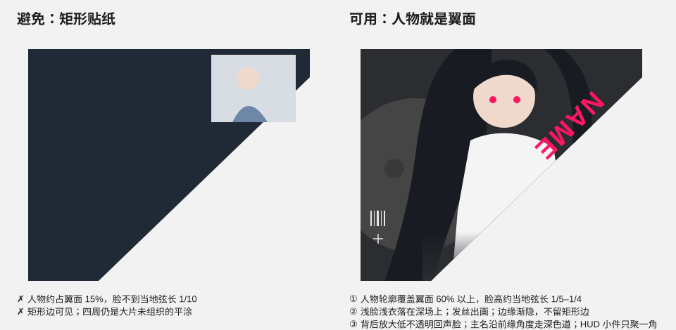
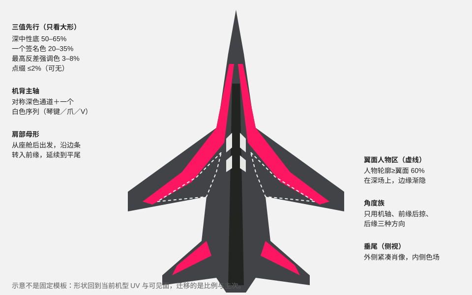

# 审美基线：好看的二次元喷气机痛涂长什么样

这份文件给出通用的审美底线和起点数值；模型容易犯的字体、配色、布局偏向和改法另见 [审美纠偏](taste-corrections.md)。用户 brief、指定参考和明确反馈优先；没有指定时按本文件做，偏离时在设计记录里写明理由。数值是起点和自检范围，不是验收分数。

**风格分支**：用户点名某种风格或作者时，装有该风格的独立 skill 就改用它（风格 skill 自带完整流程，不和本 skill 联用）。没有的话，先按本文件的展开图对照方法研究参考，再决定是否单独建立风格 skill。

## 一眼看懂的结构

好作品在整机显示尺寸下有三层，缺一层就会显得空、乱或廉价：

1. **大形（远看）**：深色中性底上，一个签名色组成少数几块大母形，人物占据主翼等最大连续面。眯眼或模糊后仍能读出机头→翼根→机背→尾部的方向。
2. **中形（中距离）**：从母形派生的分支带、机背白色序列、主名字和人物轮廓。
3. **细节（近看）**：伴线、三角马赛克或半调纹理、面板线与铆钉、HUD 小件和小字。细节只能加在已有大形里，不能替代大形。

先做第 1 层，通过眯眼检查后才进入第 2、3 层。

## 在编辑器里逐岛看展开图

整机预览只能看出"好不好看"，原因要在展开图上找。每次开工和每轮修订都要做一遍：

1. 在 Composa 里打开参考作者的颜色贴图和我们当前的贴图（`.cmps` 先复制到任务目录再开），用 `render` 加 `grid`（4K 用 256，8K 用 512）看全图，确认机背、侧身、主翼、尾面各岛的位置。
2. 对同一类岛用 `render` 的 `x/y/width/height` 看原尺寸局部；两张图分辨率不同时，用归一化坐标对齐同一区域。
3. 用 `scripts/atlas_palette.py` 对同一归一化区域出色族面积表；作者贴图的填充色用 `--ignore-color` 去掉。
4. 用 `describe_document` 看我们的图层结构。所有色场和线条压在一张栅格层里，就没法分别修母形、分支和伴线，先按下文的层级拆开。
5. 逐岛写下：安静底占比、签名色占比、浅色占比、元素数量、端头形态、有没有纹理和面板线。先修和参考差得最多的一项。

已实测的机背上表面岛（双发侧卫类，作者作品和用户选中的线条稿）：

| 指标 | 目标区间 | 常见失败值 |
| --- | --- | --- |
| 安静底（接近底色、只带弱纹理） | 55–70% | 20%：每处都填满；80%+ 且只有 3 种颜色：没做完 |
| 鲜艳签名色 | 12–25% | 35%+ 且分裂成多个明度：发闷；0–5%：没有主色 |
| 浅色（白、奶白） | 2–6%；白色主图形本身很大时（如嵌套 V）可到 15–20%，此时不再有其他大白面 | 20–25% 且是铺开的底色：白色变成底色，抢人物 |
| 每侧主要元素 | 约 10–14 个 | 25 个以上：碎 |

这张作者机背岛上每侧只有：2 条粉色母形（两端渐尖，签名色面内有三角马赛克）、3 条同角度劈出的分支带、2 组白琴键（每组 4–5 片，切自同一个三角）、母形末端各 1 团半调、2 组文字（标志加字、两行字加细线），其余都是带面板线和铆钉的炭灰。主翼岛则几乎全部交给人物，签名色只在人物之间做细边和三角。

## 配色：一个签名色

| 角色 | 默认面积（俯视可见涂面） | 取色来源 |
| --- | --- | --- |
| 深中性底 | 50–65% | 炭灰、深蓝灰等低饱和暗色；可向签名色的补色或角色深色衣物偏一点 |
| 签名色 | 20–35% | 角色最有辨识度的高饱和色：发色、瞳色、标志服饰或武器光效 |
| 最高反差强调色 | 3–8% | 近白或角色浅色部分，只给序列、刀锋形、主字和细线 |
| 点缀色 | ≤2%，可无 | 第二个小面积识别色，如角、瞳或徽记色 |

- 高饱和色相只用一个主族。两种相近的红、或红加金、红加青等多条等量彩线，会互相抵消、发闷。
- 签名色的大面要有内部变化：沿气流方向 10–20% 的明度渐变，或低对比纹理（见下文）。完全平涂的大面看起来像塑料玩具。
- 深底用来托人物：浅脸、浅衣和白色强调落在深场上。浅色人物放在浅色底上会丢失轮廓。
- 用 `scripts/style_board.py` 看灰度行：全机应能分出深、中、亮三档；只剩一档（全深或全灰）就是没有结构。

## 线条：一个母形派生出全部线条

- **线条是填充形，不是笔画。** 宽带画成两条边的多边形，按位置变宽、收窄或渐尖。不要用等粗描边。端头只有三种：渐尖到真实尖点；沿已有边或角度族斜切；接入另一条带。方向线不用圆头收尾，也不在空白里平切；圆头只用于成组、等长、刻意排列的胶囊条。
- **派生而不是堆叠。** 先画母形，分支带从母形边缘按同一角度劈出，间距相等，长度递减。琴键或爪形序列是把一个三角或楔形按等距平行缝切开，各片的外边共线。伴线贴着母形边，按 1/4–1/6 的宽度渐尖。
- **角度族取自机体。** 一个视图里只用机轴方向、前缘后掠方向和后缘方向（至多再加一个斜向）。和机体无关的折角、抖动的折线和自由曲线会让整机显乱。长弧只用于顺着机身曲面的大边界。
- **对称与主次。** 机背和左右翼的线组默认镜像对称，人物可以不对称。每侧只有一个最显眼的母形，分支带不超过 3–4 条，一组伴线不超过 3 条。同一视图内不要出现第二套同样醒目的线组。
- **默认尺寸（米，按机体实长）。** 母形宽 0.4–1.0；分支带 0.08–0.15；伴线 0.02–0.04，并渐尖；白色琴键单片 0.2–0.4，缝宽约为片宽的 1/4。小型机按翼展同比缩小。
- **白色只做有体量的形。** 白色图形最宽处不小于 0.15 m（楔形、刀片、嵌套 V、琴键），集中在主白色图形周围，共用尖点和角度。比这更细的长线一律用签名色，贴着色块边走。贯穿机身的白细针、平行白条、前缘白细边看起来像划痕，用户明确否定过（“莫名其妙的白线”）。主白色图形的同角度细描边回声是唯一例外。
- **不用独立描边框。** 单独出现的闭合描边多边形（六边形框、徽记外框）会读成贴纸。要强调区域，就用实心楔形、负形缝或色场边界。描边形只作为旁边实心图形的回声：形状和角度相同、逐个缩小、线宽约为实心形宽度的 1/10。

## 质感：纹路由少量规则产生

用户明确会把"没有纹路质感"判为不完整。默认至少用以下两项：

- **签名色面内的三角马赛克**：单元 0.10–0.5 m（机背小、主翼大，约为该岛短边的 1/12–1/25），明度抖动 ±5–12%。远看是实色，近看有材质。
- **半调渐隐**：在 1–2 处色场边界，用逐渐缩小的三角或圆点把签名色溶进深底。不要每条边都做。
- **亮漆**：漆面的高级感来自一层光滑、均匀的亮漆在游戏光照下的反光。不保留原机全强度法线，也不在颜色里叠从法线提取的模糊结构层，否则任何光照下都是一层深色纹路（用户：“自带原皮的纹路，黑不溜秋”）。材质用 `scripts/coat_material.py` 做整机一层涂层，见 [整机一层涂层](materials-and-uv.md#完整重涂默认整机一层涂层)。
- **面板发丝线**：完整重涂默认不画。参考作者的 F-2A 没有，漆面照样成立；Su-30、幻影、阵风画的是笔直、连续、在拐角接上的线。描得不干净的线在游戏里像划痕和脏迹（莱万汀 v3），见 [面板发丝线](materials-and-uv.md#面板发丝线)。
- **色面渐变**：大母形沿流向做轻微明度变化。

这些纹理都要按机体米制尺度做，同一种纹理在不同部件上的单元大小要一致。`scripts/vector_paint.py` 的 `tri-mosaic`、`tri-halftone`、`dot-halftone` 直接按米制求值。

## 人物：人物就是翼面

- **尺度**：主翼人物的轮廓覆盖该翼面 60% 以上，脸高（发际到下巴）约为人物所在处弦长的 1/5–1/4。缩进角落的小矩形是最常见的失败。
- **边缘**：不留矩形边。用人物轮廓干净抠图，边缘锐利，背后直接是深底；不保留原图背景、光效碎片和远景，不做大片渐隐。身体被面板边截断处直接截断，发丝和衣角可以出画到翼尖或后缘。保留背景再渐隐会在深底上留下一片灰雾（莱万汀 v3）。
- **回声**：可以在人物背后放一张放大 1.5–2.5 倍、不透明度 15–30% 的同角色脸部或半身，增加纵深并填满翼面，不和主像抢脸。
- **朝向**：脸和视线朝向机身或机头，人物长轴顺着翼的后掠方向，不要横躺在气流垂直方向上。
- **素材不重复**：主翼、垂尾、平尾、回声层等每个人物位置各用一张不同的原图。镜像、同图换裁切、把另一侧的主图拿来做回声，都算重复。本地素材不够时上网找官方立绘、卡面、活动插画或宣传图，列出文件名、来源和大小，经用户同意再下载，并记录来源。
- **深场衬托**：人物所在的翼面用深中性底或深签名色，签名色母形从翼根绕到前缘，把人物框在里面，但不画框线。
- **脸不被穿过**：线、字和色带可以压过人物的衣服和背景，但不能穿过脸；两张人物之间的分界做成一条与前缘平行的直线，线上放名字或一条签名色细带。
- **垂尾立绘当画面做**：立绘铺满整片垂尾，垂尾外框就是画框。前缘一条签名色窄带，顶端一块深色帽，根部一条深色带，人物身体被根部带截断；机型名放根部带，角色名缩写放顶帽。不保留原图背景。

## 文字：主名字是结构

- 主名字每侧一次，放在最大的连续深色道上，沿机轴或前缘角度排列；字高为该深色道宽度的 25–40%。用粗体几何或窄体无衬线，颜色取强调色或签名色。字体、字距、字号层级、锁组和左右读向见 [审美纠偏](taste-corrections.md#字体)。
- 次级字（机型、作品名、组织名）1–2 组，字高为主名的 1/4–1/3，和母形边对齐。
- HUD 小件（条码、十字、刻度、小方块、技术小字）聚成 1–2 个簇，放在面的角落或边缘；不要均匀撒满全机。
- 描边字、空心大字可以放在人物背后作为第二层，透明度 30–50%。

## 各面默认分工

| 面 | 默认内容 |
| --- | --- |
| 主翼上表面 | 每侧一位大人物；签名色母形沿前缘或翼根托住；主名字放在相邻深色道 |
| 机背 | 对称深色通道，加一个有体量的白色序列（琴键、爪、V 字），从座舱后指向尾部；长细线用签名色 |
| 肩部／边条 | 签名色母形从座舱后出发，沿边条转入前缘，再延续到平尾 |
| 机身侧面 | 母形向下包住侧面并渐尖；机型字与 HUD 小件放在侧面深色区 |
| 平尾、鸭翼 | 延续翼面的签名色母形；面积够时放紧凑头像 |
| 垂尾 | 单垂尾两面各一张立绘；双垂尾两片外侧各一张立绘，内侧放沿前缘渐收的签名色楔形加签名色伴线。外侧只放线条、色带或机型名不算完成；内侧不用等宽平行粗带 |
| 机腹和翼下 | 不放人物；签名色带从上表面边缘绕下来，沿进气道和发动机舱大形布置，加一处半调或马赛克 |

## 常见失败（逐项自查）

| 症状 | 看起来像 | 改法 |
| --- | --- | --- |
| 小矩形人物缩在翼角 | 贴纸 | 换紧凑素材或姿态，放大到翼面 60%，干净抠图 |
| 垂尾只有线条或色带 | 没放人物 | 外侧换成立绘，线条留给内侧 |
| 同一张立绘出现两次 | 偷懒 | 每个位置换一张不同的图，不够就找新素材 |
| 大面单色平涂、几乎没有结构 | 没做完 | 加签名色母形和中形，再加纹理 |
| 多条等粗彩线平行、圆头收尾 | 马克笔、意大利面 | 合成一个母形加派生分支，颜色压到签名色和强调色 |
| 折线随意转角 | 手抖 | 把角度改回机轴、前缘、后缘三族 |
| 悬空的描边框或徽记框 | 贴纸 | 改成实心楔形或负形缝；要保留描边就让它成为某个实心图形的回声 |
| 两种相近的红或彩色并列 | 发闷 | 只留一个签名色，另一个降为深底或删除 |
| 浅色人物放在浅色底上 | 人物消失 | 人物所在的面改成深场 |
| 边缘锯齿、糊边、细碎尖刺 | 廉价 | 线条改用 `vector_paint.py` 在原 UV 上直接求值；检查图表拉伸警告 |
| 大面单调、没有纹理 | 没做完 | 签名色面内加马赛克或半调；深底保持干净，靠大块对比和白色焦点撑画面 |
| 漆面发灰发暗，舱线在任何光照下都显出凹凸 | 原皮纹路、黑不溜秋 | `coat_material.py` 整机一层涂层（R 173、B 0、法线压平），删掉颜色里的模糊结构层 |
| 机身上贯穿的白色细针、平行白条、前缘白细边 | 划痕、赛车贴纸 | 白色改成有体量的形，集中在主白色图形；长细线改签名色 |
| 色带在机身弯折处碎成毛刺 | 廉价 | 朝上图表收紧法线阈值，弯折面留素底或交给侧面图表 |
| 机腹有零碎色块、图形断开 | 没做完 | 共用 UV 被别的图表抢了：大面图表排前，用 `surface_map.py` 查紫色区 |
| 线条或字压在格栅、舱门、弯折边上 | 碎 | 看 `surface_map.py` 分区图，挪到灰色平整区 |
| 垂尾内侧三条等宽平行粗带，其余全空 | 贴了面旗子 | 改成沿前缘渐收的马赛克楔形，内侧签名色伴线，根部半调 |

## 审美流程

1. **参考板**：打开项目登记的风格参考（`.skin-workshop.json` 的 `design.style_references`），至少两张整机图，和本机同尺度并排看；有参考的颜色贴图时，按上文在编辑器里逐岛对照。写下 5 条具体观察：明暗结构、签名色面积、母形位置、人物覆盖率和纹理。
2. **配色表**：从角色原图取色，写出各色的 hex、角色和目标面积。
3. **三值缩略图**：只用深、中、亮三档色块，在俯视和侧视各做 2–3 个变体，不放线和人物；眯眼选出结构最清楚的一个。
4. **放人物**：按上面的尺度与融合规则摆放，先看整机，再看翼面局部。
5. **构线**：先用 `surface_map.py` 看每块表面哪里平整、哪里弯折、哪里是机械件；再按母形 → 分支带 → 序列 → 伴线写成机体米制设计稿，先跑 `design_lint.py` 修掉报出的偏向，再用 `vector_paint.py` 直接出图层，出图后再跑一次 `surface_map.py`。
6. **质感和文字**：先加马赛克和半调纹理，再排主名字、次级字和 HUD 簇；材质用 `coat_material.py` 做整机一层涂层。
7. **对照**：用 `style_board.py` 把我们的整机渲染和参考放在同一显示尺寸，用 `atlas_palette.py` 对照同一岛，逐项过上面的失败表，先修差距最大的一项。对照板和数值只帮助说清看到的差别，不代替用户评价。交付前逐条过 [审美纠偏的闸门](taste-corrections.md#交付前闸门)。

## 图层结构

一张贴图至少拆成下列图层（自下而上），每层能单独替换：

1. 底色与保护的机械件
2. 深色通道和负形
3. 签名色母形（带渐变或马赛克）
4. 分支带与半调
5. 白色序列、伴线
6. 人物（各自独立，含回声层）
7. 文字与 HUD 簇
8. 面板发丝线与铆钉点（可选，默认没有；要画时用 `panel_lines.py`，过质量闸门和原尺寸检查）

线条图层由 `vector_paint.py` 的设计稿生成，每个 layer 名对应上面一层；设计稿 JSON 和导出的 SVG 是线条的可编辑源。只保存一张合并后的线条栅格层，不算可编辑。
