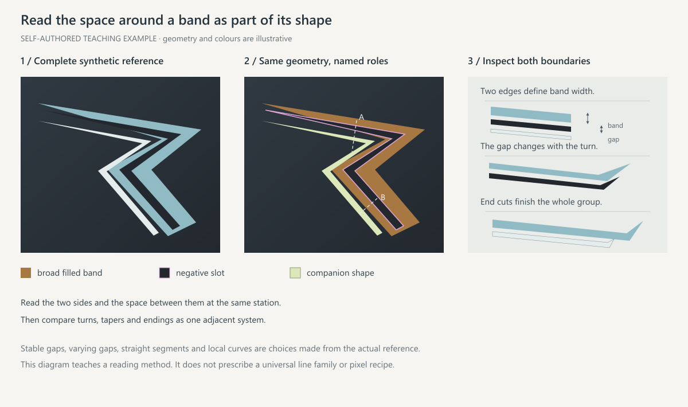

# 喷气机痛涂的线条与配色

默认风格、面积区间和失败对照见 [审美基线](aesthetics.md)。本文件讲怎么把线条做出来。

## 先定整机路径

在俯视和侧视图上各画一条主路径：从座舱后出发，经边条或翼根展开，沿机背收向尾部。母形、分支带、人物和主字都挂在这条路径上。真实间隙和活动面分开安排；被遮挡的路径保持未知。

## 先认清要做的是哪种线

参考图里的"线"多半不是笔画，要先分开下面几类再动手：

- **色场边界**：两块色面的交界，按两侧轮廓重建。
- **宽带、楔形**：有两条边的填充形，画成多边形，不用一根描边代替。
- **伴线**：贴着母形边的细长渐尖形。
- **序列**：琴键、爪形、V 字，切自同一个大形。
- **机械接缝与铆钉**：完整重涂时不保留原机凹槽和模糊结构，默认也不画面板线；要画时见 [面板发丝线](materials-and-uv.md#面板发丝线)。
- **反光**：截图中的光照，不是图案。

## 构造顺序


1. **母形**：每侧一个签名色宽楔形，两端渐尖，内部带轻微渐变或马赛克。
2. **深色通道与负形**：机背中线的深色楔形，以及母形之间留出的深色道。文字放在这里。
3. **分支带**：从母形边缘按同一角度劈出 2–4 条，间距相等、长度递减，端头沿母形边斜切。
4. **序列**：一个三角或楔形按等距平行缝切成 4–5 片，各片外边共线。
5. **伴线**：贴着母形外边，宽度为分支带的 1/4–1/6，渐尖到真实尖点；用签名色亮一档，不用白色。
6. **半调**：在母形末端或一处色场边界，用逐渐缩小的三角或圆点把签名色溶进深底。

母形、负形缝和伴线要当作一组相邻形状来画：看清带的两条边、共同的折点或切线、间隔怎么变化，在哪里收尖、齐平或错层。



每一步都在整机显示尺寸下看过再进入下一步。修改一个对象时，替换它在设计稿里的定义，不要在旧图上叠一层透明新稿。

## 角度族与端头

- 一个视图里只用机轴、前缘后掠、后缘三个方向，至多再加一个斜向。分支带、序列缝和斜切端头都取这几个角度。
- 端头只有三种：渐尖到点；沿角度族斜切；接入另一条带。方向线不要圆头，也不要在空白里平切；成组等长的胶囊条除外。
- 同组线保持共同方向和稳定间隔；稳定间距和齐端也成立，变化要有理由，不为"有变化"而错位。

## 用 vector_paint.py 直接在原 UV 上出线

线条和色场默认用 `scripts/vector_paint.py` 制作：设计稿用机体米制坐标写多边形、渐尖线和图案填充，工具在每个纹素的子采样点上求值。这样长线在 8K 下也笔直、抗锯齿，不会出现低分辨率正交稿放大后的台阶、糊边和投射拉伸毛刺。人物仍按 [正交制作](orthographic-workflow.md) 投射或在编辑器里放置。

```powershell
python scripts/vector_paint.py --geometry output/scene/geometry.npz --design design/lines.json --base textures/clean-base.png --protect design/mechanical-mask.png --out output/vector-v1
```

设计稿 `schema_version: 1`：

- `palette`：颜色名 → `#rrggbb`。
- `charts`：每个图表定义两根轴（`x`、`y`、`z`，可加 `-` 或 `abs_` 前缀；`abs_z` 让左右自动镜像），以及 `nodes`、`materials`（fnmatch）、`normal`（如 `{"axis":"y","min":0.2}`）、`where`（三角形中心的坐标范围）、`facing` 等筛选。三角形归第一个匹配的图表。
- 图表还可以写 `island`：atlas 像素种子点列表，只取沿共享 UV 顶点与种子相连的整块岛。写 `frame`（`origin` atlas 像素，`x`、`y` 每设计单位的 atlas 像素向量）时，设计坐标直接按 atlas 像素线性换算，图形在展开图上保持笔直，用于作者在 UV 上作画的情况；框架由 `scripts/uv_frame.py` 拟合，做法见 [原 UV 作画与逐组复刻](uv-native-replica.md)。
- `bleed_px`（默认 4）：图层颜色向外扩这么多像素，只扩进没有任何同贴图三角使用的空白像素，避免岛边接缝露出底色。
- `layers`：每层是一组 `polygon` 或 `stroke`。`polygon` 可加 `holes`（点环列表，按奇偶规则挖空，用于描边形）。`stroke` 有 `width`、`taper`（`none/start/end/both`）、`taper_length`。
- 图层也可以是 `images`：每项给 `chart`、`center`（米）、`rotation`、`flip`，以及 `source`（图片，配 `width` 米和可选 `crop`）或 `text`（配 `height` 米字高、`font`、`variation`、`tracking`、`color`）；`opacity`、`fade`（`from` 处不透明、`to` 处消失）、`clip`（多边形）可选。人物和文字因此也能按机体米制直接落到原 UV，与线条同层级管理。镜像的一侧要按图表方向设置 `flip` 才能保持字和人物不反；先用一张带方向标记的试写确认。
- `fill`：颜色名、`{"gradient":{"from","to","colors"}}`，或 `{"pattern":"tri-mosaic"|"tri-halftone"|"dot-halftone", "cell":米, ...}`。半调需要 `from`、`to`：标记在 `from` 处满尺寸，到 `to` 处消失。
- `shade`（任何填充都可加）：`{"from","to","stops":[[位置, 系数], ...]}`，2–6 个节点，沿 from→to 分段线性地乘明暗系数，用来做管状、斜面的明暗（例如上三分之一保持原色、往下渐暗到 0.73）。它和 `gradient` 方向可以不同，所以能同时做横向渐变和纵向明暗。
- `tri-mosaic` 的其余参数：`levels`（1–6 个 `[系数, 权重]`；系数小于 1 按比例变暗，大于 1 按超出部分往白色混合，替代 `jitter`）、`contrast`（`{"from","to","values":[a,b]}`，马赛克强度沿方向渐变，0 时变成纯色）、`inset`（三角之间的缝，重心坐标比例 0–1/3，缝里是填充本色）、`offset`（格点相位，设计单位）、`angle`（格子方向）、`mirror`（`{"from","to"}` 一条轴线：轴线右侧的点先翻折到左侧再取格子，两侧三角和明暗逐一镜像，用于沿图形中线镜像的“万花筒”马赛克）。

注意：

- **图表顺序决定共用 UV 归谁。** 三角形归第一个匹配的图表；原 UV 里多块表面共用同一纹素时，排在前面的图表赢。机腹、主翼这类大面排在小部件和上表面之前，否则大面图案会被抢成零碎色块。
- **朝上图表只收真正朝上的面**（如 `{"axis":"y","min":0.3}`）。机身侧壁、边条和机背之间的弯折面交给侧面图表或留素底；放宽阈值，色带会在弯折处被拉成一串毛刺碎片。
- **图表轴必须躺在表面里。** 俯视图表（`x`、`abs_z`）只给朝上的面，垂尾和机身侧面要用（`x`、`y`）的单独图表。工具会对缩短超过 2 倍的面积发出警告，出现警告就按 `normal` 或 `where` 拆开图表。
- **出血**：色场要越过真实表面边界 5–10 cm，否则岛边纹素只被部分覆盖，会出现暗缝；岛外的空白像素由 `bleed_px` 补色。
- 出图前跑 `python -B scripts/design_lint.py --design design.json`：它只读设计稿，列出字体、配色、线型上的已知偏向和改法（见 [审美纠偏](taste-corrections.md)）。error 先修；warn 修掉或在设计记录写理由。
- 收据里 `zero_hit_items` 不为空，说明那个图元没有落到任何纹素，检查坐标和图表。只命中几个纹素的图元也可能实际看不见，以 `surface_map.py` 的结果为准。
- **后掠面按“前缘后方多少米”定位。** 垂尾、平尾上的形状用“该高度处前缘往后 N 米”取点；沿前缘法线偏移时，靠近根部的点会掉到表面外。
- 输出每层一张 RGBA、每个图表一份 SVG（图案填充记在 `data-fill`），再加 `composite.png`。把各层导入编辑器作为独立图层；设计稿 JSON 是线条的可编辑源。

## 落笔前先看表面分区

```powershell
python -B scripts/surface_map.py --geometry output/scene/geometry.npz --design design/lines.json --protect design/mechanical-mask.png --out output/surface-map-v1
```

工具用整机深度缓冲按每个图表的观察方向渲染，出一张分区图（米制网格）：灰＝平整可画，橙＝弯曲，红＝会被拉伸，蓝＝机械件，紫＝共用 UV 被前面的图表抢走，深灰＝被蒙皮、座舱玻璃或别的表面盖住（机身内部朝外的面也会被图表选中，画上去永远看不见），品红＝接缝，白＝没有表面；设计稿里的图元叠在上面。`surface-map.json` 的 `risky_items` 按图元类型判断风险：线条和字压到拉伸、被抢、机械件、被盖住或表面外都算；色场只看拉伸和被抢，可见部分少于 35% 时也算；立绘本来就被表面裁切，只看拉伸、被抢和机械件。

- 紫色区不一定是错：左右或上下共用 UV 的部位，两边画的是同一个对称内容时，另一边显示的就是同样的图案。放字或不对称内容时才是问题。
- `vector_paint.py` 收据里命中纹素多，不代表看得见；以分区图的深灰区为准。
- 品红接缝是本图表两块表面之间的一条窄缝，由别的图表或没有图表来画，最常见的是凸起背鳍条、整流罩的侧壁（J-10C 机背中线有一条约 0.13 m 宽、高约 4 cm 的凸条）。图元跨过接缝，游戏里就会被一条细线切断：嵌套 V 的尖点落在凸条上，会碎成一个小尖加两根斜杠。`seam_items` 列出跨接缝的图元；把图形停在接缝边、整体挪开，或把凸条本身做成深色中线通道。

- 先看分区图，再定线条、字和人物的位置；改完再跑一次，`risky_items` 清空或逐条确认。
- 线条和字只放在灰色平整区。格栅、起落架舱门、天线、弯折边上的线和字会碎成几截。
- 工具只看几何和 UV。之后仍要给每个区域开近景相机看模型：机头、机背前后段、侧面前后段、机腹前后段、垂尾内外侧。

## 按表面安排

机首或座舱后引入方向，翼根和机背中段展开或分流，后机背与尾根收束。主翼与尾面按人物和轮廓组织，侧身利用连续长面，配件用同一套颜色和局部标记呼应。安静区由深底、面板线和弱纹理承担停顿；被指出单调时，先在整机尺寸调整浅深边界和中形，再补近看细节。各面默认分工见 [审美基线](aesthetics.md#各面默认分工)。

## 机腹单独构图

先在机腹图表的分区图上找平整区。双发侧卫类可用的是：前机腹（前起落架舱和进气格栅之间）、发动机舱底部的平直条带、中央通道；格栅、舱门和天线一律避开。机腹图表要排在机背图表之前（见上文图表顺序）。以中央通道、进气道、发动机舱和翼下的大形定路线，在翼根展开、尾根收束，再配较弱的边线和一处半调或马赛克。遵守无人物要求；参考只有中央腹部无人物时，不把带翼下人物的整张图当作合规范本。不同方案要改变看得见的大形或色场分配，不能只调几根细线。

## 颜色

指定配色时保留底色、主色和点缀各自的职责与相邻对比。自主配色按 [审美基线](aesthetics.md#配色一个签名色) 选一个签名色，再定底色、强调色和可选点缀。

原色优先从可靠原图或颜色贴图取，截图里的高光和环境倒影不能直接当调色板；在编辑器里可用 `sample_color` 从原图取色。灰度只辅助看明暗，最终回到原色判断。RGB 里的银灰渐变和真实金属反射分开处理，见 [UV 与材质](materials-and-uv.md)。

## 检查

- 整机尺寸：方向、主次和负形是否可读；眯眼后是否只剩几块清楚的大形。
- 原尺寸局部：两侧边、间隔、折点、端点和纹理；有没有锯齿、糊边和细碎尖刺。
- 斜视：拉伸和遮挡。
- 分层开关：隐藏细节后大形仍成立；隐藏人物后背景仍有组织；恢复全部图层后检查竞争。
- 测量记录原分辨率、坐标和方向。斜线的横纵截宽不等于法向宽度；模型截图里的曲率可能来自曲面和透视，先对照展开图。
- 提高分辨率时从设计稿和原素材重建；实际 mip 和过滤另按 [打包与验证](packaging-and-validation.md#dds-与实际-mip) 检查。
