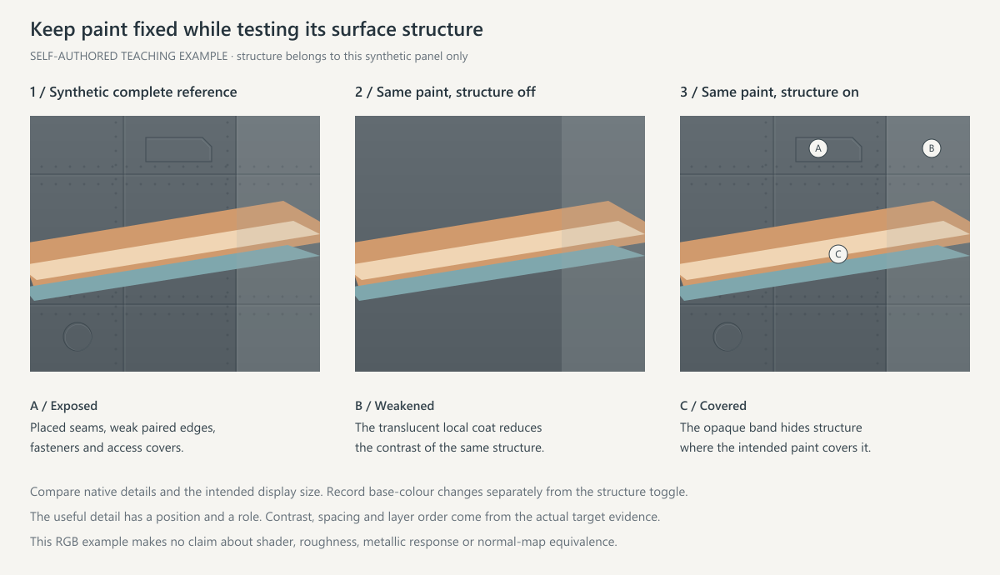

# 喷气式飞机的资源、UV 与材质

## 从配置确定资源

读取 BLK，列出精确 `from → to → 用途 → 尺寸与通道`，核对改型、部件与材质分组。保留 `name:t="user"` 及所需 wildcard，自制目标对应真实包内文件。缺失、重复或冲突映射先判明影响和结构歧义；资源用途依据配置、实际资产或 CDK，不凭作者文件名。

模板可能是常量占位图。检查通道范围、方差和局部内容，再确定它提供的是资源名／尺寸还是真实结构。沿用模板映射或更改方式时，颜色 alpha 与材质各自核对；必要时查 [Gaijin 技术说明](https://wiki.warthunder.com/cdk/creation_camo)。

## 原 UV 与基底

保留原 UV、画布比例、部件变换与材质分组，标明接缝、镜像和共享纹素。原 UV 不限定最终像素尺寸；按脸、文字和最细线实际分到的纹素选分辨率，从原素材／矢量重建并同比更新投射数据。插值放大不增加独立细节。

先确定原皮保留、局部修改或完整重涂。完整重涂按真实表面建立新底色，清除不需要的旧迷彩、标记、污损、磨损与旧涂层明暗；机械结构和需要的局部层次分别保留、压弱或重建。只有底色和必要结构的平光、受光试片先检查，再叠图文。

**完整承载面先于局部图元。** 装饰岛或零件核心的轮廓，不一定包住其周围的宽母面、侧壁、孔壁和支承场。沿参考中实际裸露的自然范围建立这些大面，再放主题图形与细结构；不能把装饰内部 clip 当作整片表面的总边界。

清点接缝、检修口、紧固件、弱双边明暗、局部色差及设计底纹。完整重涂后，面板线与铆钉默认用 `scripts/structure_layer.py` 从确认过的法线通道提取，作为单独图层压回颜色图；它不改材质贴图，只恢复颜色上可见的结构。复合件沿前面→倒角／亮唇→返面／孔口的可见关系核对，长件不同位置可有不同亮带起点和峰值。宽度、明暗顺序与连续转面本身就是质感，单一灰底加细线不能代替它们。没有原机基线或作者工程时，统一称“源贴图可见结构”，归属保持未知。

结构按真实位置和层级露出、受涂层压弱或被图形覆盖，深底、浅带和人物印刷上的显隐可不同。重复单元逐区核对尺度、相位和裁切，不统一铺满或加黑。跨机型迁移这些职责，具体孔口和紧固件回目标 UV 定位。



固定底色／图形做结构开关时说明实际变化，固有构件体积可保持。若同时改了底色或渐变，另列变量。先在颜色 RGB 中验收可见层次，反射与凹凸按各自数据检查。

## 通道与格式

目标资源确认后再解释打包通道。当前常用合同为 R＝inverted roughness、B＝金属度、G/A＝法线数据；不能由 `_n` 文件名或普通 roughness 图直接推定。颜色 alpha 与材质 A 职责不同，不能把法线 A 当透明度删除。

RGB 预览先分离 alpha；数据通道独立按数值处理，避免预乘和摄影调色污染。以确认过的原数据为基底，声明修改通道、遮罩与保持域，用 `build_skin.py --channel` 组装实际 8-bit 灰度通道。DDS 编码和实际 mip 见 [打包与验证](packaging-and-validation.md#dds-与实际-mip)。

## 先区分表面类型

| 表面 | 颜色与反射的分工 |
| --- | --- |
| 柔和主题涂层／人物印刷 | RGB 承担阅读，限制冲淡脸与字的反射 |
| 亮漆 | 控制高光，通常仍按非金属涂层，不因发亮提高全部金属度 |
| 装饰金属／边条 | 明确局部遮罩，与相邻涂层形成反射差 |
| 喷口、热区和机械裸面 | 保留确认过的区域差异，不跟主题底色统一填值 |

外露可涂罩壳与机械裸面按真实职责区分，不按节点名、网格连通或未命中主体选区推定。RGB 中画出的银灰高光不证明反射；截图灯光与环境倒影也不能反推作者原参数。

## 分区编辑与数据保持

列出“区域 → 目标质感 → 语义遮罩 → 通道 → 验证”。遮罩来自实际人物、涂层、边条及机械贡献层；相似 RGB 可能属于灰发、白衣或银饰，颜色阈值只能辅助定位。

人物或装饰移动、缩放、裁切后，若材质含旧图案分区，同步处理新印刷区、腾出的旧区域及下层饰条；不依赖图案的均匀材质可以保留。按明确合同保持或编辑 G/A：需要保留的机械凹凸与不需要的旧涂层凹凸分别处理，域外数据保持。不能把“全量原样保留”或“全部清空”设成通用新漆规则。

已确认反粗糙度时，较高 R 趋向更光滑，较低 R 趋向更粗糙；宽高光和集中高光都可能影响阅读，效果不是数值与肉眼亮度的线性换算。用相同 RGB、几何、相机和光照，固定 B 比较 R，再固定 R 比较 B，复看不同完整受光环境。结果只适用于当前基底和条件，不形成通用 R/B 配方。

## 装饰凹凸与表面细节

高度／法线素材与原结构分开，用正确生成和合成方法核对方向、编码、幅度与区域；灰度高度不能直接当两法线通道，颜色相加也不等于法线合成。恢复图文后检查细线、脸和字是否被不必要沟槽破坏。

## 质感检查

分开诊断采样变糊、RGB 变色与受光压白。在同位置依次比较源层、albedo、受光图和可得问题截图，固定相机、机体显示尺寸与输入；截图饱和不证明颜色图已纯白。对照需实际覆盖投诉区域，保留未解决的外观失败，不能用文件保持或其他局部改善关闭。

近似布局、近似材质和游戏 shader 的结果分别记录。代理显示异常也需保留其环境和假设，核对解码、色彩空间、数值重映射、法线轴序后再判断原因。单环境改善不证明其他环境或游戏改善。

公共多材质场景见 [整机场景](orthographic-workflow.md#多材质整机场景与补充相机)。`scene_preview.py render --mode material` 提供工作室近似；需要两完整环境时使用：

```powershell
python scripts/finish_preview.py --scene scene.json --profile generic --environment outdoor --view iso --out outdoor.png
python scripts/finish_preview.py --scene scene.json --profile generic --environment studio --view iso --out studio.png
```

`--profile` 显式选择。`generic` 使用上述 R/B 解释；只有确认与固定公开 `dynamic_masked_chrome_bump` 路径相符时，才用 `dynamic_masked_chrome_public` 的特定重映射和 BRDF，仍不证明当前游戏编译 shader 身份。两入口的光照不同，不能直接把亮度差归为真实 N 问题。

法线仅 material 模式显式启用。场景支持 `normal_convention: none`（默认）、`ag_xy`／`ga_xy`／`rg_xy`，`normal_strength` 为 0–4、默认 1，`normal_y_sign` 为 ±1、默认 +1；`normal_texture` 可带 path／sha256，否则取已绑定 packed。轴序按实际资源和 shader 证据确认。`--normal-off` 用于固定条件隔离，查看 normal_mapping 配置与退化 UV 回退，再实际复看目标面。

当前 TBN 由原 UV／几何派生并处理镜像手性，不宣称匹配游戏切线；额外 tiled/detail normal、活动／损伤状态、目标环境、阴影／AO、透明度及运行时 mip／各向异性仍按实际未验证范围说明。
