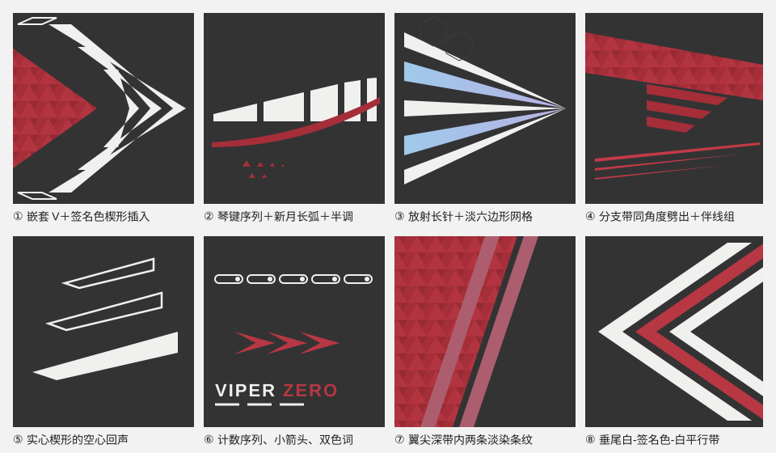

# 线条与图形库

所有图形都是**填充多边形**，边缘笔直锐利，尖端是真实尖点。尺寸按机体实长（米），下列数值来自 8K 贴图按岛长折算，误差约 ±30%，换机型按机身长度同比调整。

## 机背主图形（四选一）

每架只选一个当主角，左右镜像，占机背长度的 1/4–1/3。

| 图形 | 构造 | 适合 |
| --- | --- | --- |
| **嵌套 V** | 3–4 个同角度 V 字，尖端在中线、指向机尾；V 臂与机轴夹角 15–20°；臂宽 0.35–0.6 m，由外向内递减；相邻 V 之间留 0.08–0.15 m 深色缝。签名色楔形从机头方向插进最内层 V | 单发、窄机背（F-16、F-2、幻影） |
| **琴键序列** | 一个长楔形按等距平行缝切成 4–6 片；各片顶边落在同一条直线或一条顺机身的缓弧上；片长由前向后递减（长-长-中-短-短）；缝宽约为片宽的 1/4 | 宽机背（侧卫、阵风） |
| **放射长针** | 6–10 根细长三角从座舱后一点向后放射，白与签名色淡染交替；每根都是根宽 0.15–0.35 m、收成真实尖点的三角，不是等宽细线；长 2–5 m；签名色针内做渐变和马赛克 | 浅色签名分支、宽机背 |
| **嵌套 V 腹饰** | 同嵌套 V，但放在机腹或腹鳍，尖端指向机头，白色 | 机腹、单发下表面 |

## 配套图形

- **分支带**：从签名色母形边缘按同一角度劈出 2–3 条，宽 0.05–0.1 m，间距相等，长度递减，端头沿母形边斜切。
- **伴线组**：2–3 条签名色亮一档细线，宽 1.5–3 cm，彼此平行或略收拢，贴着母形或大楔形外边跑 2–4 m，末端渐尖。全机统一一种组数。
- **空心回声**：主图形外侧放 2–3 个同形的细描边（线宽 2–3 cm）平行四边形或梯形，形状和角度与实心图形一致、逐个缩小。只作回声，不当框用；单独出现的描边框仍然避免。每个回声都要落在平整、可见的面上：往外排出机身边缘或压到座舱、舱盖的就删掉，宁可只留一个（J-16 示例和 v10 都因此删过回声）。
- **虚线序列**：侧面或机背边缘一排 6–12 个等距小形（短平行四边形、空心梯形或带圆点的胶囊框），长度递减或等长，像弹药计数。
- **新月长弧**：签名色或白色大面的边界可以是一条顺机身的长弧，从机头延伸 4–8 m 后收成尖。这是唯一允许的大曲线。
- **折角包边**：浅色签名分支在边条、进气道外沿用 0.1–0.2 m 宽的签名色折角带，顺结构边转一次角后收尖。
- **翼尖条纹**：主翼外侧一条深色带（约翼尖弦长的 1/4），内含两条签名色淡染条纹，宽 0.2–0.3 m，间距等于条宽的 1.5 倍，平行于翼尖边。
- **垂尾内侧楔形**（双垂尾内侧的默认做法）：沿前缘一条签名色马赛克楔形，根部宽约根弦的 1/3，向翼尖渐收成尖，颜色从暗一档渐到主色；楔形内侧一到两条签名色亮一档伴线（宽 3–4 cm，两头渐尖），朝翼尖慢慢收拢；不用白色长针；根部用三角半调把签名色溶进深底。其余保持深底。
- **垂尾平行带**（只用于不放人物的外侧，如 F-2A）：白-签名色-白三条平行带，宽 0.3–0.4 m、缝 0.1–0.15 m，两侧垂尾的带在前缘汇成一个 V 顶点；签名色带中间可加一条黑色细线。
- **小箭头组**：3 个嵌套的签名色小 V（">>>"），带渐变，放在侧面尾段，指向机尾。

## J-16 参考尺寸（v10 实做值，用户已认可）

上面的尺寸是从作者 8K 贴图按岛长折算的（±30%）。下表是在 J-16 上实做、对过模型的米制值，换机型按机身长度同比缩放；用户认可前只当起点。

| 元素 | 尺寸 |
| --- | --- |
| 机背签名色母形 | 从机头 x≈10 m 到尾根 x≈−6 m，最宽约 1 m，马赛克单元 0.22 m |
| 白色琴键（主排） | 4 片，长 1.15 / 0.8 / 0.5 / 0.3 m，高 0.19→0.26 m，缝 0.16 m，斜切 1.1 m/m |
| 白色琴键（副排） | 3 片，长 1.0 / 0.7 / 0.45 m，高 0.10→0.16 m |
| 伴线 | 宽 0.026–0.03 m，距母形边 0.14 / 0.24 m，末端渐尖 1.2–2 m |
| 主翼前缘签名色带 | 宽 0.55–1.2 m，马赛克单元 0.28 m；翼尖深色带宽约 1.5 m，内含两条 0.25 m 淡染条纹 |
| 主翼立绘 | 宽约 6.2 m，脸在翼根附近；回声脸宽 3.4 m、不透明度 0.22–0.24 |
| 垂尾外侧立绘 | 宽 3.9–4.6 m；前缘签名色窄带 0.30 m，顶帽高约 0.95 m，根部深色带 0.36 m |
| 垂尾内侧楔形 | 根部宽 1.3 m（约根弦 1/3），伴线 0.03–0.04 m（v10 交付时这里是 0.07 m 白长针，现已改签名色） |
| 机腹四段 V | 前机腹 x 2.7–4.95 m，臂到 z 0.92 m；中线细针宽 0.06 m，用签名色（v10 交付时是白色） |
| 小箭头 | 每个长 0.32–0.40 m，间距 0.32–0.36 m |
| 字 | 翼面角色名字高 0.30 m、副名 0.11 m；机背角色名 0.24 m；垂尾根部 J-16 0.20 m；机头侧面 J-16 0.22 m |

## 质感

- 三角马赛克：`vector_paint.py` 的 `tri-mosaic`，`jitter` 0.08–0.12。
- 半调：母形末端或白色大面边缘用 `tri-halftone`，三角从满尺寸到消失跨 0.8–1.5 m；只在 2–4 处出现。
- 漆面：`coat_material.py` 整机一层亮漆，颜色里不叠模糊结构层，见 SKILL.md 的“漆面”。要画舱线就在设计稿里手画少量笔直深色细线（约 0.01 m）和等距铆钉点。

## 角度与对称

- 一个视图里只用三族角度：机轴、主翼前缘后掠、一个与之相近的斜角（嵌套 V 的臂、分支带）。
- 左右镜像：设计稿里用 `abs_z` 轴，一份形状自动对称。
- 白色总面积控制在 [配色](palette.md#实测面积) 的区间内；白色主图形越大，其余白色元素越少。

## 白色怎么用

作者五架飞机的俯视图里，白色都是有体量的形：F-2A 的宽臂 W 形，幻影青色面里的嵌套 V，Ellen 黑色通道里的宽刀片，Esdeath 根部很宽的放射长三角。它们集中在主图形周围，共用尖点和角度。贯穿机身的长细线是签名色（红、粉、青），贴着色块边走。

- 白色单件最宽处不小于 0.15 m；比这更细、长过 1 m 的线用签名色亮一档。
- 细白线只有一种：主白色图形的同角度细描边回声（F-2A 主 W 旁边那组），id 里写 `echo`。
- 不画贯穿机身的白细针、平行白条、前缘白细边、白色伴线。`design_lint.py` 对这些报 `thin-white-line`。
- 画嵌套 V 时，每条臂的两条边都要朝同一侧偏移（内边整体向机头平移一个臂宽）。旧版示例把顶端的偏移方向写反了，臂在中段交叉，渲染出来是两根相交的细针，照着它做的作品也跟着错了。`design_lint.py` 会把这种交叉臂报成平均宽度约 0 的 `thin-white-line`。

## 用 vector_paint.py 实现

`examples/j16-nested-chevrons.json` 是双发侧卫的线条配色示例：深色中线通道、签名色马赛克机头被 4 层白色嵌套 V 刺穿、伴线组、翼面马赛克加翼尖淡染条纹、垂尾内侧楔形（外侧留给立绘）。`examples/j16-key-sequence.json` 是琴键序列加半调的示例。`examples/j16-chen-full-livery_build_design.py` 是一架完整涂装（v10，`surface_map.py` 检查过可见性）的生成脚本：两翼与两侧外垂尾立绘、回声脸、字组、机腹平整区布局、侧面、垂尾内侧楔形，可看各图层、左右镜像和图表顺序怎么写。换机型时：

1. 改 `charts` 里的节点名和材质名，图表轴要躺在表面里（机背 `x/abs_z`，侧面和垂尾 `x/y`）；
2. 按新机身长度缩放坐标；
3. 落笔前后各跑一次 `surface_map.py`，线条和字只放平整区；跑 `vector_paint.py` 后看警告和 `zero_hit_items`，再在整机、各区域近景和编辑器原尺寸下检查。
