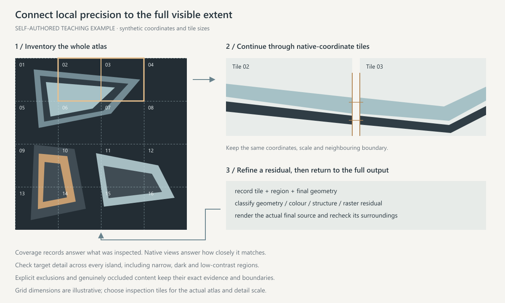

# 研究、学习与工作流审计

按本次问题决定产出：观察布局、检验机制、审计工具或制作新作品是不同任务。研究可以包含原创练习，但只有用户同时要求制作时才进入完整新作流程。遵守本次素材获取范围，图片观察不自动授权下载原涂装包。

## 来源与既有台账

从项目登记中定位现用研究索引及其关联批次，先查已收录、已分析与仅候选的范围；只有实际分析有证据时才称已研究。沿用索引已定义的 canonical 来源 ID。War Thunder Live 的语言记录 ID 可能不同于帖子的 `lang_group`，保留二者及其依据，不凭相似数字合并来源。

要求未研究案例时，先排除台账中的相应范围，再检查图片是否为同图、换色或简单改型。保留来源页、原图地址、作者、实际文件哈希、观察视角和选择理由；无法证明全库原创性时只陈述本次排重范围。新案例追加到当前研究台账或按项目规则登记新的批次，不改写已冻结的历史证据。

## 证据层级

| 类型 | 可以说明什么 |
| --- | --- |
| 来源观察 | 实际图中可见的立绘、图文分工、色场及路线；不可见面、被遮挡路径、源图层参数保持未知 |
| 设计预测 | 改裁切、移动线端、增强对比等可能结果；明确尚未实验，不冒充作者用过的方案 |
| 原创迁移练习 | 在自己的几何、素材和条件下检验方法；几何占位不能证明真实角色、手势、发衣或身份保持 |
| 完整制作 | 当前飞机、角色及必需表面的整机结果；技术通过与用户美术认可另行登记 |

封面外的人物、边框、标题和装饰不算机体图案。单张图可支持局部观察，不能恢复未知反面、机腹、材质参数或作者工程。多角度来源也只支持真正显示的部分。像素拆分不能冒充作者原生分层。

## 展开贴图与模型对照

研究线型、UV 布局或接缝时，在本次素材获取范围内同时检查真实颜色贴图和对应机身视图；只有截图或缩略 atlas 时，保留原尺寸贴图未检查的范围。由 BLK 确认资源用途，记录原文件身份、尺寸、编码与通道。在编辑器中保留原尺寸完整 atlas 作为未修改底图，研究标注另建层；全图用于定位，原尺寸局部用于看笔画、间隔、端点与压缩边缘。RGB 与 alpha 分开核对，导入后确认实际尺寸与内容，不能把元数据里的原尺寸当成预览图的尺寸。

关键观察建立“资源及局部坐标 → 表面或 UV 岛 → 对应模型视图”的关系，用同一条边界、端点、字形或结构锚点定位；有当前作品时，再与其对应部位比较。atlas 中相邻的区域不证明模型相邻，分开的岛也可能在真实接缝两侧接续；区分图案的实际端点、岛边截断和图案叠压。接缝、共享纹素及表面归属由几何、UV 或可核对的视图确认，无法确认的保留未知，不凭平铺方向补线。

普通 DDS、TGA 或 PNG 是已合成的平面贴图；导入、裁切与按颜色拆分不恢复作者图层、蒙版、字形源或人物后方底图。原生工程、人工研究层与重建练习分别标明；不把补绘背景当成作者隐藏内容。先在原尺寸贴图辨别色场、带组和负形，再在模型上核对方向、主次及曲面变化；测量边界见 [线条与配色](linework-and-color.md#线条的尺度与形状)。

## 原作复刻练习

用户要求照原作重画时，先按本次约定清点原尺寸完整 atlas：逐岛登记可见色场、宽带、负形、伴线、端点、设计底纹与表面结构，再注明人物文字等排除范围。排除人物和文字本体时，字孔、字间、发丝外侧及其他仍可见的目标内容继续清点。真正遮挡的部分保持未知。参考只有截图或局部时，记录证据实际能覆盖的范围。

在原坐标中自行建立几何；要求自己照着做时，源像素只进入参考与对照，重建几何不用原图裁片、嵌入栅格或自动轮廓。人工选择的行列、锚点和颜色测量可以辅助录入，如实记录方法。先核对相连、分开和覆盖关系，再修双边界、间隔、折点、尖端和层间接缝。方向渐变、规则底纹和弱结构按其实际区域分别重建；自绘重复单元仍逐区检查尺度、相位、裁切和强弱。疑似装饰的灰沟、岛边和机械填充回到对应机身视图核对。复刻阶段与新机型迁移分别交付。

从最终可编辑源直接渲染，用全图总览检查大形与漏族，再按原坐标连续巡检全部可见目标区域。逐区记录最终图元、分片巡检范围、对应证据和未解决项；相邻片区覆盖范围有记录，狭窄和低对比区域也进入检查。疑点回到原尺寸局部修形，再回看整图与预计展示尺寸。几何、颜色、结构与压缩／栅格化残差分别记录；总体均分与背景占比不能掩盖细线错误。示意的网格与尺寸仅说明覆盖证据如何衔接精度证据，代表性特写只负责展示。

需要研究线形时，可关闭结构或底纹形成隔离稿，同时保留完整参考和删层说明；完整外观中仍需处理实际可见的面板、铆钉、检修口、弱明暗与设计底纹，见 [原 UV 与基底](materials-and-uv.md#原-uv-与基底)。细、浅、重复或难画不构成自动排除依据。比较结构作用时固定其他图形做结构开关。对照保留未经遮盖的原图、实际重建与叠差，评价范围另行标出。

完整外观依实际完整输出验收。指定全范围完成同时需要全图清点、连续原尺寸巡检与展示尺度复看；必需区域仍有未检查或未解决项时保留未完成。独立检查先找漏族、错误连接和排除域，再看最终源的原尺寸残差，修订后重新绑定最终文件复查。作者工程未知时，交付称为人工重建与对照工程，可编辑矢量与编辑器中的栅格比较面板分别说明。局部近似、全范围完成和用户认可分别记录，案例数量不升级为掌握风格的结论。

## 有效实验与关闭条件

实验围绕可观察的问题比较。单变量控制保留相同素材、几何、相机与展示尺度；同时改变裁切、尺度和背景的方案标作设计候选。说明填充、描边、文字和人物哪些实际改变，先确认预期内容非空且修订进入最终导出，再看模型效果。几何命中、零交集、图层数量和渲染数量不作美术评分。

研究中以隐藏人物检验背景组织时，先确认人物实际来自哪些贡献层；边缘修色、轮廓补绘等人物相关贡献一并处理，其他底色、结构与对照条件保持一致，再核对实际导出。只关闭主立绘层或依据图层名，不能证明人物已从对照移除。

审计用最小可复现输入确认失败及其范围，把工具缺陷、规则冲突和未研究能力分开。测试夹具与失败证据保存在本次任务，不覆盖原素材或重放历史脚本。独立检查只给现用规则、问题和必要原始输入，避免预先提供期望结论。

研究以来源与可见范围、实验结果、更新后的台账、已证实的规则增量及仍未知事项结束。公开 Skill 只吸收可迁移的方法与条件，不写入个人记录、案例计数或任务私有路径。没有证据支持的预测仍保留为预测；研究完成不代表所有收集材料已学透，也不赋予现有或新作品美术认可。制作任务另按 [打包与验证](packaging-and-validation.md) 关闭。
