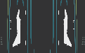
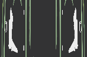
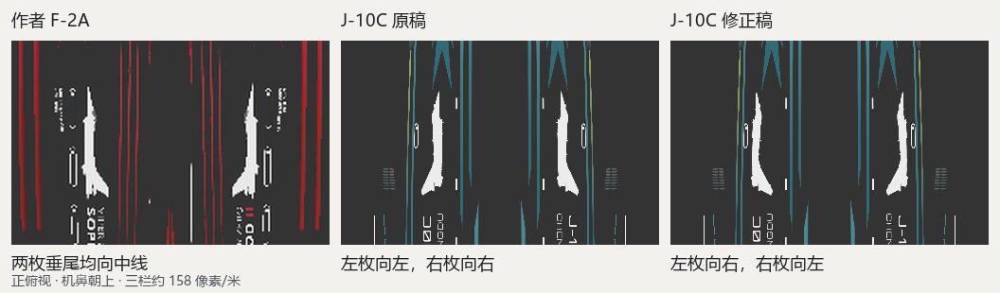

# 后机背双侧剪影：在模型上判断方向

仅用于复用 F-2A 的后机背成对侧视小飞机。相机正俯视，目标机机鼻朝上，原图不再旋转；用每枚小飞机自己的尖机鼻确定前端，再辨认尾段突出的垂尾。画面左枚垂尾朝右、右枚朝左，二者朝向机身中线。左右对称只能证明成对，不能辨别朝内还是朝外。

| 实际模型局部（保持原图像素，两个局部的屏幕尺度不同） | 看什么 |
| --- | --- |
|  | 旧[无人物原图](current-approved-j10c.md)：机鼻都向上但垂尾向外。两翼渐变与肩字仍是认可参考；新作不用这个局部的朝向。 |
|  | [祀最终组合](current-approved-j10c-si.md)：机鼻仍向上，尾段朝中线伸出。不要把这个已正确的组再次镜像。 |

同一架无人物歼-10C 的归档还保留了约 158 px/m 的正俯视同尺度三联：左是作者 F-2A，中是歼-10C 旧稿，右是已修正的无人物发布稿。量测左右垂尾相对机身轴的横偏分别为 F-2A (+4.5, −4.5)、旧稿 (−6, +6)、修正版 (+5, −5) 原生像素；正号向画面右。**公开青玉金黄包已经朝内，无须再改。** 两个剪影之外、Alpha 和机械保护区的改变量均为 0。

修错只沿**每枚剪影自身的机鼻—机尾轴**镜像，固定两枚的锚点、机鼻方向、相邻箭头与字；不要翻整张 atlas 或整侧字组。共享 UV 的另一侧会随同一纹素变化，两侧须在最终模型一次看全。平尾用俯视徽记，其他独立排布不套本条。上述图是已有离线模型渲染的局部，不是 F-2A 原包、游戏截图或新作品的认可。
