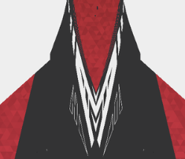

# 已认可的中轴白形

用户在 2026-11-04 明确认可下图的白色线条处理，并要求写入 Skill。认可对象是这组中轴主白形、内部留黑、小 V 和外侧细描边的组合；不要把它扩大成对字体、后段装饰或全机交付的统一认可。

本页记录的是当时的中轴局部认可；后续青色 J-16 完成中央细节后获得的当前状态认可，另见[当前 J-16 基线](current-approved-j16.md)。两条反馈按各自范围保存，不用较早的局部记录覆盖较后的明确反馈。

可编辑示例：[J-11B 中轴设计](../examples/j11b-approved-centreline.json)。它来自实际 8K 原生 UV 构造，包含完整白组及相邻色场；不依赖临时目录、作者位图、1.15 工具或额外字体。

## 要保留的关系

1. **先确定色场和白组的内外关系。** 中央签名色从机头、座舱向后收成凸出的尖端，白形隔着炭灰间隔包在外侧。不要画成两条向后伸出的色肩，在中间挖洞再塞白色箭头。
2. **主白形有体量，内部负形有归属。** 主形是一个可编辑多边形；示例的四个封闭孔洞以 `holes` 从它内部扣除。孔洞留炭灰，与主形一起调整；不能用零散黑色补丁凑轮廓。
3. **小 V 共轴，内外剖面独立，且禁止跨模型保留圆孔缺口。** 示例有两枚小 V，外侧约 12°、内侧约 18°，开口、尖点与内凹点分别定位。不要用等宽描边生成 V，也不要拿一枚 V 连续等比缩小充数。特别注意：若参考引导轮廓（如 J-16 的 `idx 16 / 17 / 20`）曾为了避开该机型独有的机背圆包雷达罩而在小 V 顶点绕出一圈半圆缺口，迁往机背平整的机型（如 F-15EX）时必须把三块碎片接回一条完整、连续、不镂空圆洞的实心锐角白 V（见 [F-15EX 机背修平案例](f15ex-endfield.md)）。这些角度是本例观察值，不是全部部位的固定角度表。
4. **回声细、空、闭合，弱于主形。** 两侧各三件回声由独立外轮廓和内孔组成，包含长尖形、四边形和三角形。保留各件的长短、错位和端部；不把它们改成三个相同框、统一外扩轮廓，或几根开放白线。
5. **前端白片负责接续，后端清楚收尖。** 断开的白片沿主组方向渐变长短，与主白形之间留空。尖端是多边形真实交点；细处不能突然截成方口，端帽也不能取自参考机的机械遮挡。
6. **黑色间隔也是构图。** 主色场、白母形、孔洞与外侧回声之间的炭灰通道保持连续，不被加粗线条挤没。底色按[统一炭灰底](palette.md#统一炭灰底)使用 `#333334`。

本例是一个主白形、四个内部孔洞、两枚小 V、六个外侧回声和六个前端白片。数量描述此例；换机型先保留角色与疏密关系，不以凑数量代替构图。

## 可编辑示例如何使用

`examples/j11b-approved-centreline.json` 使用现有 `vector_paint.py` 的格式：

- `clear-old-centre`：清理机背基底，只保留该例的机背图表。
- `convex-signature-field`：向后收尖的色场、相邻弧形伴线与马赛克面。
- `white-mother-and-independent-members`：主形、孔洞、小 V、回声和白片；每件有独立 ID，回声使用 `holes`。

该例的 `dorsal` 图表、节点、材质、`island` 种子与 `frame` 只对应 J-11B 的这套 8192 UV。坐标单位为米，设计 x 朝机头、y 为横向。示例包含基底清理和色场；局部修改已有作品时按需要提取白色图层，不能把整份示例当成通用贴纸覆盖其他内容。

换机型时重新建立目标机的承载图表。先对完整白组做整体缩放和移动，使主形、孔洞、回声一起落位，再依据曲面和接缝修改端部。不要先用每个岛独立拉伸把整体关系拆散；不要直接复用 J-11B 的 UV 像素坐标。

同一批三角形同时需要原 UV 图表和机体投影图表时，分开烘焙；1.14 的图表选择会优先占用三角形，不能把第二张图表零命中误认为图形已经画好。

## 构造与检查

`arrangement.py` 仍用于确实适合等宽切格的形状；本白组采用明确的多边形与孔洞，不要求把独立角色重新改写为 `region` + `cuts`。

检查三件事：原生 1:1 的边缘与闭合孔洞、模型上的完整落位与遮挡、正常观看尺度的主次与间距。`zero_hit_items` 中出现白片或回声就回查承载面；不能删除检查对象来获得通过。`thin-outline` 或方向数量提示用于定位风险，不自动加粗或删掉已认可的闭合细回声。

随附示例经本版 `design_lint.py` 检查为 0 个错误、2 个 `thin-white-line` 警告，对应 `centre-chip-upper-tip` 和 `centre-chip-lower-tip`。它们是完整白组前端的渐尖收束片，原尺寸及模型视图已检查；保留警告记录，不改名成 `echo` 绕过检查，也不删除它们。此判断只对应当前示例；移到其他承载面后仍须重新检查。

迁移这一组时保留 1.14 已有的机翼色块、翼尖淡染条纹和平尾前缘带。先把中轴做对，再根据用户要求处理其他部位；局部认可不自动授权重做整机。

## 在新机上避开机械件

先在正常机背视图中找到签名色尖端预计落点，沿机轴查看母形、小 V 的尖端和附近原厂硬件。若局部出现密集横纹，读同一像素的可见三角、UV 和保护罩，判明是结构露出还是原有细回声。幻影 2000C-S5 的试作在这一步查到受保护的原厂栅格恰好穿过小 V。把母形与独立成员作为一组适配机背，栅格所在段保留炭灰，并在同相机下核对两侧细回声与前方色场的距离。不同机型的栅格位置与可用长度随原模而变。
