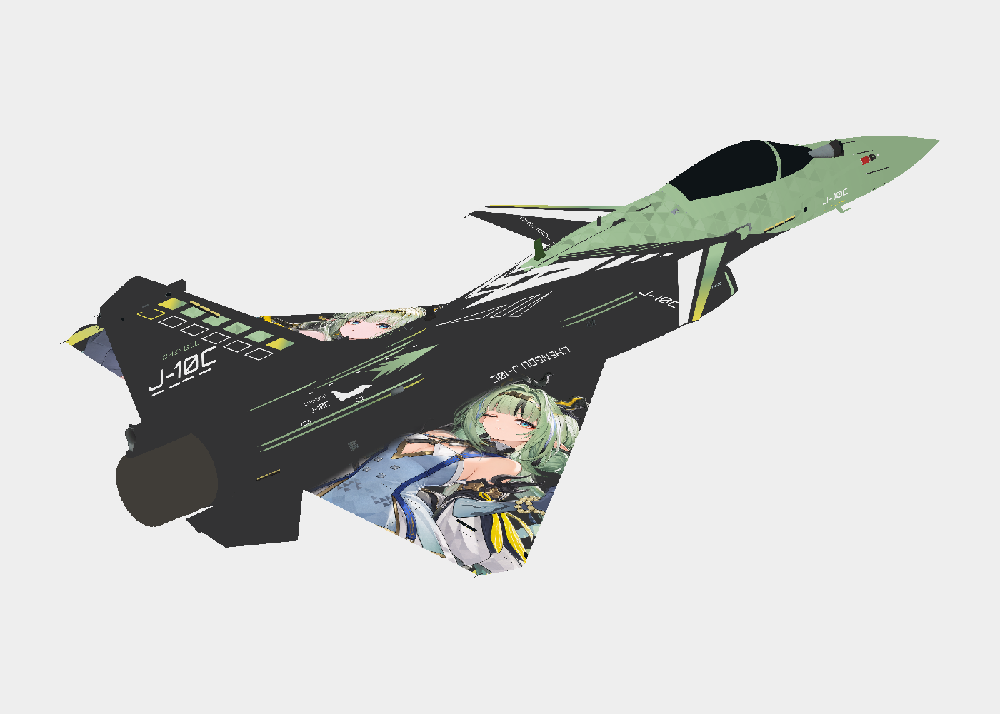
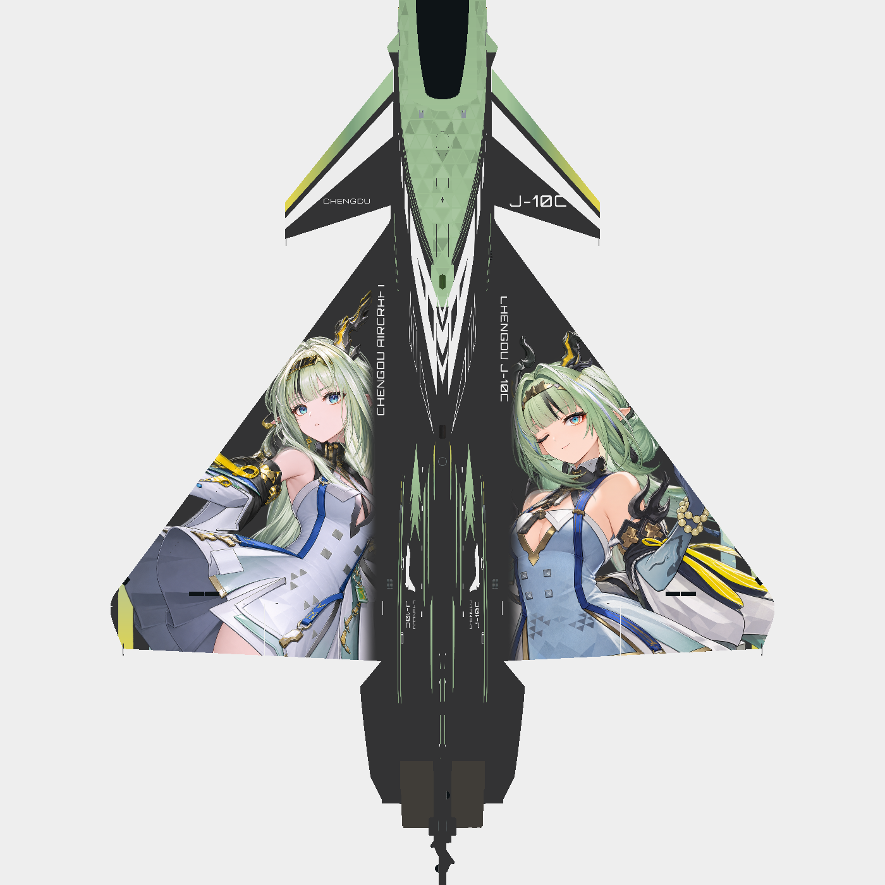
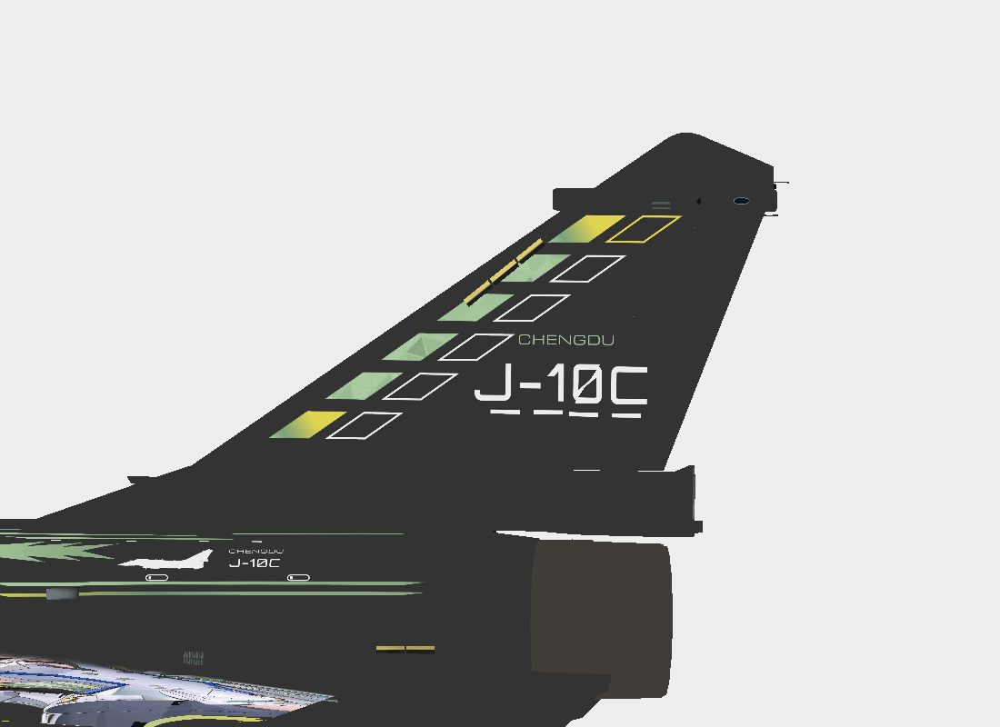

# J-10C 祀：1.20 已认可案例

## 当前验收

2026-11-05，双翼过渡和全机淡翠绿／金黄渐变完成后，用户明确反馈“目前很满意”，并要求把这些改动总结为 Skill 1.20。本页记录的最终组合已认可，取代此前机腹、机头、中轴和人物翼根的待审状态。中间失败稿不是正向范本。

最终颜色 `j_10c_jade_gradients.dds`：8192²，传统头 BGRA8 无压缩，单层；SHA-256 `2659bf6834bbe25df04bbf17f14480bfcda128b20ef190b8db37029e7f3b32cc`。材质 `j_10c_satin_n.tga`：SHA-256 `86e9f168b1329a0d44c528376c72bc0fec17967c1bd76c67d75c535e7c26762a`。完整标识见[验收记录](../examples/j10c-si-acceptance.json)。

认可的是这个实际成图，不表示任意机型、图源或格式均已验证。维护当前作品时保持它；新机型重新适配原 UV、材质和构图。诊断沿革见[历史记录](j10c-si-history.md)，其中旧“待审”描述当时状态，不覆盖本页。

## 人物、清晰度与翼尾取舍

- 两翼分别使用官网基础立绘与官方宣传封面，人物占据翼面主要区域。允许裁取上半身、衣摆和肢体，不为容纳完整人形而缩成贴纸。下翼面维持无人物布局。
- 本项目明确不用潜能图、允许官方宣传插画。具体素材限制按用户要求，不泛化到其他项目。同图镜像或换裁切仍算重复；同一个图案连续跨主翼及升降副翼不算另一个展示位置。
- 垂尾保持无人物的色块、描边与机型字组。矩形胸像被否定；不因主翼有人物就强制垂尾也放。
- 检查人物有效像素和图像模式，而非只看 atlas 是8K。初版素材被放大约4.40／3.63倍；本例官网256色 PNG 不如同尺寸真彩 WebP，不能据此泛化所有格式优劣。
- 用户授权模型辅助后，分别修复上半身、头部和衣装，再配准核对轮廓、面部比例与衣片接缝。请求4K而实际返回1254²时按实际尺寸记录；工具不暴露型号时不宣称是 Image 2.6。
- 模型修复属于官方素材衍生图，不是官方原像素提取或找回真实缺失细节。保留原图、来源、提示词、输出尺寸及变换；未经授权不以重绘替代忠实处理。
- 沿“源图→图层→atlas 1:1→包内解码→安装字节→游戏尺度”核对清晰度，不以一次生图或离线检查自行宣布成功。

## 两侧翼根过渡

硬边来自多个层共享矩形裁切框，在本机原生横向坐标 ±0.92 m 处把头发和衣装齐切。最终仅在该根部约0.20–0.30 m范围内用 smoothstep 过渡到同一炭灰底，保留脸、姿态、尺寸和主体纹理，不给整个人物做大片灰雾。

左右按坐标符号分别处理，并覆盖主翼及两段升降副翼。漏掉一侧或控制面会重新露出硬边；已完成的一侧不重复叠加淡出。真实下表面遮罩保护少量共享纹素，机械件与 Alpha 保持。具体值是本机参数，见[参数记录](../examples/j10c-si-approved-parameters.json)。

## 机头、进气道与中轴

**机头连续收势**：旧层以 x=5.05 的三角面筛选界线整圈填色，覆盖上部收尖，侧视出现硬切。最终完整选择承载岛，在图元内部定义连续边界，使机头、座舱下方与机背连贯；前端三角纹在雷达罩接缝前逐渐减弱。看最终叠层和左右侧／上斜视，不只看俯视母形。

**进气道克制处理**：先清掉侧壳、底面旧投影和残留碎条，按真实壳体岛沿进气口斜边布置窄带，小字落在炭灰底上并避开凸件。只压暗、缩窄原条带未解决碎块；完整但孤立的梯形马赛克也被否定。几何正确不等于构图协调。

**中轴保留复杂构造**：最终保留原主白形、四孔、双 V、前端白片与细回声。用户明确否定简化成大 V、取消镂空或大挪小 V；只内缩孔洞几像素也不是最终方法。

F-2A 原 DDS 对照显示各件共用展开框架。旧 J-10C 母形按0.60在原 UV上，双 V却按纵向0.60／横向0.85的世界投影补绘，且遗漏独立凸脊。最终统一双 V与主形的原生框架和比例，在凸脊补中央衔接；外侧长尖保留在实际侧壁载体上，不能复制到凸脊卷边形成交叉。可编辑本机示例见[统一框架白组](../examples/j10c-si-approved-centreline.json)，换机型须重新建图表。

同时核对主体宽窄、孔洞、连续留黑、尖端错位、正常距离主次和1:1边缘。清旧白形时恢复下方真实色场，不随便涂灰。字组和剪影也在左右实际观看方向核对：从左右各自的侧向观察看，剪影垂尾朝画面上方、文字完整可读。另在机鼻朝上的正俯视核对后机背两枚侧视剪影：左尾向右、右尾向左，见[实物局部](aft-silhouette.md)；被朝向阈值裁断的字不能当装饰短横保留。

## 淡翠绿与多色渐变

旧 `#4b8891`／`#326b76` 本身偏蓝青。最终主色约 `#a5c69b`、暗色约 `#89a780`，金黄端 `#dfd44f` 保留。纠正覆盖机头、座舱框、机背、两侧垂尾、侧线、进气口、鸭翼、上下翼面与活动翼面，避免只改一处；保护人物和机械件，不给全 atlas 统一套色。

用户明确喜欢并要求：**人物有多种识别色时，从人物配色中选择主色和配色做连续渐变点缀。** 渐变用于周围线条、箭头、带状装饰和选定色场，保留人物本色；保留方向、长度、跨岛一致性和马赛克层次。见[配色规则](palette.md#多色人物的渐变点缀用户认可)。本例绿色不是其他角色的默认值。

## DDS、紫边与材质

白字源 RGB=236/236/236、Alpha不透明；本地 BC1 实验把大量白像素变为239/235/239，可复现粉紫偏色，但不证明游戏实际采用该编码。

| 本例路径 | 实际观察 |
| --- | --- |
| TGA颜色＋TGA材质 | 可加载，用户仍见紫边 |
| DX10头 RGBA8 DDS＋完整 mip | 离线通过，游戏退回原皮；失败 |
| 传统头 BGRA8无压缩、单层＋TGA材质 | 用户确认加载，紫边消失或明显减轻；最终采用 |

可用 `texconv.exe -dx9 -m 1 -f B8G8R8A8_UNORM --ignore-srgb`，或本包 `scripts/legacy_dds.py` 导出并回读核验。新工具对最终8K样本的输出已与上面已加载的 DDS 逐字节比对。此路径不是全局取消 mip 的规则；其他格式仍须实机验证。

核对头部、掩码、尺寸、负载长度和 Alpha。8K无压缩图可核验头部后直接按 BGRA读取，避免慢速通用解码。保持材质数据通道不被 sRGB调色；先放完整贴图并核验，再更新BLK。加载失败先恢复可用路径。

本地F-2A参考实测 R=173、G=125、B=0，A众数127并有少量结构，没有额外“哑光层”的证据。最终本例涂装区 R=128、B=0，保留既定G/A及机械区，作为该作品认可的较柔和反射方案；不取代所有作品的173起点，也不因旧通用范围自动把它改回去。在相同机型、光照、角度、颜色下逐变量对照，区分高光冲白、源图模糊及压缩偏色，不在颜色上盖灰模拟哑光。

## 维护与交付

保持原 UV、Alpha、机械件、共享纹素、已认可布局和素材来源。局部变更核对域外像素，成对部位检查双侧；以用户最新反馈验收。当前成图已认可，Skill升级不触发重绘。

游戏ZIP只含BLK和运行贴图，来源／检查放源码包。Skill汇总方法和参数，不捆绑整套模型、8K成品或来源人物图。展示图为本地模型预览，不冒充游戏截图；七视图另须用户授权。
