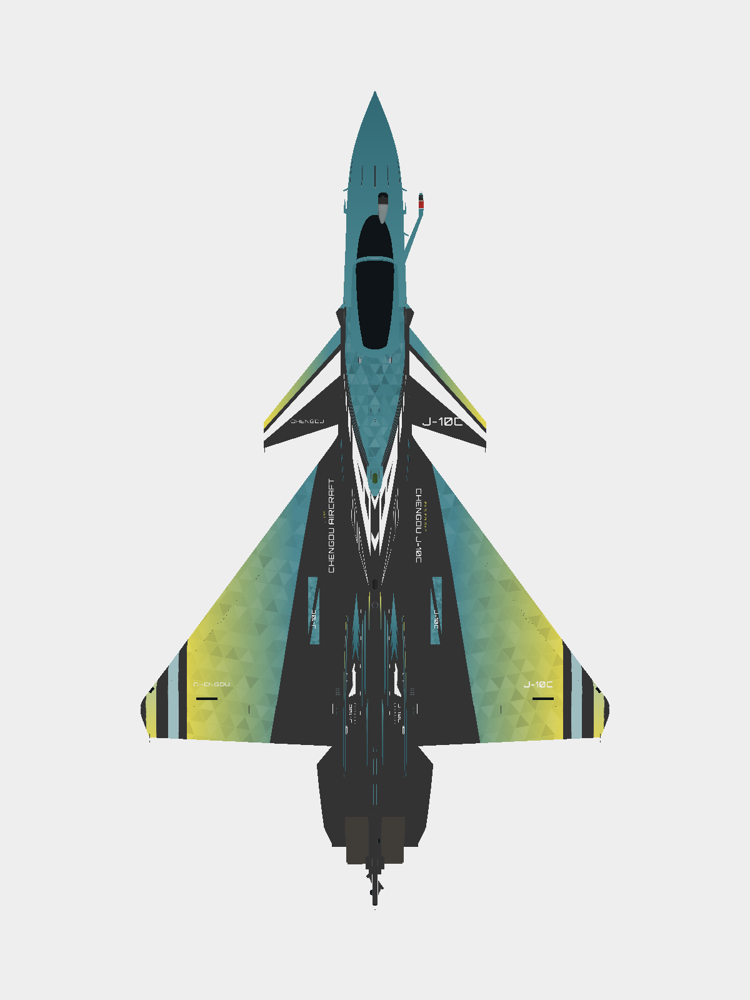
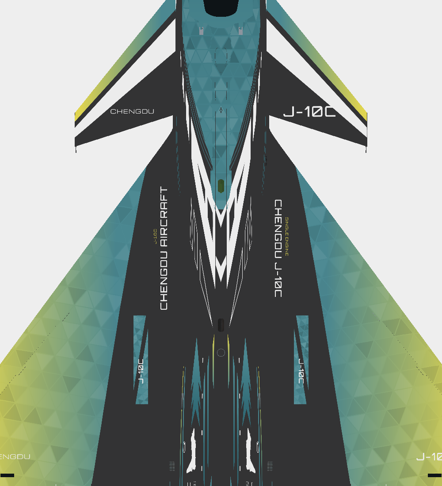

# 已认可的 J-10C 无人物基线

1.16 整理的是经过颜色纠正、全翼渐变和文字内收后的无人物版，已于 2026-11-05 获得美术认可。沿用 1.14 的构形方法，不采用 1.15 或另一条 0.2.x 版本线。J-16 继续作为已认可的双发参考；两者互补，不能互相覆盖具体作品的状态。

**后机背两枚白色侧视剪影有单独勘误。** 上图保留的是文字内收时的原图。以机鼻朝上的俯视看，两枚小飞机的机鼻已朝前，但左图标的垂尾朝左、右图标的垂尾朝右。用户在本次复核指出这一朝向有误。沿用作者 F-2A 的这组构图时，左枚垂尾应朝右、右枚应朝左，两者指向机身中线。分别沿每枚剪影自己的机鼻—机尾轴作横向镜像，保持两个锚点和机鼻方向。此图仍用于对照本例的翼面渐变和两肩字距；剪影方向改用[后机背双侧检查](mosaic-and-charcoal-detail.md#后机背的关系不能只靠元素齐全验收)。人物版的同部位已有独立修正记录，复用时从对应成图核对，避免翻转两次。

**当前公开游戏包已完成上述局部修正。** 不要仅依据页首旧图再翻一次。发布件对应[同尺度修正实物](aft-silhouette.md)，ZIP SHA-256 为 `a3b1265ac64708ca4ac6f6d8bb754343e9728571db520990d82de73a4a28630d`；最终颜色 PNG 为 `0f961d3a3835f6e6e53213601188ab9f058dc09f9bd82edc85b01ee7815d213f`。下文文字内收阶段的 PNG 指纹用于复现修前版本。

## 大形与层次

先分配炭灰底、成片签名色与中轴白色焦点。主白母形带孔洞，独立小 V 与闭合细回声分别构形；不是一个 V 反复等比缩放，也不为消除细线警告统一加粗。机翼保留翼根深楔、主色场、外侧深带与条纹，鸭翼沿实测前缘布带，垂尾按自己的表面组织序列。

炭灰区的第二阅读层由字组、细线、箭头、该机型剪影、胶囊和短标记组成。后机背按左、中、右分别检查，中央渐尖序列独立管理。不要把“补细节”变成到处填空，也不能只有两侧而遗漏中间。

## 同一色块布局换机型

用户明确指定这件作品作为幻影 2000C-S5 色块参考时，正俯首先对照三个分开的区域。青色机鼻绕过座舱后在中线上收尖，主白形从外侧包围；左右翼根与后机背构成连续炭灰，两块主翼色场各自展开，内青外黄。翼根深楔逐渐向后变宽，翼尖有深带、淡青条及外缘窄黄。幻影没有鸭翼，J-10C 鸭翼上的条带、白片和字留在本例。

以下站位来自本页 1200 × 1600 正俯实图，可在另一架机的正俯小样上检查大形。原图中线 x≈600，最大半翼展约 375 px。沿主翼根弦从前端 y≈696 走到后缘 y≈1188，在横截线上量中线至**成片翼面渐变起点**的距离；除以整架机的最大半翼展。跳过字、次要色签、鸭翼与机械件。数字近似，原图和目标机的实际形状同时保留。

| 主翼根弦从前到后 | 20% | 35% | 51% | 66% | 82% | 92% |
| --- | --- | --- | --- | --- | --- | --- |
| 右侧大色场起点，占最大半翼展 | 27% | 31% | 34% | 37% | 41% | 43% |

后半翼面的成片金黄从约 58–59% 半展开始，连续到约 80%；随后是深带和淡青条，最外一段可再见黄色。机鼻青色尖端在主翼根弦约 20%，实心白形至约 36%，最细白回声可延到约 48%。换机型先从目标机真实翼根与活动面找前后站位，再从两翼和中轴取样。数值用于发现边界明显错位，作品认可仍按用户对整机的评价。两份紫晶反例见[幻影色块反馈](mirage-amethyste.md)。

## 青黄双色覆盖完整色场

颜色目标来自指定局部参考，最终采用青色 `#4b8891`、暗青 `#326b76`、淡染 `#9ebdc0`、黄色 `#dfd44f`、暗黄 `#aaaf2e`；底色 `#333334`，近白 `#ececec`。这些数值是本例，不硬编码成所有角色的配色。

主翼从翼根青色连续过渡到外翼黄色。两种颜色都占据可见的大色场，三角马赛克贯穿其中；只把鸭翼细带、小箭头改成双色而主翼仍单色，是本次纠正的错误做法。左右镜像、上下面和独立控制面的物理渐变范围要对齐。

本例翼面图表以机体 X/Z 为米制坐标：左右 `s = -1/+1`，渐变从 `[0, s*1.6]` 到 `[0, s*3.75]`，颜色为 `signature → gold`。必须配合该机型坐标与图表使用，不能复制给别的飞机。参数摘录见 [JSON](../examples/j10c-approved-parameters.json)，它是参数记录，不是可直接烘焙的完整设计。

三角纹同时管理格距、留缝、明暗权重和模型上的方向。本例主翼格距 0.31 m，机背 0.24 m；权重从 F-2A 参考迁移后针对青色校准。左右模型显示约 +10°/−10°，图表角度不等于模型显示角度；不能把一张图的 atlas 角度当作通用常数。

## 两肩文字内收

原位置太靠外，修订只移动两侧主副字锁组，每侧向中线内收 0.28 m。主字中心由 `[0.72, ±1.15]` 改到 `[0.72, ±0.87]`，副字由 `[0.90, ±1.28]` 改到 `[0.90, ±1.00]`。主字、副字的字体、尺寸和方向保持。应学习的是“落在窄机身炭灰通道内”的关系，不是固定 0.28 m。

修订核对：四处文字中心变化，其他设计参数相同；文字移动影响范围之外像素变化为 0，Alpha 保持。局部需求优先做局部修改，已认可白组和翼尾色场不随之重画。

## 新机型必须重新解原生 UV

- 本例真实模型轴向为 +X 机头、+Y 向上、+Z 右侧。按真实岛建立米制 frame，不继承 J-16 的岛号与横向距离。
- 雷达罩左右是不同岛。只覆盖一半会留下半边深色；机鼻要逐岛核对，而不是仅看一个俯视小图。
- 座舱框、机背凸脊需要各自匹配的投影和覆盖顺序。一个大图表可能先抢走相邻表面的纹素，小 V 也可能落不到预想表面；把需要补投影的组分层处理，并在真实几何上检查覆盖。
- `zero_hit_items = []` 只说明图元有命中。仍须看左右对称、断口、遮挡、字组距离、渐变连续和正常观看尺寸；不得把零命中检查等同于美术通过。
- 复用预览场景前核对机型、贴图和构型。只补本次涉及的整体与局部视图；不自动生成七视图，不覆盖别的任务场景。

## 保留入口与验证范围

认可的是完成文字内收的版本，颜色 PNG SHA-256：`81e4e0829269e3b545f8d32c5ce05d477e679e8cf1947efee5c0b8f6c7096b77`。整理、打包和更新 Skill 不触发该作品重绘；旧候选、人物版和文件名叫 final 的其他目录不能替代它。

颜色 8192² RGBA，材质保持原生 2048²。原颜色 Alpha、机械 RGB 与保护区材质 RGBA 均保留；漆面 R 173 / B 0，平法线 G 125 / A 127。TGA 回读与包内源码核验通过。模型图片是离线预览，玻璃与喷口含预览代理，**未执行游戏内验证**。

## 1.16 发布时的人物状态（历史）

后续状态见 [J-10C 祀逐部位认可记录](current-approved-j10c-si.md)。本节保留早期失败，不代表后续版仍全部未通过。

本次人物试作被判定为放置未掌握。素材不同、透明边缘干净、UV 有命中、Alpha 未破坏，都不能证明立绘与翼面构图成立。1.16 不收录该人物成图、素材或放置坐标为正例，也不把无人物认可外推到人物。

既有人物参考保留为研究材料。之后只有在明确的人物任务中，才以参考与目标机真实形状重新研究尺度、姿态、裁切、脸部位置、背景色场和整体主次；不要以“摆满几个位置”或检查数值达标宣布完成。
