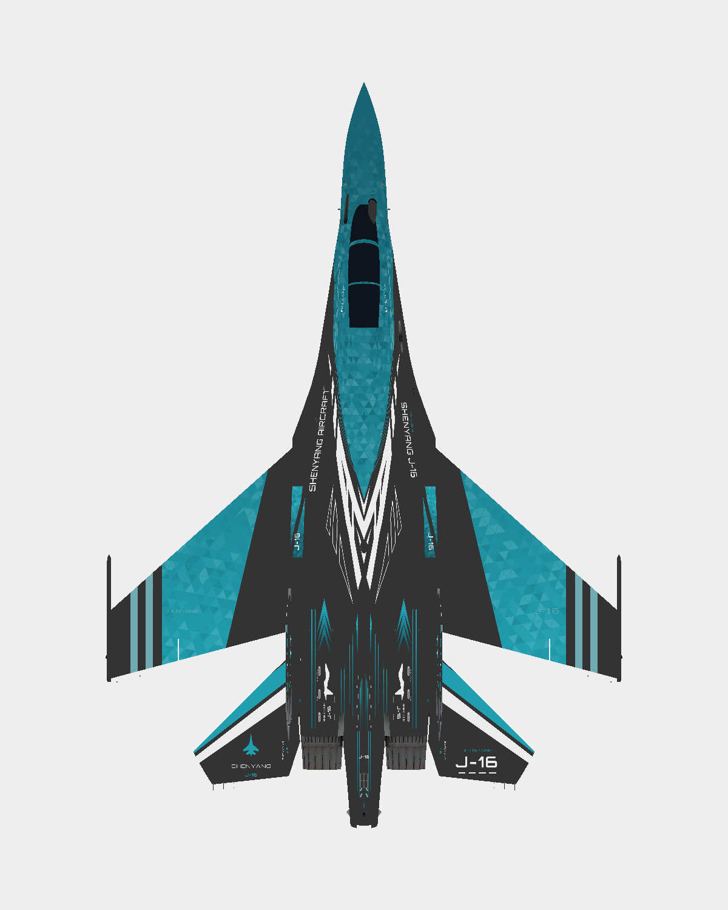
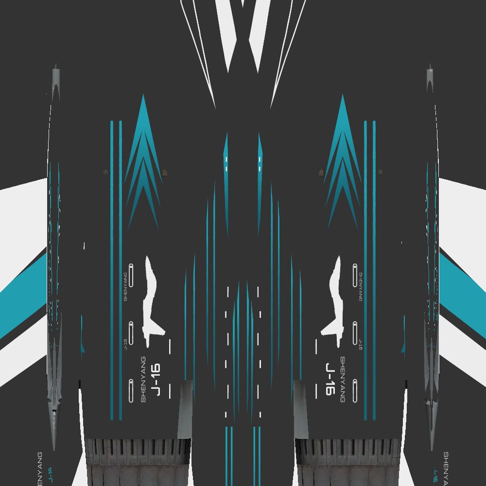

# 当前认可的 J-16 基线

青色无人物 J-16 完成后机背中央补齐的状态已获认可，要求保持（2026-11-04）。这是对这版设计与预览的认可，不把它扩大为游戏内材质验证或其他机型作品的认可。

## 保持什么

- 1.14 的整体色块、翼根楔形、翼尖条纹、平尾前缘带及已经认可的中轴母形、孔洞、小 V 和细回声。
- 统一炭灰 `#333334`；本例青色 `#219eaf`。分区三角纹的格距、留缝、明暗权重与鼻端渐弱按[实测规则](mosaic-and-charcoal-detail.md)保留；本例左右翼俯视约 +10°/−10°，其他 UV frame 重新换算。
- 后机背外侧长线、内侧箭头、目标机侧视剪影、端点胶囊和微字；**中央**成对短尖片、错位渐尖细线、下段窄尖片与断续短标记。左、中、右分别核对，不漏中央一列。
- 两肩宽体方形字及有三角纹的分裂刀片；平尾俯视剪影与机型字组。机械 RGB、原 UV、Alpha 和材质数据保持各自保护范围。

## 后续怎么工作

复查、整理、重打包或更新说明时，先读取当前认可成品的身份和真实入口，不触发美术重绘。项目中的旧 `final`、候选或历史报告不能仅凭名字被当作当前版本。

用户没有提出新美术修改时，保持当前像素与布局；不为消除启发式警告、符合通用比例、凑足缺点数或“更简洁”而自行改字、加粗、减件、换色或重排。通用审美参考、早期实验和其他风格 Skill 不覆盖这一基线。

用户提出新修改时，以这版为起点，只改指定范围，输出到新目录。先确认当前生成器与保留设计一致，防止新代码配旧贴图；然后根据实际改动检查未改部分。纯增补可用“所有旧设计层相同、增加图层之外的最终像素变化为 0”验证。检查结果与用户评价分开记录，不自动继承到新的候选。

本例认可的 8192 颜色 PNG SHA256：`6857c4a32b6fe429dc22b1da801f486e492a95dacb538256c153cb307db65ee6`。图片为该成图的模型预览；此记录是具体作品的基线，不能把其机体坐标直接复制到其他飞机。
