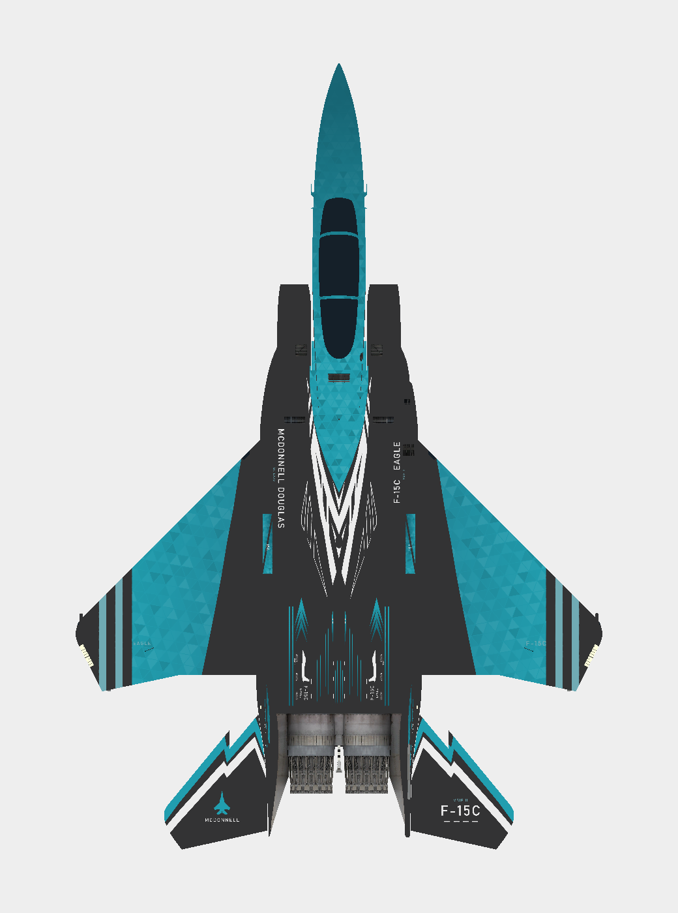
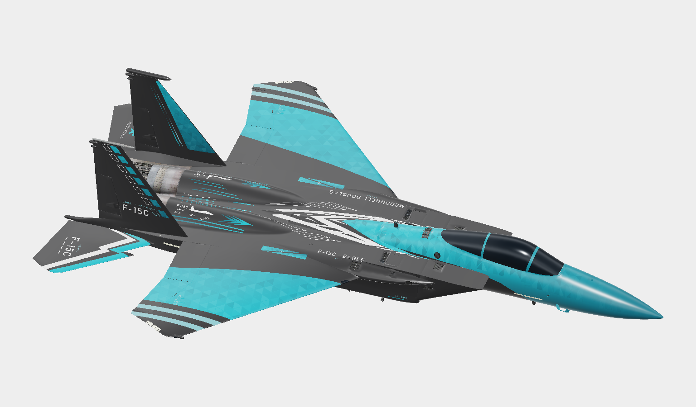

# F-15C MSIP II「青锋」· 已认可的双发无人物基线

2026-11-13，用户对最终安装的「青锋」评价「无人物做的很好，开始进行有人物的，人物限制终末地角色」。本次整机美术认可属于美国 F-15C MSIP II 的无人物终稿。游戏选择名为 `Akamywek_F15C_MSIP_II_Cyan`。交付件为《F-15C MSIP II 青锋涂装.zip》，SHA-256 为 `07f8ccf2dcbc8fca2f85365fb1b2527feaed2091fd83eb131392b04ff4876035`。

青锋从[歼-16 青色无人物版](current-approved-j16.md)取色，在 F-15C 原生 UV 上重画。正俯时，机鼻的青色绕座舱，在中央白组内收尖。炭灰肩部留给两侧字组，两块青色主翼在外缘以深带和淡青条收边。减速板后，两侧发动机舱各有箭形与朝中线的小飞机，中间留出独立的一组短尖和细线，三组都在裸金属前收住。

从斜俯区分双垂尾的面向。外侧有型号字和成列的小块，内侧保留较深的青色楔。独立平尾的青白前缘带顺着实际折口展开。两张图均从上述游戏包的 8K 颜色 DDS 与 2K 材质 DDS 渲染到本机 LOD0；正俯和右斜俯保留原图字节。颜色 DDS 的 SHA-256 为 `5affa8ad04e90415a862db18e86a0c3c9c80da4bc77be0168b776056e790e75e`。

实作时，进气肩盖按模型和原厂色图确认为漆面，后方格栅保留原色。尾部裸金属在上下表面的起点不同，分别取样再划机械区。肩字、两片外垂尾的型号字要从各自外侧放大看首尾笔画与格栅、细框之间的净距。换机型时重新找可读的位置。

同机[莱万汀人物版](f15c-laevatain.md)沿用青锋的机背白形和双发尾段。用户随后认可了该人物版的整体布局，并单独要求提高清晰度。
