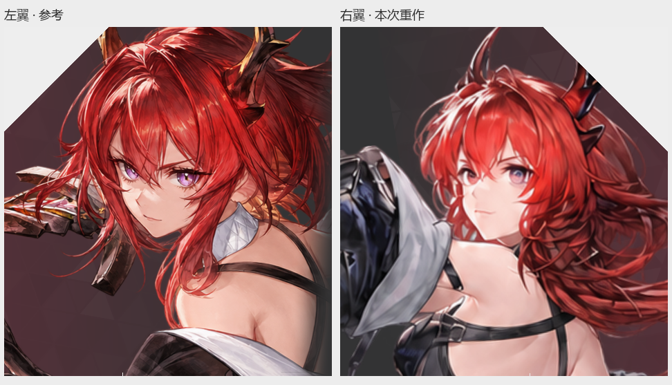
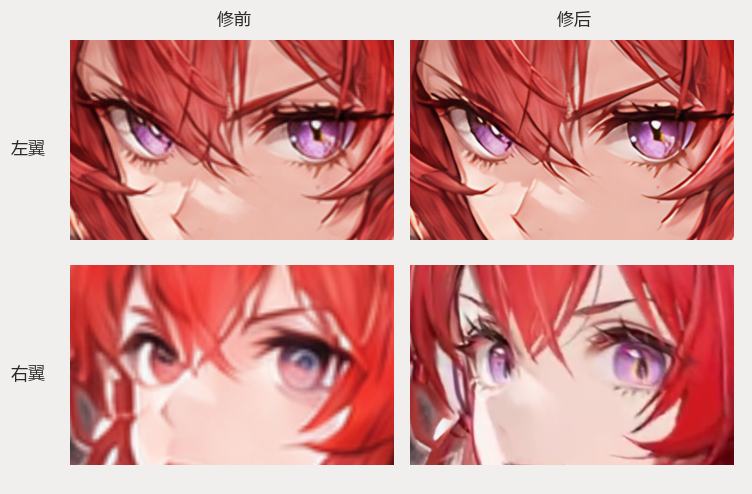

# F-15C MSIP II「莱万汀」双翼人物

**用户认可的范围。** 《明日方舟：终末地》莱万汀沿用[青锋无人物版](f15c-cyan.md)的机背白形、双发后段和双垂尾。用户先要求「保留不同立绘，两边脸和肩同向」，在同向版交付后评价「整体布局可以，但是立绘分辨率太低了」。整机构图可用作范本。随后完成的高清修复已有最终 DDS 对照，清晰度的美术评价仍待用户反馈。

## 两张不同立绘怎样同向

把两翼从同一张机鼻朝上的正俯实模等尺度并排。以左翼回身插画为参照，右翼保留举剑立绘，从双眼中点定位，比较眼线、下巴和近侧露肩。获认可的布局里，两张脸均微朝画面左侧，发顶朝机鼻、下巴朝机尾，露肩都在各自脸的右下方。右翼取到肩甲、衣领和上半身，沿上翼轮廓裁去脱离动作的远端剑焰。再看斜俯的脸部可读性和翼根裁切，翻到下翼核查共享 UV 的影响。

前一稿把右翼胸到腰的连线调到距翼展约 4°，用户仍指出「怎么还是竖着的，要和左翼那样啊」。该数值只描述躯干，对脸和肩的读向没有判定力。把左翼也一起旋转，或各从一个机位取“脸朝上”的局部，会丢掉正俯中两幅立绘的相对关系。上述具体朝向属于本件，其他姿态按所选范本判断。

## 布局认可后提高清晰度

冻结翼面上的眼位、人物物理尺寸、朝向、裁切和透明轮廓。先查源图有多少真实瞳距像素，再看该处原生 UV 在 8K 成品上的纹素密度。本例左、右翼旧素材分别约 204、109 源像素/米，眼部所在翼面约 375 纹素/米。单看整张贴图或放大后的画布尺寸，容易漏掉眼睛和发丝上的细节不足。

右翼找到了同一举剑姿势的官方影片近景。旧图双瞳间约 40 像素，近景约 139 像素。用瞳孔、嘴线、下巴和衣领配准，在眼脸与内侧额发采用真实近景细节，保留原外轮廓。左翼回身姿态使用原有抠像做两倍超分，新增的高频细节按推断记录。两侧分别注明真实来源、超分区域和工作图。有效分辨率与修复方式按具体素材判断。

从最终游戏包解码颜色 DDS，在同一翼面位置取 1:1 的虹膜、睫线和交叠发丝，再用固定机位看整机和两翼。清晰度复核同时对照原布局的眼位、裁切与人物之外的表面。下图为局部旋正后的修前修后细节，仅供清晰度比较。

## 对应游戏包

游戏选择名为 `Akamywek_F15C_MSIP_II_Laevatain`。同名包经历多次修订，回查时按 SHA-256 定位。

| 状态 | 游戏 ZIP 的 SHA-256 |
| --- | --- |
| 侧倒稿，用户要求改为与左翼脸肩同向 | `53fdd136c27429831f2b9ae137dc94d15e4d2373986356412052c694b5d25939` |
| 整体布局获认可，立绘分辨率被指出偏低 | `3405a6df6a875ff80a24945bc8027389614e5f144cf6cf6088cb972ca7bd2baa` |
| 同布局高清修复，已有最终贴图对照 | `e54a871222a9b78e60848b0f28067ef43004313a135b6a9cf3404508321f6997` |
