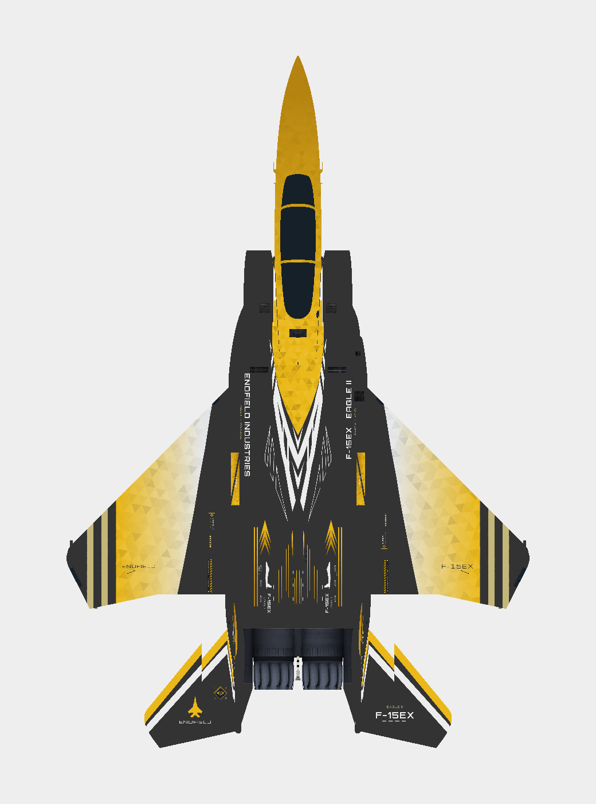
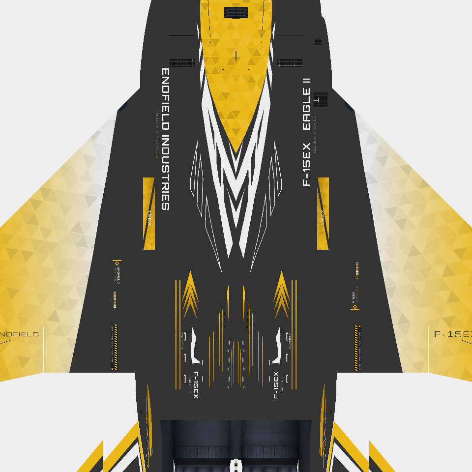
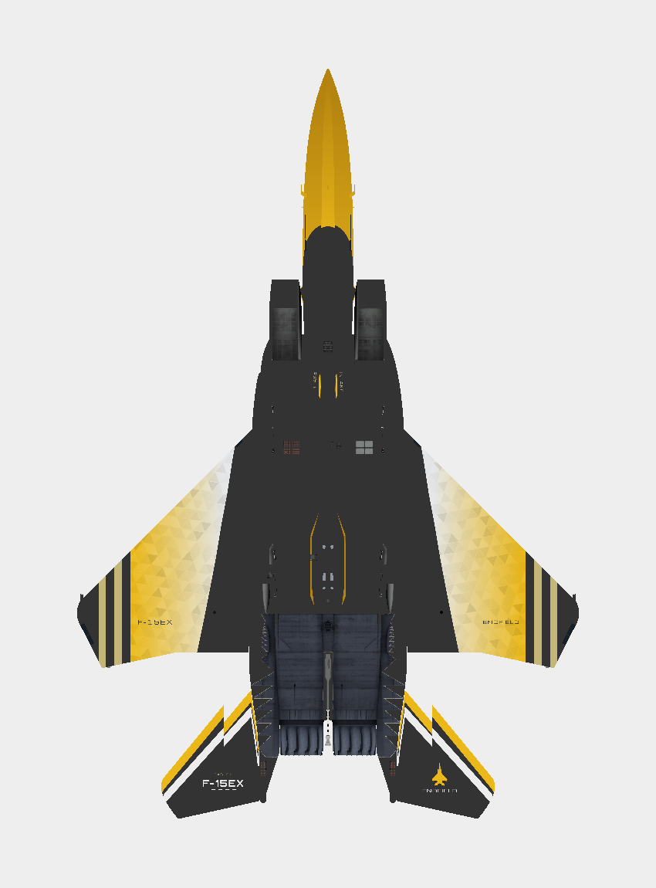
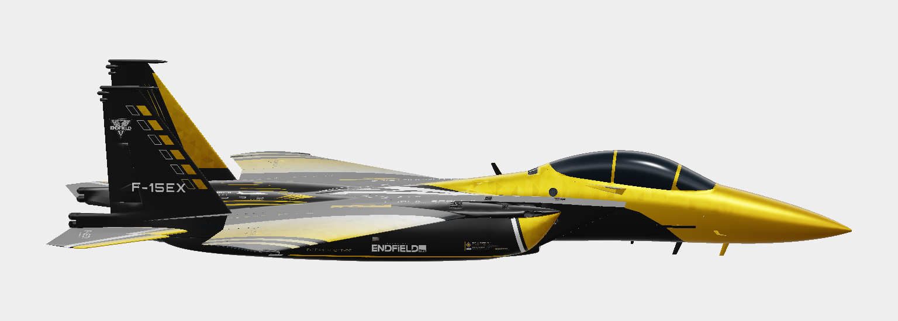

# F-15EX「终末地」· 缎面金属反光、CFT 与双发炭灰细节补齐参考

2026-11-18 结合实机参照涂装 `[Bronya][Cy30][D-9A][SFW]` 与多轮《战争雷霆》实机截图反馈定稿。游戏目录名 `Akamywek_F15EX_Endfield`，对应交付件《F-15EX 终末地涂装.zip》（含主机身 8K/2K、保形油箱 CFT 2:1 贴图与平坦细节法线）。

> **风格定位**：本作品是在原教旨 Akamywek 几何构型、双发后段分区、炭灰技术细节与 PBR 涂层上叠加《明日方舟：终末地》工业贴花的 **Akamywek 联名变体**。做纯原教旨 Akamywek 时仅取机身构型、材质与文字层级；做终末地联名变体时可直接调用随包内置的 [终末地贴纸素材库](../assets/decals/endfield/CATALOG.md)。

## 本案例补齐的 6 项关键规范

1. **内置宽体几何字体（`Orbitron-VF.ttf` + `Michroma-Regular.ttf`）**：随 Skill `assets/fonts/` 自带两套字体及 `OFL.txt`。`vector_paint.py` 与 `design_lint.py` 默认即加载 `Orbitron-VF.ttf`（Bold/Medium 作机型、两肩与大标），副行配 `Michroma-Regular.ttf`，不再静默回退到偏窄的 Windows `Bahnschrift`。
2. **中轴内侧白 `V` 保持完整锐角，不留原雷达罩圆孔**：从 J-16 等带机背凸起天线的基线迁移中轴白组时，必须合并并修平 `idx 16 / 17 / 20` 绕开圆包的切口碎片；在 F-15EX 等光滑机背上画成一条完整、对称、不镂空的锐角实心白 `V`（见 [机背近景](images/f15ex-endfield-dorsal-close.png)）。
3. **双发后机背与内翼根炭灰技术簇不可遗漏**：
   - 后机背两侧发动机舱上方：外侧双长线、内侧渐变箭头、机鼻向前的白色侧视剪影旁，**必须保留完整的机型型号锁组（如 `F-15EX` / `EAGLE II`）及胶囊-微字簇**，不能只画剪影而漏文字；
   - 内侧主翼后根部 / 平尾前方宽炭灰区（`x ≈ -2.4 .. -4.4`）：保留菱形标/方框品牌字、条码刻度与黄黑斜纹警示条等炭灰技术细节簇，连同翼根两片刀形贴纸与短机型标，避免双发大翼根沦为空光板。
4. **文字与徽记防逼挤 + 几何边缘/铰链缝净距**：
   - 垂尾外侧白色徽章居中放在前缘序列方格后方与垂尾后缘之间，完全高于方向舵 `rudder` 铰链缝；不强塞紧贴根部机型大字上方/下方的多余小副标；
   - 平尾型号字（`F-15EX`）向内中段收进宽敞区（如 `z = 2.72`、`height = 0.175`），不推到翼尖窄弦角；`design_lint.py` 查同图幅重叠/贴靠，`surface_map.py` 的 `edge_items` / `seam_items` 对 `< 2.0 m` 小徽章与文字自动核对距离边界与 `SEAM` 是否 `< 5 cm`。
5. **缎面高金属 PBR 与去水波纹细节法线**：
   - 使用 `coat_material.py --preset metallic-satin`（`R=163` 光滑度、`B=188` 金属度、`G/A=(128, 128)`、`--structure 0.0`），兼顾金属质感和丝滑环境反光，避免 `R≥240` 的玻璃球失真；
   - 用 `--flat-detail-out` 生成 512² 常值中性细节法线（`RGBA=(198, 128, 255, 128)`）并在 BLK 替换槽位 4（`aircraft_normal_detail_lo_n*`），消除机翼与脊背上的平铺 Perlin “水波纹”。
6. **三段式尾喷口/机腹护罩改质 + CFT 非正方挂载涂装**：
   - 使用 `coat_material.apply_exhaust_finish` 把喷口前方机腹/机背金属护罩（`shroud`）压成深暗枪灰钛金属（`gain=(0.35, 0.37, 0.42), R=150, B=224`），外部收敛片（`noz_outer`）改为深阳极钛（`R=138, B=240`），内部衬板（`noz_inner`）改为哑光碳陶（`R=86, B=36`），同时 100% 保留原图 `G/A` 铆钉/百叶法线（见 [机腹渲染](images/f15ex-endfield-belly.png) 与 [右舷侧视](images/f15ex-endfield-starboard-side.png)）；
   - 对可选保形油箱（CFT：`f_15ex_fuel_tank_opt_c*` + `f_15e_fuel_tank_opt_n*`）按 2:1 原比例清理原皮小徽记碎块，完整涂装并用同一套清漆。

