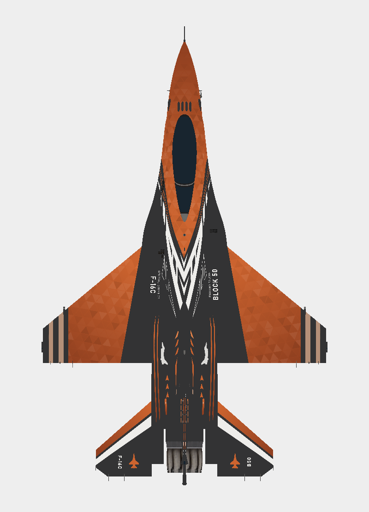
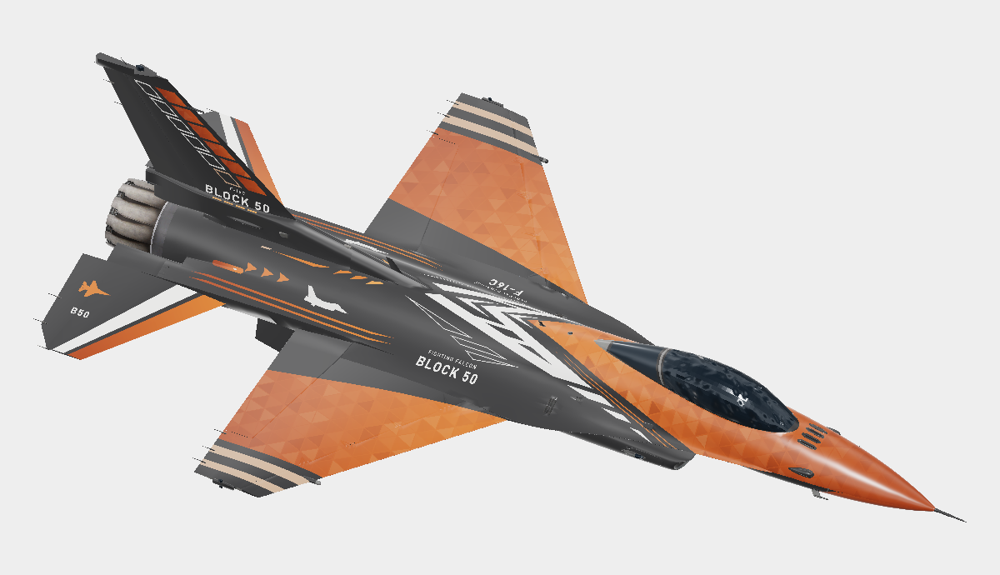

# F-16C Block 50 · 铜橙无人物

2026-11-12，用户看过交付的 F-16C 铜橙终稿后评价「非常优秀」，要求再做一架，并让这套质量可以常态化复现。认可对象是该终稿。游戏内目录为 `Akamywek_F16C_Block50_Copper`，游戏 ZIP SHA-256 为 `c31e6f6ad32788d8d2bd9321a333d7f425a57e2f9ae9d13b18aa0f30d590914a`。下图均由终包 DDS 贴回本机 LOD0 渲染。

## 在初样就能看出的四件事

1. 在目标机的正俯视看机头色场怎样收束。铜橙从机鼻包住座舱，留一段炭灰间距再交给白色母形、内孔及小 V。左右翼中段有足够宽的同族色场承接机头，翼尖用深带和浅纹收边。换三角翼、双垂尾或可变后掠翼时先画出承载面和活动边，再决定每一带的宽度与终点。新机的签名色由该作决定。
2. 用目标机实际可见的后机背安排「两侧—中间」的层次。此机初样六枚中央短尖片落到背鳍占据的位置，全无命中。移动到背鳍两侧露出的蒙皮后，与外侧剪影、长线形成前后呼应。若一枚箭头或文字有采样却在实模消失，绑定正确观察方向重看遮挡，再决定移位或删掉冗余件。
3. 在最初可显示的分层样稿上，文字就放最终要用的内容。各从一侧外部斜俯看本侧肩字与平尾，再从侧面读进气口和垂尾。记录实际读出的机型或字词。若水平字倒置，只旋转该侧字组并固定锚点；若文字镜像或只露半截，分别查翻转及独占 UV。F-16C 的终稿按这个方法修了双肩与双平尾共六个放置，颜色图变化限定在四处字组内，其余三层逐字节相同。新机的图表方向不沿用这一架的 180° 参数。
4. 粗略的位置正确后，把实际 DDS 贴到同一模型，在机背、尾翼的真实两点间标定约 100 px/m。看主白、孔洞、各自独立的细回声能否分开，再在包内原像素上检查边缘。F-16C 最细回声的部分边段已接近屏幕一像素。新机优先调整承载面和深色间隔，再单独调整出现断口的细件。漆面斜俯再看一次副字和机肩，亮斑与涂色串入要回原 UV 分辨。

该例使用炭灰 #333334、铜橙 #CD642F、暗铜 #924020、淡染 #B59078、暖白 #EEEDEA。新机设计可复用色块、留黑和阅读层级，并按自己的原皮识别喷口／轮舱等机械节点。具体帧、岛号、签名色和色面占比均属于 F-16C。人物方案的独立姿态、眼脸、裁切与翼根过渡使用[七件认可作品中的人物对照](reviewed-works.md)。

交付核对覆盖原始 267,262 三角面的飞行模型、8K 颜色、4K 材质、同位置原尺寸裁切、左右外侧字向、源码重建和安装哈希。用户的整体评价与这些离线技术记录分别保留。
