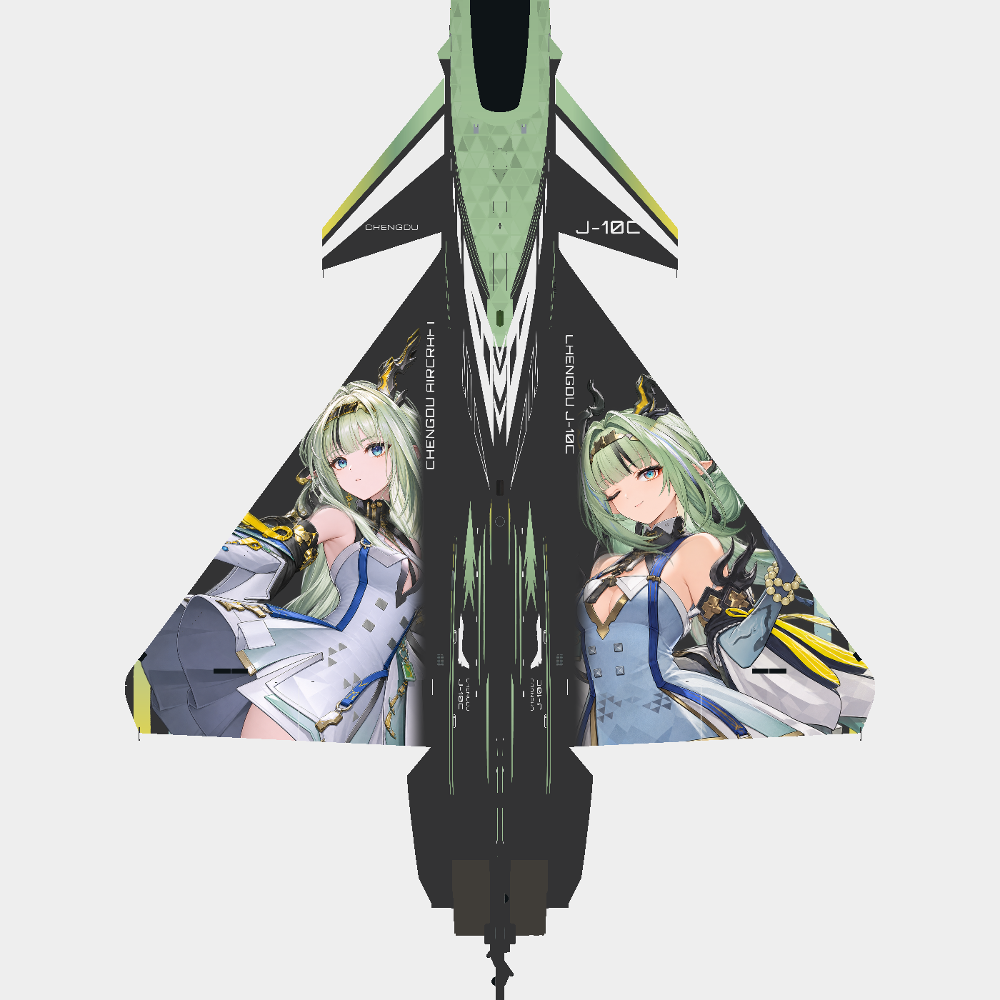
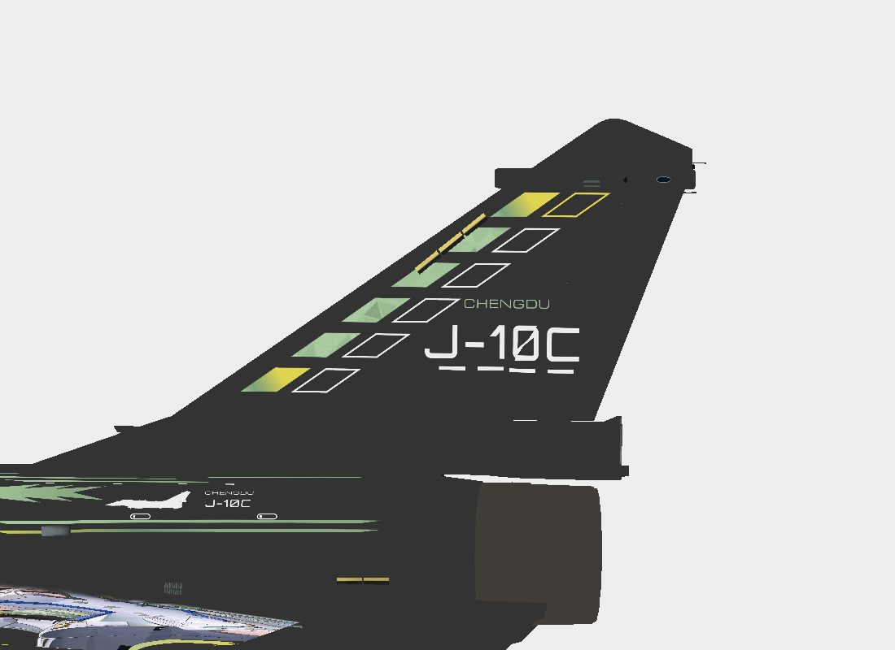
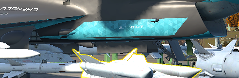

# 验收前的诊断记录（历史）

**以下记录保留失败原因与当时的反馈，不是当前待办。2026-11-05 用户已确认最终组合满意；当前状态以[1.20 已认可案例](current-approved-j10c-si.md)为准。不得把历史“待审”覆盖后来的验收，也不得恢复被否定的中间稿。**

# J-10C 祀：逐部位认可与实机修正

## 认可范围

2026-11-05，用户对当前 J-10C 祀反馈：“机腹部分的色块处理的不是很好，其他地方不错”。这只确认机腹以外的当前效果；机腹/进气道外侧色块仍为失败项，后续候选不能自动继承认可。正式 Skill 仍为 1.16，本记录属于本地待审补充。

后续用户另以 F-2A 侧视图指出“机头做的也很粗糙，F2A是流线型美丽的”。因此机头色场与侧面标记也从认可范围中排除，以最新逐部位反馈为准；此前“其他地方不错”不能阻止用户继续指出具体问题。

用户随后又指出 J-10C“中轴线的粗白线还是差点意思”。该机的主白形与小 V 组合因此重新进入修订；别的机型已认可的母形不能证明缩放、投影后的 J-10C 实机效果也通过。

认可时安装颜色为 `j_10c_cloth.dds`，SHA-256 `99238ee2b264fa6c810f5292e4968c3986099f093848c2769fbc5bf66ed90c77`；材质 SHA-256 `86e9f168b1329a0d44c528376c72bc0fec17967c1bd76c67d75c535e7c26762a`。哈希标识整张输入，**不表示其中被明确否定的机腹也获认可**。



## 人物与翼尾的取舍

- 每翼用一张不同的官方源图，人物占据翼面主要区域。允许取上半身、切掉衣摆或四肢，让实际翼面边界完成裁切；不把完整人形缩小成一张贴纸。
- 当前左右分别来自官网基础立绘和官方漫画《溯始先声：缘起》宣传封面。用户排除了潜能图，允许官方宣传插画；不可因缺素材重新混入潜能图或另生成新姿态冒充官方。
- 同图镜像、换裁切或复制为另一侧回声，都不满足“素材不重复”。同一人物在主翼、两段升降副翼及其内部细节图层上的连续投射，只是同一个图案跨 UV 岛，不属于另一个人物展示位置。
- 主翼有人物不意味着垂尾也必须放人物。此例的小矩形尾部胸像被否定，最终明确恢复了无人物垂尾：前缘斜列色块、细描边及 CHENGDU / J-10C 字组。
- 按已认可成图保留其他色场与中轴结构，不用旧面积比例或人物数量规则压小人物、硬塞垂尾、重画整机。



## 清晰度：检查有效像素而非文件尺寸

初版虽然为 8192² 贴图，左右实际取用的素材只有 836×1050 和 1000×1080，宽度映射约 3681 / 3628 纹素，分别插值放大 4.40 / 3.63 倍。8K 文件头不证明人物细节足够。

本例原官网 PNG 是 256 色索引图；同尺寸 WebP 保留更多颜色。选择素材时同时检查尺寸、调色板/真彩、局部线稿及实际人物占比，不把更大的画布当成更高的人物细节。此差异只是本例，不推定所有 PNG 都差于 WebP。

用户允许内置生图辅助抠图和修复。请求 4K 后实际只返回 1254²，必须记录实际输出，不能把提示词要求当成已完成。工具没有暴露模型名时，不宣称它是 Image 2.6；用户后来明确接受无法核实内置型号。

当前使用上半身、头部、衣装局部细节图层分别配准：先按真实特征估计缩放/旋转/位移，复查面部比例、衣片接缝与轮廓，再映射到同一原生 UV。头部有效采样从约 123 / 149 px/m 增至约 506 / 482 px/m；衣装随后以局部图补细节。局部图应填补同一人物的细节，不出现双重轮廓，也不能为遮接缝抹糊整个人物。

这些是**官方素材衍生的模型修复图，不是官方原图的逐像素提取**。需要保留源图、处理提示词、实际尺寸、变换和前后对照；模型重绘细节不能宣称为找回了真实官方细节。只有用户允许这种处理时才使用。

验证按“源图 → 源层 → atlas 1:1 → 包内解码 → 安装文件 → 游戏实际尺度”追查。原尺寸对照只证明该环节改善；游戏里仍糊就继续查加载、采样与观看尺度，不重复生图后自行宣布解决。

## 字组和剪影方向

在左右两侧分别看模型的正常观看方向。此例第一次只上下翻了飞机剪影，遗漏了倒置的 CHENGDU / J-10C 字组。最终从两侧各自正常视向看，垂尾朝画面上方，两行文字正常可读；复用后机背成对剪影还须按[正俯视方向](aft-silhouette.md)核对；不要仅看 UV 上的方向或只检查一侧。

修改图标时核对配套字组，修改字组时核对图标、对侧与前后阅读顺序。已认可的纹样、人物和机械件保持，用明确的修改覆盖范围验证域外像素未变。

## DDS 与紫边

本例的白字源 RGB 为 236/236/236，Alpha 全不透明；本地 BC1 编码实验将大量白像素变为 239/235/239，能复现粉紫偏色。但这不是游戏实际采用该编码的证明，也不能泛化为“所有 TGA 有问题”或“所有 DDS 都更好”。

实机证据：

| 输出 | 实际结果 |
| --- | --- |
| TGA 颜色 + TGA 材质 | 可加载，用户仍见紫边 |
| DX10 扩展头 RGBA8 DDS、完整 mip | 本地像素/包体校验通过，游戏退回原皮，失败 |
| 传统头 BGRA8 无压缩 DDS、单层 + TGA 材质 | 用户确认可加载，紫边消失或明显减轻；成为当前主包 |

当前颜色导出示例（路径按项目替换）：

```powershell
texconv.exe -dx9 -m 1 -f B8G8R8A8_UNORM --ignore-srgb -o output colour.png
```

确认实际头部没有 DX10 扩展，32 位 RGB/Alpha 掩码正确，并逐通道回读比较。8K 传统未压缩 DDS 用 Pillow 通用解码极慢时，可在核验头部、尺寸和掩码后直接读取 BGRA 字节、交换为 RGBA 比较；不跳过校验。保持颜色 Alpha，材质数据通道不作 sRGB 调色。

单层 DDS 是这个案例已验证的兼容方案，不是全局取消 mip 的规则。其他格式或 mip 链都须在目标游戏中验证，不能用离线可解码替代实机加载。

安装时先放完整贴图，再更新 BLK；必要时采用新贴图文件名避免旧缓存，验证实际安装字节。游戏 ZIP 只含 BLK 及引用贴图。更换格式造成整机退回原皮时先恢复可加载路径，不继续试改 RGB 或 PBR。

## 材质与对照

F-2A 实测为 R=173、G=125、B=0，A 众数127并带少量结构；没有证据支持额外的“哑光层”。当前 J-10C 涂装区域 R=128，B和G/A保持、机械区保持。128 是此作品的实际选择，不取代所有深底作品的173默认值。

先保持相同机型、光照、视角与颜色内容，只改变格式或一个材质通道。不要拿阴影下的 F-2A 和受直射光的 J-10C 直接判断参数；高光冲白、源素材模糊和颜色压缩是不同问题。不要在颜色图上覆盖一层灰色来假装“哑光”。

## 机腹未通过



截图中的长条亮青色纹样位于进气道外侧下部。用户认为处理不好；不能把它作为本例正向范本。后续应局部检查色块与壳体的关系、亮度、三角纹密度和收尾，并保护已经认可的双翼人物、垂尾、字组和其他表面。尚未确认的修订只能记录为候选，不给整机“全部通过”状态。

本例下翼面有少量与上翼共用的纹素，原流程通过真实几何投影的下表面遮罩保护。保留原生 UV、Alpha、机械件和这些共享纹素处理，不因为人物清晰度或机腹修订而破坏它们。

### 失败修订：只收窄、压暗侧面条带

随后用户明确反馈：“对不上机体分块太严重了，切割也粗糙”。该候选只移除了旧的侧面梯形，未移除下方旧机腹投影；侧壳与底面的朝向筛选又在不同三角面中断，于是留下细碎青色条、锯齿端头和跨壳体接缝的色块。变暗、缩小以及遮罩域外像素不变，都不能证明构图已修好。

局部返工须先追查所有贡献旧颜色的图层，再用真实 UV 连通岛确认载体。曲面不能仅靠 normal 阈值切割：侧壳、折面与底面分别处理；先清掉废弃图形和载体上的残留，再在低曲率侧壁内留出明确边距。使用原生 UV frame 保持直边，不能让多边形在选中三角形的边缘被截成碎块。字组也须绕开模型实际凸件，UV 图中可读不代表贴到机体仍完整。

本次采用左右进气道壳体原生岛重做的版本仍为待审候选；只能报告实际检查结果，不把新方法直接写成获用户认可的成功范本。局部检查须至少包括两侧和斜下视角，关注色条残留、接缝终止、折面和机械件遮挡。

### 再次否定：边缘完整，但独立色块突兀

用户随后对原生 UV 侧壳上的独立梯形马赛克反馈“太突兀”。该版本虽然移除了碎条、保住直边，并避开了凸件，整块带字色板仍像孤立贴纸，没有融入机体线条。几何映射正确与构图成立是两项判断，不能互相替代。

下一候选取消整个梯形背景，只沿进气口实际斜边留一条窄色带，将小字直接放在炭灰底上。此方向只属于本次局部返工，不推广为全机取消马赛克或缩小已认可翼面色场的规则；在用户再次确认前仍为待审。

## 机头硬切：跨图层覆盖破坏连续收势

用户的游戏侧视对照显示，本例机头青色在座舱后方形成近竖直截断，边缘还有缺口；F-2A 参考则从机头沿机背形成连续、向后收束的色场。原 J-10C 上部原生 UV 色场已有收尖，但后绘制的 `nose-field` 以机身 x=5.05 为三角面筛选边界，整圈填色，覆盖了侧面收势。单独检查俯视母形会漏掉这个侧面问题。

修订需核查最终叠层，而非只看母形：完整选择承载 UV 岛，在图元内定义纵向连续边界；让侧面、机背和机头色场衔接，在头部渐弱纹样，跨岛统一色彩渐变。侧面字组被朝向阈值裁掉时应重新按原生 UV 放置，不能把截断的字当成装饰短横。检查左右侧和上斜视，保留已认可人物、中轴白形及局部范围外像素。新机头候选仍待用户确认。

## J-10C 中轴白形再次修订

本机原主白形内缘有阶梯式转折、四个孔洞，另叠加两枚独立投影的小 V。代理尝试把它简化为大 V、取消孔洞并挪开后端小 V，用户明确否定：“你改后更丑了，我要原来那种，但是要更精细化”。**该简化方向失败，未安装进游戏，不得作为推荐范本。** 用户要的是原有复杂构造的精修，不是把“精细”解释成“简化”。

继续修订时保持母形外轮廓的全部顶点、四个孔洞、双 V 的纵向位置、前端白片与细回声。本次精修候选仅将孔洞边缘内缩约 7 mm（8K 约 4 纹素），给薄白壁留余量；两枚小 V 横向分别收窄约 10% / 14%，消除轻微偏轴，使原位置的深色缝更清楚。具体数值只属于该机候选，仍待用户确认。

先看目标机正常游戏尺度上的主次、留黑和端部，再看 1:1 边缘；不能靠母形来自已认可示例、零命中检查通过或像素保护通过代替美术验收。局部清理旧白形时须恢复其下方真实色场，不要直接铺灰破坏蓝绿色尖端。中轴凸起是独立 UV 岛，要核对其实际图形，但这不是重构已选构图的授权。

用户继续提供 F-2A 中轴游戏截图，明确认为上述局部微调仍远不如参考精细。随后直接解码并检查本机已安装 F-2A 原 DDS：主形、孔洞和双 V 在同一展开坐标中构造。J-10C 当时的母形按 0.60 比例在原 UV 上，两个小 V 却按纵向 0.60 / 横向 0.85 在机体投影上，且主形遗漏独立凸脊。仅微调孔洞不能纠正这种比例与承载面的不一致。

新候选保留原母形及四孔，恢复双 V 的同尺度比例，主形和小 V 使用共同原生框架，并在凸脊补中央衔接。不能把整个外侧长尖复制到凸脊的卷边侧壁，否则末端会出现交叉：须按实际载体限定补绘范围，在俯视和斜视逐项核验。此候选尚未经用户认可，不能称为已经达到 F-2A 的精细度。

## 右侧人物翼根竖切

用户指出人物过渡不自然，并明确是“左侧直接被竖着切割了”，而不是头部与衣装图层接缝。检查发现三个人物细节层继承同一个固定裁切框，内边界在原生横向坐标 0.92 m，造成头发和衣装沿一条直线齐断。不要把此反馈当成重新生成脸、全图模糊或缩小人物的请求。

当前候选保持源图、脸部、姿态、尺寸及主体纹理，在原裁切位置内侧用约 0.20–0.30 m 的局部 smoothstep 蒙版过渡到同一炭灰底；其余外轮廓保持，效果仍待用户确认。这是修复明确硬切位置的局部方法，不推广为给全人物做大片淡出。过渡须同时覆盖主翼及两段升降副翼对应的 UV 岛，否则下半截会重新露出硬边；保留机械件、Alpha 与共享下翼面纹素。

首轮只处理截图中的右翼，用户随后指出“你怎么只改一边”，左翼仍有同样竖切。该遗漏已补为左主翼及两段升降副翼的对应过渡，沿相反符号的横向坐标处理；保留已经完成的右翼像素，避免重复叠加淡出。两翼使用不同人物源图，不能把一侧画面镜像过去。交付前同时检查左右近景和完整双翼，不以一张局部截图代替成对部位的核对。

## 淡翠绿色不等于旧青色参数

用户后来明确指出机头应为淡翠绿色，游戏中却显示青色。原因包含沿用无人物基线的 `#4b8891` / `#326b76`，这组数值本身偏蓝青；不能仅归因于环境光，也不能因为旧基线获认可就冻结与当前颜色要求不符的参数。

本次局部候选把相连的机头、前机背、座舱框和已涂色前部附件校为浅翠绿，保留现有流线轮廓、三角纹及明暗层次。主色约 `#a5c69b`，暗色约 `#89a780`；这是本作品的待审目标，不是全风格默认色。校色限制在原签名色图层的实际覆盖区，保持白字、白形、炭灰、黄色标记、机械件、人物和数据 Alpha，不靠改变 PBR 来掩盖底色选错。须分别检查左右及上斜视，实机颜色仍待用户确认。

用户随后要求“其他地方也要改”，并明确说“渐变色倒是很喜欢……人物立绘带多种颜色就弄渐变色点缀”。因此应把残留蓝青装饰统一到淡翠绿，保留金黄端与原渐变走向；认可的是这种多色渐变点缀关系。该规则已写入当前使用的配色参考，未发布新版本，也未把其他待审修订整体安装为正式 Skill。
