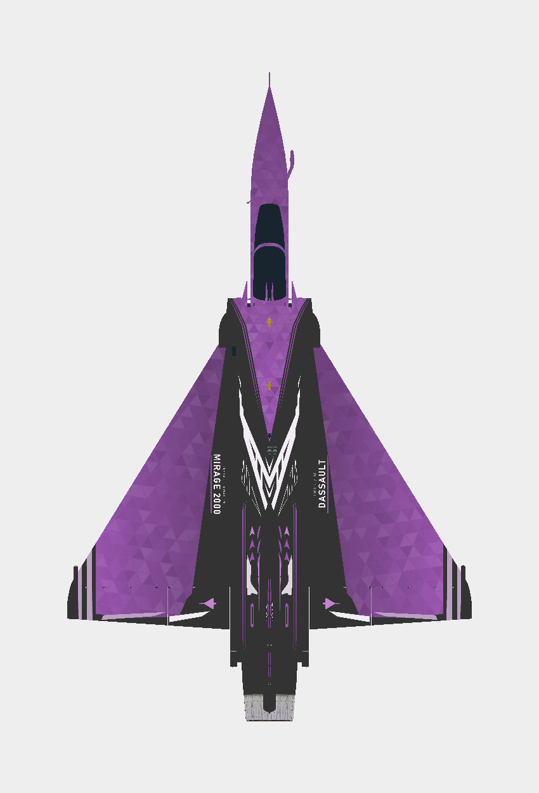
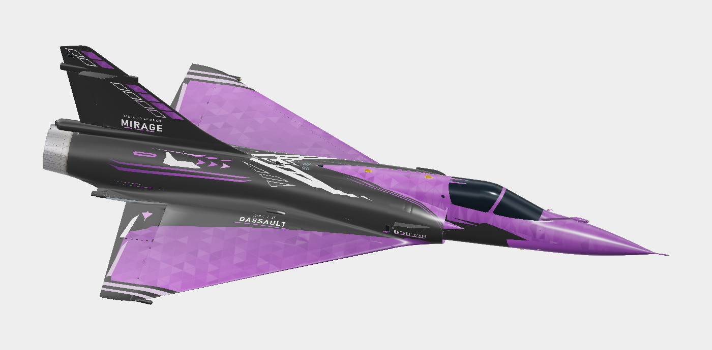
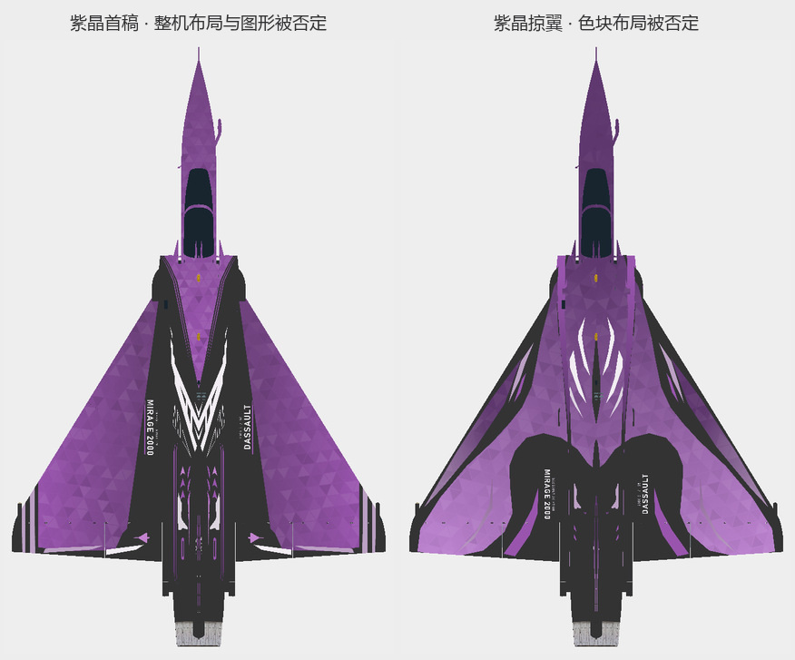

# Mirage 2000C-S5 紫晶首稿 · 整机布局与图形反例

用户在实际交付后评价「这张很失败」，进一步指明「整机布局和图形」。此反馈适用于整个紫晶首稿，包括腹面修正版。其游戏包 SHA-256 为 `2c83c146936644cd84a3e993188bdf9f17d4b3532be037b96f1fccd19a6c8e56`。下图用于辨认被否定的版本；图元可见性、字向、颜色通道、安装核对和源码重建仍然是可复查的工程试验。

从正俯观察，紫色机鼻与两个大三角翼面之间有宽炭灰肩区，中轴集中使用嵌套 V，后段的小剪影、短箭和纵线形成成对列。复核时尤其要看这些部位如何接成一个整体。用户只指定了问题范围，以上对具体结构的观察与改法属于制作判断。

**失败版本的主翼与尾面。** 大三角翼的翼根留炭灰楔，中段铺连续紫晶色场，外翼深带中留淡紫条纹。原来平尾承担的收边与机型标识由三角翼后缘、升降副翼以及实际可见的机体部位分担。检查同一渐变和纹理在固定翼与活动面上怎样接续，投影跨到别的岛时以模型为准。签名色 #9955AE、淡染 #BCA0C4 属于这件作品。

**中轴小 V 与固定垂尾。** 摄像机从机背上方看，初样小 V 的白边距原厂横栅只有约 1 屏幕像素。回查可见三角和机械罩，确认横栅属于原机。白组后移、尾端压短，在色场和白组中间留出炭灰；同机位的小样间隔约 6.7 px。固定垂尾的可涂上段受到侧向凸件打断，前缘序列分成上下两组。实际固定垂尾在 `fuse` 节点内，名为 `tail` 的小盒不能代表它。两处均用同光同机位复核，数值仅说明这次移动效果。

**左右文字。** 初样两个进气口标签对应的图表零写入；找到各侧外皮后重新落位，实际可见笔画才可测字向。随后查看右外侧原字，发现一个独立小窗遮住字的起始处。右组向机头移动 0.27 m，左组保持其本侧位置。固定右侧机位的最短间隔从 1 px 增至 24 px。零漏写和读向正确各有意义，最后仍要从外侧逐字念出内容。

**下鼻与后腹。** 在正仰视先看紫色是否环过机鼻下表面，再看后腹两条细线是否出现在预期位置。这件首试包的腹线已有纹素命中，但仰视无法看到。为下鼻和后腹分别建图表，沿负 Y 观察外皮。以 2048 校样逐条移除腹线比较仰视渲染，首试两线各改变 0 个屏幕像素。修订后左线改变 297 个、右线 312 个，各跨 126 行。[图元可见性复核](core/item-visibility.md)也可用来判断图元是否与下方同色、落到其他面或被完全遮住。用同一机位比较修前修后，查看喷口保护和翼面原有图案也是否符合该版设计。

新机遇到不同翼形时，先依据颜色场、白组和字标各自的职责决定落在哪个面，再为目标面重建图表。优先复用同一份最终尺寸设计的小样、原模侧影和观察机位。具体做法见[原生小样](core/new-airframe.md#7-试画循环)、[取机型剪影](core/resource-markings.md#从本机飞行几何取剪影)和[字向检查](core/lettering-review.md)。

## 原作者同机对照

Akamywek 的幻影 2000「陈千语」原包（作品 1187043）含 S5 的 BLK，机体颜色键为 `mirage_2000_c5_c*`，指向 `mirage_2000c_s4_c.dds`。用该原包在与紫晶相同的 S5、相同正俯和右斜俯机位复核，作者的 V 形白组嵌在浅蓝色前机背中，进气肩为蓝色，两侧翼根的白蓝箭组顺应各自前缘。后机背有大段深色，翼上人物承担另一层视觉重量。无人物新作需为这片主翼重新设计可辨的大形。用户明确指出紫晶首稿的整机布局和图形失败，没有单独评价某一种形状。

## 紫晶掠翼，色块布局再次被否定

「紫晶掠翼」保留 S5、紫晶色板与无人物主题。两份原生小样都在同一正俯和斜俯机位比较。A 案将紫色分成前后两片，斜俯下两片容易连读。制作时选择 B 案，沿三角翼前缘留出弯折的炭灰带，紫色从进气肩绕过翼根再往外展开。前机背以两侧短白尖片环绕中间的暗形，在翼根加更小的一组淡色尖片。用户反馈「更失败了完全错误了色块布局」，继而明确选择「以歼-10C 青玉金黄无人物为准」。两份紫晶都是整机反例。机头、进气肩与主翼连成紫色、沿主翼挖回弧，是失败稿实际采用的做法。下一次先对照指定作品的分区边界。

图中两版分别从各自游戏 ZIP 的 DDS 渲染，使用相同 LOD0、相同相机及材质文件。重构包 SHA-256 为 `b24e647043073020c33f9fc4dd3e2d8f426e38ad1a234da89ad0cd1ea39d7918`。

用户指定歼-10C 青玉金黄无人物为新版依据后，幻影改用[青黄分区](mirage-jade-gold.md)。
