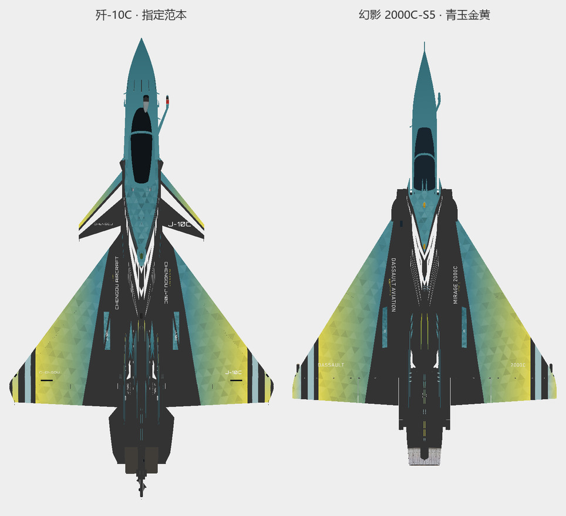

# 幻影 2000C-S5 青玉金黄 · 按指定范本迁移

用户否定同机两份紫晶涂装后，明确选择「以歼-10C 青玉金黄无人物为准」。这次沿用歼-10C 的青黄配色，便于观察同一块颜色在另一副机翼上具体落到哪里。美术认可仍归属被点名的歼-10C；幻影属于待评制作实例。[歼-10C 正俯与色块分区](current-approved-j10c.md#同一色块布局换机型) · [两份紫晶的反馈](mirage-amethyste.md)

**机鼻与肩部。** 青色包住座舱后在机背中央收尖，两侧留宽炭灰。白色母形包住青尖，独立小 V 与细回声向后收。正俯要同时看青色尖端和白区有多少可读的面积；在斜俯上再查机身圆侧会不会把字尾拉长。

**主翼与翼尖。** 左右主翼各保留一整块青到金黄的色面。内侧黑楔从翼根前部向后变宽，外侧是深带、淡青条和窄金边。渐变落到同一侧固定翼和升降副翼时仍按同一组机体坐标取色。幻影没有歼-10C 的鸭翼，其条带和字没有单独对应部位。

**如何复核。** 先把两架正俯按相同翼展并排，并对准主翼后缘；这个对比保留各自轮廓。再在各自翼根弦长的相同位置横向取色，看深楔边界、金黄大面和翼尖条在哪里。白形长度接近时，再取几条横线比较中央实心白区总宽。幻影首轮就出现过尖端长短相近、主白形仍显细的情况。制作时只调整体量不足的母形与小 V，保留细回声的独立轮廓。

在两侧各六个弦向站位，8K 游戏包正俯中成片翼面色场的内侧边界与范本最大相差约 0.73% 半翼展。结果只描述翼面边界。中央青尖、白区与两架飞机不同的座舱和机背曲面仍须并排观察。歼-10C 展示图用于比对色块，后机背两枚剪影另按[已勘误的参考](aft-silhouette.md)朝向内侧。
