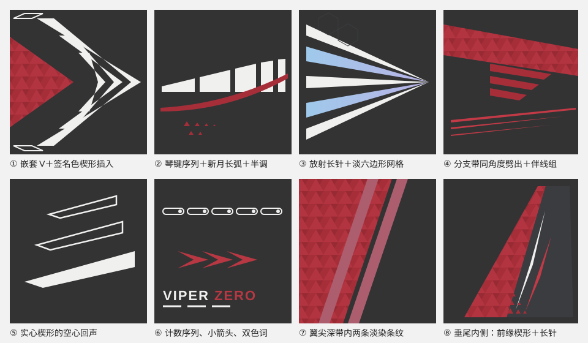

# 线条与图形库

所有图形都是**填充多边形**，边缘笔直锐利，尖端是真实尖点。尺寸按机体实长（米），下列数值来自 8K 贴图按岛长折算，误差约 ±30%，换机型按机身长度同比调整。

## 机背主图形（四选一）

每架只选一个当主角，左右镜像，占机背长度的 1/4–1/3。比例实测自作者幻影 2000 的机背（8192 原图），换机型按签名色场的宽度缩放，不按整机长度。

**机背中线有凸条时**（J-10C 背鳍条约 0.13 m 宽、高约 4 cm）：凸条侧壁不属于朝上的图表，游戏里是一条细缝，V 的尖点放上去会碎成一个小尖加两根斜杠。把凸条本身做成深色中线通道，V 拆成左右两组尖片，尖端顶到凸条边，左右镜像读起来仍是一个 V。落笔前看 `surface_map.py` 的品红接缝和 `seam_items`。

| 图形 | 构造 | 适合 |
| --- | --- | --- |
| **切格 V（F-2A 的做法，基本布局默认）** | 一整块白色箭头铺满签名色场后端的深色缺口，用等宽深色切缝切开：V 形切缝（12° 族，尖点在中线或凸条边）切出层层嵌套的 V 臂，水平切缝（0°）切出台阶锯齿。所有白块和切缝共用同一组构造线，用 `arrangement.py` 的 `region` + `cuts` 写（见下文“白色怎么用”）。F-2A 实测：11.8° / 18.2° 两族斜线尖点在中线，5 条水平线切台阶，臂宽 10–14 cm | 单发、窄机背（F-2、F-16、J-10C） |
| **嵌套 V（尖片组）** | 2–3 个同心 V，尖端在中线、指向机尾。每条臂是细长的渐尖尖片：开口端最宽、尖端收成真尖点，与机轴只夹 6–13°，最宽处约为臂长的 10%；最大的 V 里留一个同角度的深色 V。两侧再配 2–4 根独立的菱形尖片（两头尖，最宽处在长度 35–45% 处，约为长度的 7–12%），平行于场边、起止错开。整组铺满签名色场的宽度，长约场宽的 1.5–2.5 倍 | 单发、窄机背（F-16、F-2、幻影） |
| **琴键序列** | 一个长楔形按等距平行缝切成 4–6 片；各片顶边落在同一条直线或一条顺机身的缓弧上；片长由前向后递减（长-长-中-短-短）；缝宽约为片宽的 1/4 | 宽机背（侧卫、阵风） |
| **放射长针** | 6–10 根细长三角从座舱后一点向后放射，白与签名色淡染交替；每根都是根宽 0.15–0.35 m、收成真实尖点的三角，不是等宽细线；长 2–5 m；签名色针内做渐变和马赛克 | 浅色签名分支、宽机背 |
| **嵌套 V 腹饰** | 同嵌套 V，但放在机腹或腹鳍，尖端指向机头，白色 | 机腹、单发下表面 |

## 配套图形

- **分支带**：从签名色母形边缘按同一角度劈出 2–3 条，宽 0.05–0.1 m，间距相等，长度递减，端头沿母形边斜切。
- **伴线组**：2–3 条签名色亮一档细线，宽 1.5–3 cm，彼此平行或略收拢，贴着母形或大楔形外边跑 2–4 m，末端渐尖。全机统一一种组数。
- **空心回声**：主图形外侧放 2–3 个同形的细描边（线宽 2–3 cm）平行四边形或梯形，形状和角度与实心图形一致、逐个缩小。只作回声，不当框用；单独出现的描边框仍然避免。每个回声都要落在平整、可见的面上：往外排出机身边缘或压到座舱、舱盖的就删掉，宁可只留一个（J-16 示例和 v10 都因此删过回声）。
- **虚线序列**：侧面或机背边缘一排 6–12 个等距小形（短平行四边形、空心梯形或带圆点的胶囊框），长度递减或等长，像弹药计数。
- **新月长弧**：签名色或白色大面的边界可以是一条顺机身的长弧，从机头延伸 4–8 m 后收成尖。这是唯一允许的大曲线。
- **折角包边**：浅色签名分支在边条、进气道外沿用 0.1–0.2 m 宽的签名色折角带，顺结构边转一次角后收尖。
- **尖片箭头**：2–3 根渐尖尖片（白、签名色交替，中间留深色缝）平行排开，一端收成共同的尖点、另一端斜切或做成燕尾。作者幻影翼根和阵风鸭翼都是这个；不要换成整条前缘色带。
- **翼尖条纹**：主翼外侧一条深色带（约翼尖弦长的 1/4），内含两条签名色淡染条纹，宽 0.2–0.3 m，间隔约等于条宽（F-2A：条 0.21 m、间隔 0.23 m），平行于机轴；上下两面一样。
- **垂尾内侧楔形**（双垂尾内侧的默认做法）：沿前缘一条签名色马赛克楔形，根部宽约根弦的 1/3，向翼尖渐收成尖，颜色从暗一档渐到主色；楔形内侧一到两条签名色亮一档伴线（宽 3–4 cm，两头渐尖），朝翼尖慢慢收拢；不用白色长针；根部用三角半调把签名色溶进深底。其余保持深底。
- **平尾前缘带**（F-2A 的平尾；三角翼加鸭翼的机型放在鸭翼）：一条签名色带包住前缘（每面 0.13–0.31 m），隔 8–13 cm 深缝，后面一到两条白带（0.40 m 收到 0.19 m），都平行于前缘；上下两面一样。以前误写成“垂尾平行带”。
- **垂尾序列**（F-2A 的垂尾）：沿前缘一列签名色马赛克平行四边形（宽 0.14–0.18 m，顺后掠角排），旁边一列同形的细描边平行四边形（线宽约 0.8 cm，一个签名色、其余白色）；根部放字组。
- **小箭头组**：3 个嵌套的签名色小 V（">>>"），带渐变，放在侧面尾段，指向机尾。

## 鸭翼

作者阵风的鸭翼（8192 原图）：沿前缘一组尖片箭头，靠前缘一根白尖片、外侧一根签名色尖片，中间留深色缝，向翼尖收成尖点，根部端头斜切；其余深底放机型名大字（RAFALE）和制造商小字（DASSAULT），两档字重。没有整条前缘色带。

- 尖片贴着本机鸭翼的实测前缘走：先用 `surface_map.py` 出鸭翼图表，读出前缘两端坐标，不从别的任务抄坐标（莱万汀 v2 抄了庄方宜的坐标，审查指出相关处理需要修订）。
- 尖片最宽处约为鸭翼根弦的 1/8–1/6，长度约为前缘的 3/4；机型名放在尖片后方的深底里，字头朝外。
- 下表面只放一根签名色暗一档尖片或留空。

## J-16 参考尺寸（v10 实做值，用户已认可）

上面的尺寸是从作者 8K 贴图按岛长折算的（±30%）。下表是在 J-16 上实做、对过模型的米制值，换机型按机身长度同比缩放；用户认可前只当起点。

| 元素 | 尺寸 |
| --- | --- |
| 机背签名色母形 | 从机头 x≈10 m 到尾根 x≈−6 m，最宽约 1 m，马赛克单元 0.22 m |
| 白色琴键（主排） | 4 片，长 1.15 / 0.8 / 0.5 / 0.3 m，高 0.19→0.26 m，缝 0.16 m，斜切 1.1 m/m |
| 白色琴键（副排） | 3 片，长 1.0 / 0.7 / 0.45 m，高 0.10→0.16 m |
| 伴线 | 宽 0.026–0.03 m，距母形边 0.14 / 0.24 m，末端渐尖 1.2–2 m |
| 主翼前缘签名色带 | 宽 0.55–1.2 m，马赛克单元 0.28 m；翼尖深色带宽约 1.5 m，内含两条 0.25 m 淡染条纹 |
| 主翼立绘 | 宽约 6.2 m，脸在翼根附近；回声脸宽 3.4 m、不透明度 0.22–0.24 |
| 垂尾外侧立绘 | 宽 3.9–4.6 m；前缘签名色窄带 0.30 m，顶帽高约 0.95 m，根部深色带 0.36 m |
| 垂尾内侧楔形 | 根部宽 1.3 m（约根弦 1/3），伴线 0.03–0.04 m（v10 交付时这里是 0.07 m 白长针，现已改签名色） |
| 机腹四段 V | 前机腹 x 2.7–4.95 m，臂到 z 0.92 m；中线细针宽 0.06 m，用签名色（v10 交付时是白色） |
| 小箭头 | 每个长 0.32–0.40 m，间距 0.32–0.36 m |
| 字 | 翼面角色名字高 0.30 m、副名 0.11 m；机背角色名 0.24 m；垂尾根部 J-16 0.20 m；机头侧面 J-16 0.22 m |

## 质感

- 三角马赛克：`vector_paint.py` 的 `tri-mosaic`，`jitter` 0.08–0.12。
- 半调：母形末端或白色大面边缘用 `tri-halftone`，三角从满尺寸到消失跨 0.8–1.5 m；只在 2–4 处出现。
- 漆面：`coat_material.py` 整机一层亮漆，颜色里不叠模糊结构层，见 SKILL.md 的“漆面”。
- 面板发丝线：基本布局不画（F-2A 没有）。用户点名要时，见 SKILL.md 的“漆面”。

## 角度与对称

- 一个视图里只用三族角度：机轴、主翼前缘后掠、一个与之相近的斜角（嵌套 V 的臂、分支带）。
- 左右镜像：设计稿里用 `abs_z` 轴，一份形状自动对称。
- 白色总面积控制在 [配色](palette.md#实测面积) 的区间内；白色主图形越大，其余白色元素越少。

## 白色怎么用

作者五架飞机的俯视图里，白色要么是有体量的形（F-2A 座舱后 3 层嵌套 V，主臂宽 12–14 cm，Ellen 黑色通道里的宽刀片，Esdeath 根部很宽的放射长三角），要么是成组的渐尖尖片（幻影青色面里的尖片 V 和菱形尖片）。它们集中在主图形周围，共用尖点和角度。贯穿机身的长细线是签名色（红、粉、青），贴着色块边走。

- 白色单件只有两种：有体量的形（最宽处 ≥0.15 m 的楔形、刀片、琴键），或主图形里成组的渐尖尖片（两端或一端收成真尖点，最宽处约为长度的 7–12%，与机轴夹 6–13°，起止错开）。作者幻影机背的尖片只有约 0.5 m 长、最宽几厘米，因为成组、收尖、集中在色场里，看起来不是“白线”。
- 粗细不变的白线、长过 1.5 m 的白细线、主图形以外孤立的白线都不画；长细线改签名色亮一档。
- 细白线只有两种，都是**空心描边**、成组出现：主白色图形外侧的回声（F-2A 是 3 个空心四边形，上下边水平、两端斜切，前后错开排成扇形；不是平行细线），id 里写 `echo`；垂尾序列里的空心平行四边形，id 里写 `sequence`。开放的细条即使叫 echo 也算白细线。
- **游戏距离下限**：玩家常见的观看距离约 100 px/m，1 cm 只剩 1 像素。白色件至少 8 cm 宽，深色切缝至少 7–9 cm，描边至少 1.2–1.5 cm（F-2A 原图的回声描边约 1 cm，是因为它的机背宽而平、看得近；新机型照 1.5 cm 做）。回声或描边落在弯曲的肩部、侧斜面上时会被压成断续细线，宁可不画。`design_lint.py` 对过细的描边报 `thin-outline`。
- 不画贯穿机身的白细针、平行白条、前缘白细边、白色伴线。`design_lint.py` 对这些报 `thin-white-line`。
- 嵌套 V 的臂可以是等宽带：F-2A 原图里 3 个嵌套 V 的臂就是等宽的（约 10 cm），它们是构造线切出来的格子，所以不会交叉。rev 9 的交叉细针是手算偏移时方向写反造成的；不要手算，用 `arrangement.py` 的格子（`design_lint.py` 会把交叉臂报成平均宽度约 0 的 `thin-white-line`）。幻影那种渐尖尖片组是另一种图形（见上表“嵌套 V（尖片组）”）。
- **机背白色焦点一律用构造线切格写，不要一片片手写尖片**（J-10C 的教训）。做法：
  1. `region`：缺口里的白色区域，内侧到中线或凸条通道边，外侧离签名色缺口边 7 cm（一条和缺口边平行的线），尾端一条 18° 线。
  2. `cuts`：等宽深色切缝。V 形切缝 2–3 道（12° 族，尖点在中线或通道边），水平台阶切缝 1–2 道（0°）。机背窄时少切几道，让每块白色都有体量。
  3. 机背直边只用 0° / 12° / 18° 三族（`design_lint.py` 按 6° 聚类、镜像算两族，超过 4 个方向报 `too-many-angles`）。
  4. 先用平面预览定构图，再上色，再用接近游戏观看距离的近景相机看一遍。
  - J-10C v4（手写两片尖片 + 4 条 1 cm 平行“回声”线）在游戏里读成“一整块白板加一把梳子”，审查记录：该处理需要修订。
  - v5 用切格：两道 9 cm 的 V 形切缝加一道 7 cm 的台阶切缝，切出带台阶的长刀、约 0.2 m 宽的中臂和顶到缺口尖端的三角，不画回声。
  - 中间试过 4–5 道 6.5 cm 切缝，俯视读成鱼骨，最里面的臂只剩 4–6 cm，也不行。

## 用 vector_paint.py 实现

`examples/j16-nested-chevrons.json` 是双发侧卫的线条配色示例：深色中线通道、签名色马赛克机头、3 层渐尖尖片嵌套 V 加两侧错开的菱形尖片、伴线组、翼面马赛克加翼尖淡染条纹、垂尾内侧楔形（外侧留给立绘）。`examples/j16-key-sequence.json` 是琴键序列加半调的示例。`examples/j16-chen-full-livery_build_design.py` 是一架完整涂装（v10，`surface_map.py` 检查过可见性）的生成脚本：两翼与两侧外垂尾立绘、回声脸、字组、机腹平整区布局、侧面、垂尾内侧楔形，可看各图层、左右镜像和图表顺序怎么写。换机型时：

1. 改 `charts` 里的节点名和材质名，图表轴要躺在表面里（机背 `x/abs_z`，侧面和垂尾 `x/y`）；
2. 按新机身长度缩放坐标；
3. 落笔前后各跑一次 `surface_map.py`，线条和字只放平整区；跑 `vector_paint.py` 后看警告和 `zero_hit_items`，再在整机、各区域近景和编辑器原尺寸下检查。
