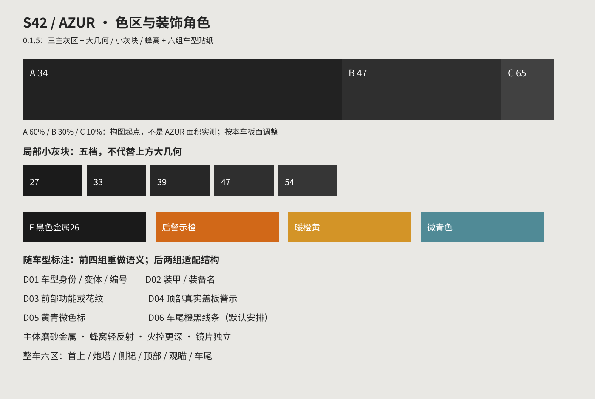

# AZUR 制作精髓：先有整车，再有贴纸

AZUR是第一制作范本。要继承的是颜色、尺度、区域、焦点和材质之间的关系。主体有重量，几何有层次，近看有细节，车尾也有完成度。M1是美术来源，99A/A6HEL是经验案例。

## 1. 整体用三个主灰区，火控深黑另作材质焦点

这是从AZUR提炼出的0.1.5制作起点，不是声称原作者按固定比例分了三个物体，也不是对AZUR模型面积的实测。三个色区在整车不同板面上穿插；不能简单规定“车体一色、炮塔一色、侧裙一色”。同色跨部件联系全车，次级灰块分开真实装甲层次。

| 角色 | 8位sRGB起点 | 起始占比建议 | 怎么用 |
|---|---|---|---|
| A 主炭灰 | RGB 34/34/34，#222222 | 主漆面约60% | 车体、炮塔主要大面，保持连续的大轮廓；保留细磨砂 |
| B 第二灰区 | RGB 47/47/47，#2F2F2F | 约30% | 在真实盖板、装甲模块、首上与炮塔顶面形成较大的几何切分 |
| C 提亮灰区 | RGB 65/65/65，#414141 | 约10% | 少量分块、局部装甲与构成呼应，避免整车都压成同一个黑灰 |
| F 火控黑色金属 | RGB约26/26/26，#1A1A1A | 局部，不计成第四大色区 | 镜组外壳和遮光结构，更深但有受控高光；镜片单独保护 |

60/30/10只是在被涂装装甲表面上的构图建议，不含轮履、玻璃、网布、孔洞等，也不是强制验收阈值。新车按真实板块和观感调整，三个灰阶必须仍可区分。大面积过黑、提亮区变白棋盘、B/C全堆在一小角，都需要返工。不能用UV画布像素占比代替可见车身面积。

依据：当前AZUR v29分层源码中，声明车体漆面中性样本P10/P50/P90为30/34/65，炮塔为27/35/65，火控壳体为25/26/28。这是明确遮罩内的颜色描述，非整车美术通过或面积比例；统计方法见[实测记录](azur015-measurements.json)。新车34/47/65是便于落地的候选调色起点，最后以本车材质与同光照观感判断。

## 2. 大几何、小灰块和蜂窝是三个尺度

**大几何分区**先做。首上、炮塔主板、顶部盖板、侧面装甲分别按真实结构安排A/B/C；边界顺板缝、折线或有意设计的大斜切。连贯板面用几块读得出的形状，不把每个三角面或每块装甲都再切碎。ERA按实际模块组织基础色，一块ERA出现多色须有明确构成理由。

**低对比小灰块**后加。它们在首上、顶面局部、侧后装甲与窄肩形成细节节奏，不能替代大色区。AZUR侧面这层用27、33、39、47、54五档中性灰，约65mm节距，邻接折面共用原点与方向。五档里包含深浅变化，不能整层只剩一个均值。首上和顶部按板面重新设计节距、密度与覆盖，不能把65mm复制全车或把首上铺成矩形棋盘贴纸。

**蜂窝模块**形成侧裙主带和炮塔局部次级装甲重点。细密主带、较大局部蜂窝、少数亮格与暗边有尺度差；不是全车同样大小的白线空心六边形。沿实际板面填满，保留禁绘面与合理边距；折面、窄压条、后半裙甲不能漏掉。局部蜂窝凹凸只在确有设计时加入，不把颜色格自动宣称为法线细节。

## 3. 整车分六个检查区，防止只做侧面

| 检查区 | 色区与细节任务 | 常见遗漏 |
|---|---|---|
| Z1 首上与车体前部 | A/B/C大块几何；局部低对比块；首下按可见承载面安排图形或适当文字 | 单色首上、被备用履带挡住的标签、ERA窄立面误铺蜂窝 |
| Z2 炮塔正侧装甲 | 主炭灰与次级几何呼应；少量蜂窝焦点与本车身份标识 | 只贴一个大标志、整侧同灰、文字跨缝、炮根仍原皮 |
| Z3 侧裙与侧面装甲带 | 连续但按板缝分段的细密蜂窝；少量亮格；与炮塔蜂窝区分 | 前后段密度不同、后半段漏铺、框边残留 |
| Z4 顶部与设备 | 真实盖板的相近灰阶和少量低对比块；实际维护/弹药盖警示；微色标 | 顶部一色、无意义大黄块、图案被行李遮住、机枪本体和枪托漏涂 |
| Z5 观瞄与特殊材质 | 深黑金属壳体覆盖顶部/侧壁/框边；玻璃、橡胶和布料分别处理 | 只改顶部、黄线误作黑金属、镜片Alpha损坏、窄边漏面 |
| Z6 车尾 | 橙色/橙黄与黑色警示线条，左右可用实板呼应；尾部钢面、备用件和灯组完成检查 | 屁股素灰、只做一侧、旧条纹重影、直接涂上格栅/尾灯 |

新车型缺少某种设备时记录实际替代角色，不虚构APS或强加不存在的装甲牌。六区是检查覆盖方式，不要求额外做六张图。默认用已有本地交互预览器检查，确需图像时再按请求导出；七视图仍逐次授权。

## 4. 车尾橙色线条默认纳入S42构成

后续S42制作默认安排橙色/橙黄黑警示，不能因为主要展示角度是斜前视便省略。优先选两侧可见尾部实板、外侧后挡板或真实维护盖；有遮挡时换可用承载面。条纹组的宽度、倾角、间距与边距随车型重排，左右呼应但不要求相同UV坐标。可从每组3—5条的短斜条/竖条开始，最终条数由板宽与清晰度决定。

AZUR独立车尾图层可见橙黄油墨约RGB205—211/144—148/38—40，以及更橙的约209/102/24，配深灰黑。它们是源图层样本，非通用物理反射色。0.1.5提供暖橙黄#D39427与橙#D16818起点；按环境和整体饱和度调到能辨认而不过亮。灯组、排气口、冷却格栅、拖车耳、网布孔和透空防护栅不能被当成整片实板。

用户当前明确另有选择时按本车要求更新，不把橙条画成虚假安全认证。后视检查同时看左右底漆与旧标识底影，不能只看新橙线有没有出现。

## 5. 装饰要有疏密和用途

每侧身份/装备焦点、顶面实际功能警示、车尾橙条、首上几何、少量黄青色标互相呼应。围绕这些角色安排，保留安静大面。不要用重复长电路线填所有空白，也不要把微字堆到游戏里不可读。近看应该有线宽、留边、螺栓避让、细磨砂与金属差异；远看仍先读到大色区和模块关系。

随车型变化的六组贴纸角色见[贴纸标注表](decal-adaptation.md)，机器可读字段在[decal-adaptation.json](decal-adaptation.json)。先填写角色，再做子版和上车；完整母版只提供构图关系。

## 6. 颜色层次与材质层次一起完成

主体用克制磨砂金属漆，蜂窝反射比主体轻且保持格内细节，火控壳体更深并以集中高光突出，镜片读作玻璃。炮管/炮根、机枪金属/聚合物、备用履带钢/橡胶、网布分别给对应材质。去掉低频脏斑，保留细磨砂、焊缝、螺栓、合理AO和结构边。

同色不同材质、同材质不同几何朝向都可能形成层次；C不能单独替代N.R/B和法线。不得全车同一个N值或仅为“有材质”而高金属度拉满。实际N参数来自本车shader与游戏反馈，当前AZUR样本不跨车硬套；光学Alpha和N.A数据独立保护。

## 完成前的防单调检查

- 缩小整车：能否读出A/B/C主次，大几何是否先于小像素块？如果拿掉贴纸全车就同一灰，先修底色构成。
- 看顶部/首上：是否与侧面同样完成，而不是一色盖板加一张黄牌？
- 看左右与车尾：蜂窝后半段、窄肩、炮根、小件、橙条两边是否完整，是否存在旧框/白影？
- 看贴纸：六组角色中哪些随车重做、哪些无对应部件而省略，是否有真实语义与可读像素？
- 转动光照：主体磨砂、蜂窝轻反射、深黑壳体、玻璃和橡胶是否区分？去污后是否还保留微表面？
- 以最终DDS、实际绑定和加载文件复核，技术通过、视觉、游戏反馈与发布授权分开记录。
