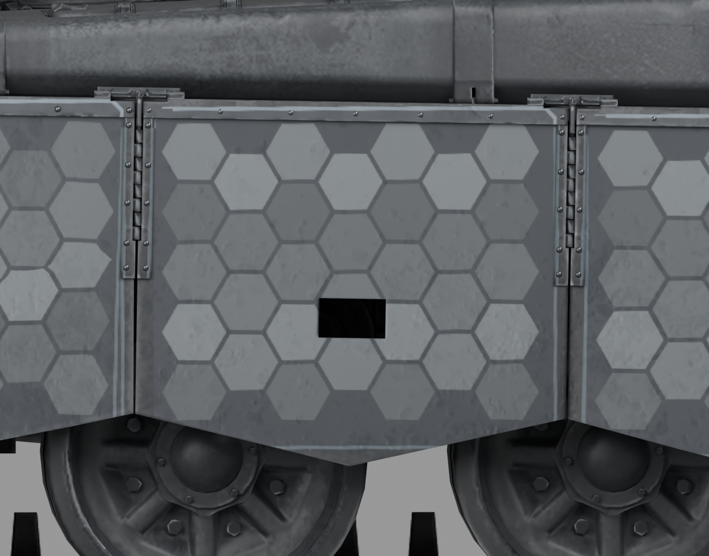
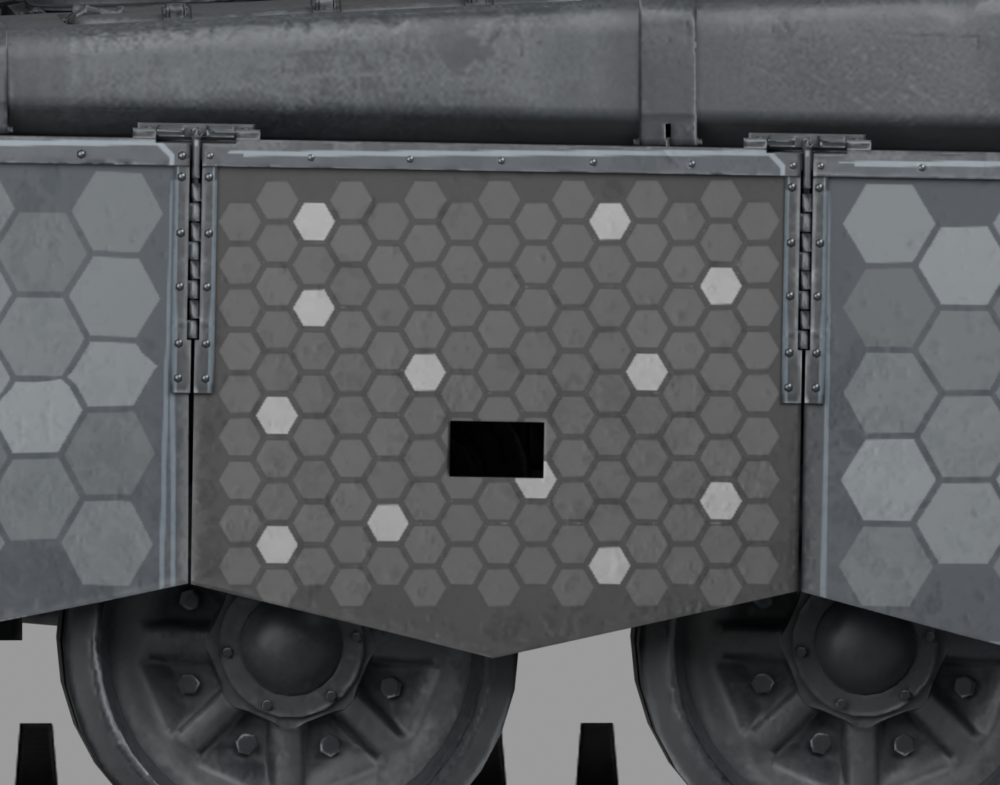
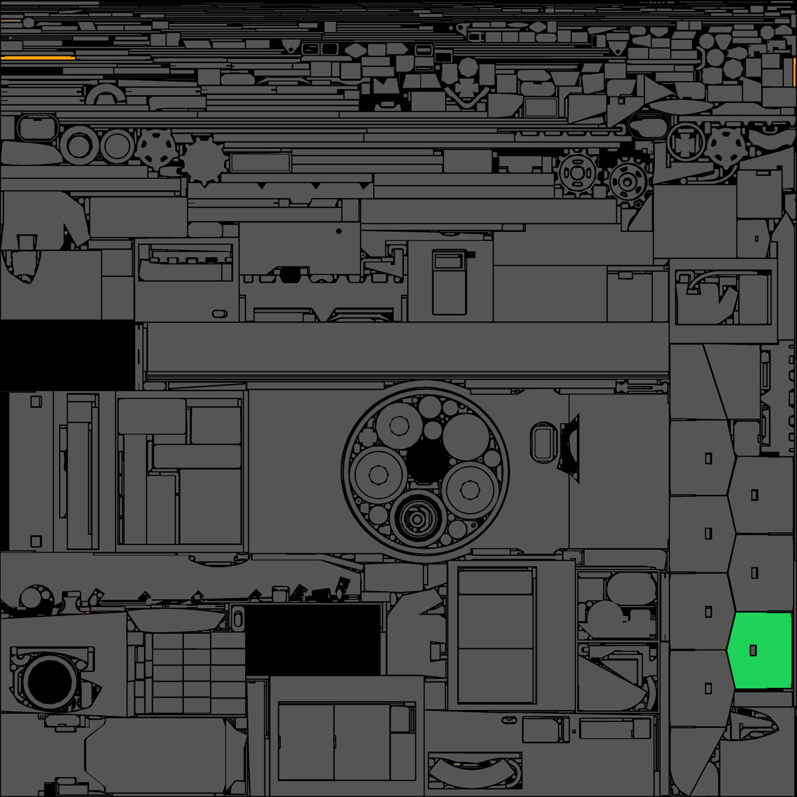

> 整合候选：本页保留分支的历史方法与案例配方。当前决定以[共同规则](consolidated-rules.md)、[车型案例](vehicle-cases.md)及[材质／Alpha](material-and-alpha.md)为准；旧认可、参数和阶段方案不自动扩展。

# 99A侧裙单板：一次实际母子版闭环

**范本仍是AZUR。99A是已见迁移试验案例，不能变成新的默认风格或未见测试答案。**

目标为99A左侧第三块附加侧裙外平面，约1.0214×0.8788m。模型几何与原生UV未改，使用该节点的实际三角面回贴，真实孔口与共享UV保留。原版整车与游戏安装未覆盖。

## 两次生图并不自动意味着合格

第一轮输入：AZUR蜂窝母版、认可AZUR侧视、99A旧图案（仅取目标幅面，明确禁止继承旧配色和大蜂窝）。输出142单元，有透明格缝，但内部平均B-R=+5.899、P95通道差7，不符合中性色要求。不得直接入库。

第二轮针对同一结果请求保留142单元和亮格分布、规整边缘、去蓝。输出仍142单元，B-R=-0.839、P95通道差2；但内部平均灰值从约65升至约70，说明修色同时发生明度漂移。单元包围盒宽102..105、高89..92像素，外观与尺寸较一致；这不是所有边长/角度精确相等的数学证明。

所以最终C图合成阶段另做范本灰阶校准：主体基底采用本车细节的中性灰；生成层按亮度处理暗格，保留少量亮格。具体本次配方见calibration.json，不作为通用滤镜反复叠加。两份原始生图结果未被事后修改；不能声称生图模型直接输出了最终校准色。

## 选对节点仍必须查共享UV

初始目标覆盖125,310像素，其中8,270像素也被非目标三角面使用。先从允许区剔除并保留原值，再改剩下117,040像素。最终保护区RGBA逐像素不变，未分类/角色重叠/超出占用均为0。修改区R=G=B，平均约42.95。

保留区域清单：共享8,270像素——避免牵连其他面；该资源其余占用区域——超出本次单板试验；所有其他颜色资源、N/AO——未修改。覆盖审计针对局部试验的边界，不等于99A整车无原皮残留或完整哑光材质已验证。

## 当前结论

原生模型以最终DDS读回图重绑，用同镜头/灯光对比前后。用户反馈“方向接近，继续补进Skill”，只记单板方向认可。尚无整车、美术全套、游戏或独立重复性通过结论。此案例用于复用问题检查和解决步骤；新车型仍先看AZUR。
